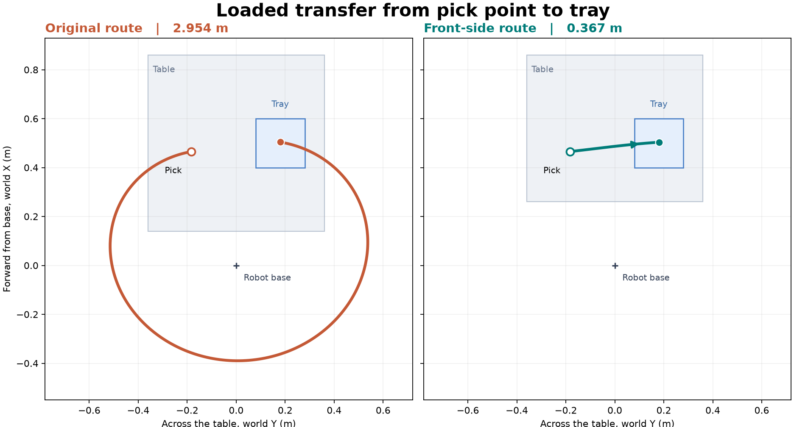

# MA6216 UR5e Vision Pick-and-Place

UR5e + Robotiq 2F-85 在 MuJoCo 中完成视觉引导的物理抓放。固定 RGB-D 相机提供观测，OpenCV 估计相机参数并分割目标，FoundationPose Model-based 估计目标位姿，Python 规划器生成经过碰撞检查的关节轨迹。



[绿色工件抓放视频](docs/media/green-workpiece-pick-place.mp4) · [安装与复现](docs/SETUP.md) · [小组协作](docs/TEAM_WORKFLOW.md) · [依赖与验证版本](docs/DEPENDENCIES.md)

## 已验证的功能

- 1280 × 960 固定虚拟 RGB-D 相机及米制深度。
- 从真实渲染棋盘格估计相机内参和相机到机器人安装坐标的外参。
- 红方块、绿色斜角工件的图像 mask 和 Model-based 6D 位姿估计。
- 桌前接近、垂直夹取、同一关节分支横移、落盘和撤离。
- 双指有载接触、抬升、搬运保持、托盘支撑和静止释放的物理验收。

## 三工件扩展与打印交接（2026-11-06）

同一场景中同时存在原绿色工件、新橙色斜肩棱柱和紫色渐缩切角块。完整视觉流程在一次固定布局中完成连续 3/3 抓放；这是单层分槽放置，尚未实现堆叠。[运行方法与实测范围](docs/MULTI_OBJECT.md) · [视频](docs/media/multi-object-pick-place.mp4)。

三个模型的毫米制 STL、米制 OBJ 和尺寸清单已放在 `assets/printable`。[3D 打印及真机交接说明](docs/PRINTING.md) 说明单位、原点和实物测量；[码垛评估](docs/PALLETIZING_ASSESSMENT.md) 区分现有基础与待实现工作。

## 开始运行

先在 WSL 或 Linux 中克隆。

```bash
cd ~/projects
git clone https://github.com/LewisLYU-HW/ma6216-ur5e-vision-pick-place.git
cd ma6216-ur5e-vision-pick-place
```

新机器先按 [SETUP.md](docs/SETUP.md) 下载机器人模型和安装环境。模型、FoundationPose 源码及网络权重单独获取，路径可由环境变量配置。

已有环境和模型的组员可以先自检。

```bash
conda activate foundationpose
python scripts/check_setup.py --vision
```

完整视觉试验包含重新标定和绿色工件抓放。成功标定后才执行下一步。

```bash
RUN="artifacts/demo_$(date +%Y%m%d_%H%M%S)"
python -u scripts/run_camera_calibration.py --output "$RUN/calibration" && python -u scripts/run_front_pick_place.py   --calibration "$RUN/calibration/estimated"   --output "$RUN/pick_place" --record --viewer
```

在无窗口终端运行时可去掉 `--viewer`。结果写入本轮 `summary.json`、`motion/samples.csv` 和 `motion/physical_pick_place.mp4`。每轮选择新输出目录。增加 `--xy .44 -.19 --yaw-deg 15` 可以改变工件摆放，`--target cube` 使用红方块。

仓库提供 `demo_data/calibration/estimated` 下的估计参数，匹配默认相机，用于快速复现。修改相机后重新执行标定。命令省略 `--calibration` 时默认使用该样例。

CPU 机器可按安装说明运行 `--ground-truth` 物理对照，它会明确记录该控制来源。完整视觉演示需要可工作的 FoundationPose CUDA 环境。

## 代码地图

| 位置 | 用途 |
|---|---|
| `scripts/run_front_pick_place.py` | 新工件的端到端演示入口 |
| `scripts/run_camera_calibration.py` | 棋盘格采图、标定和独立评价 |
| `scripts/run_foundationpose.py` | 对保存的 RGB-D、mask 和网格执行注册或跟踪 |
| `src/ma6216/workcell.py`、`scene.py` | 工作站、相机和标定板 |
| `src/ma6216/workpiece.py` | 绿色工件几何、米制 OBJ 和 mask |
| `src/ma6216/foundationpose.py`、`vision.py` | 官方推理适配、观测和坐标链 |
| `src/ma6216/direct_route.py`、`motion.py` | 离线 IK、路径检查和物理执行 |
| `scripts/check_setup.py` | 仿真或视觉环境自检 |
| `scripts/run_vision_pick_place.py` | 保留的原方块路线演示 |
| `scripts/capture_vision_dataset.py`、`replay_vision_trials.py`、`evaluate_vision.py` | 批量采集、对照和评价 |
| `docs/results/` | 小型实测摘要及指标定义 |

## 实验记录

以下是 2026-11-04 在开发机执行得到的结果，样本和评价范围按行列出。

| 试验 | 实测结果 |
|---|---|
| 相机内参 | 19 张有效训练图，4 张有效留出图，留出每图平均 RMSE 0.050 px |
| 相机外参 | 5 张训练、5 张独立验证图，固定外参复验 RMSE 0.074 px，参考误差 4.25 mm / 0.122° |
| 红方块原基线 | 六种摆放的视觉物理抓放 6/6，位姿平均误差 4.08 mm / 0.49°，旋转考虑立方体对称性 |
| 绿色工件前向路线 | 两种摆放 2/2，位姿误差 4.12–4.32 mm / 0.56–0.91°，落盘中心误差 0.25–0.82 mm |
| 同红方块、同估计位姿的路线对照 | 搬运 TCP 路程 2.954 → 0.367 m，动作时间 40.68 → 20.98 s，两种方案采用各自的桌面布局和待机姿态 |

[前向路线说明](FRONT_ROUTE.md) 记录桌面近边退让、路径设计和对照范围。当前物体为预先选定的已知模型，绿色工件使用直立桌面支撑先验。运行采用单次取图的开环视觉目标；控制器在执行过程中检查关节误差和接触。动态目标、任意未知物体和真实机器人接入仍需另外验证。

## 小组开发

组员为各自任务创建分支，通过 Pull Request 互相检查。提交源码、说明和小型结果摘要。每轮原始 RGB-D、录屏、权重、外部仓库和本地环境写入 Git 忽略目录。仓库中已选取一个短视频和一张对照图，便于在安装环境前了解结果。

第三方来源和许可见 [THIRD_PARTY_NOTICES.md](THIRD_PARTY_NOTICES.md)。本仓库未包含 FoundationPose 权重或 Menagerie 模型。自有代码的对外开源许可由小组确认。
