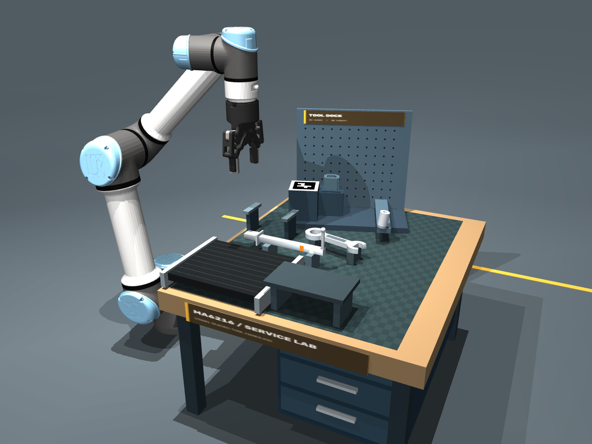
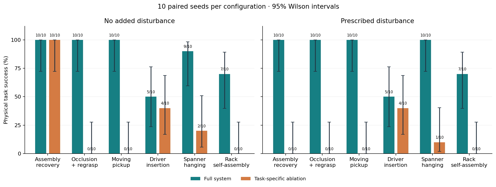
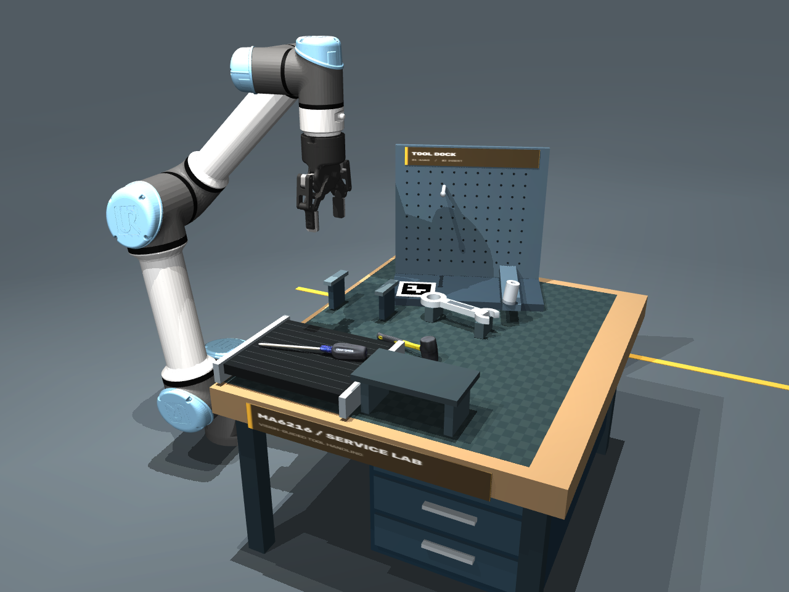
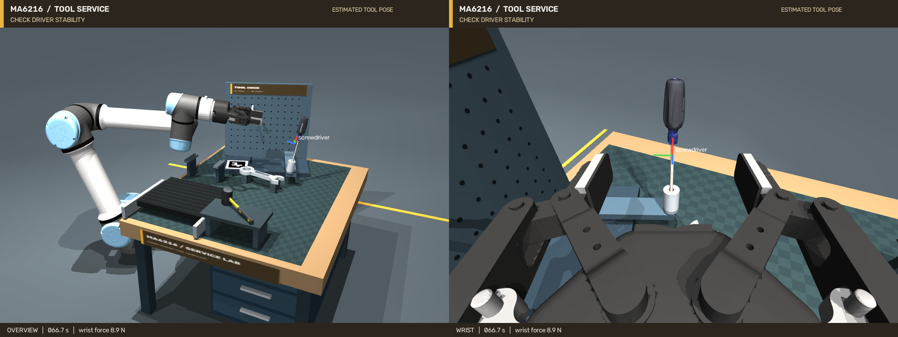
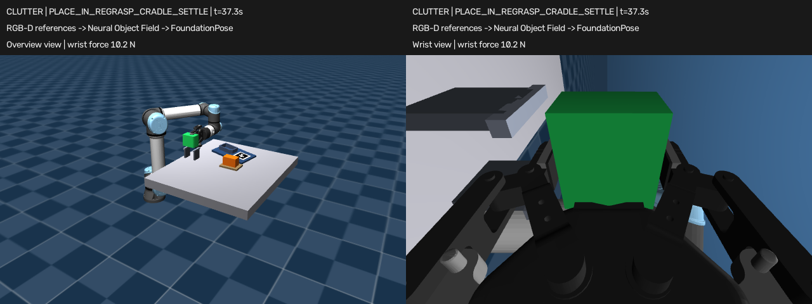
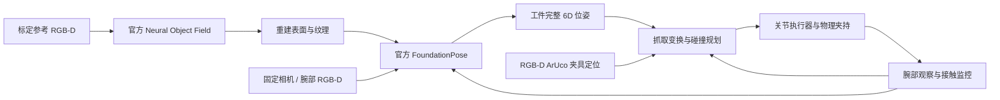

# MA6216 · Model-free 6D 维修工具工作站

**分支：`feat/model-free-manipulation`** · UR5e + Robotiq 2F-85 · MuJoCo · 官方 FoundationPose

本分支接续小组原有抓放与码垛仿真，新增带真实扫描纹理的**维修工具工作站**：锤子归位、移动螺丝刀抓取与倾斜插架、扳手换抓与穿孔挂放，以及**先装好工具架、再挂上扳手承重**的多阶段任务。
先从标定 RGB-D 参考图重建工具，再用官方 FoundationPose 估计 **6D pose（三维位置＋三维朝向）**，驱动实际接触下的夹持、转向、插入和悬挂。新工作站采用深度背景分割，无需给工具涂分割色。
原有的视觉装配恢复、遮挡换抓和运动目标抓取任务继续保留。

[演示视频](docs/videos/README.md) · [工具架自装配](docs/RACK_ASSEMBLY.md) · [统一评测](docs/EVALUATION.md) · [工作站复现](docs/WORKSHOP.md) · [安装](docs/SETUP.md) · [小组 PR #3](https://github.com/LewisLYU-HW/ma6216-ur5e-vision-pick-place/pull/3)

## 新任务：先装工具架，再挂扳手



`--task rack` 将固定挂钩换成可抓取的独立支架。机器人从横放姿态取起支架，腕部 RGB-D 复测后转为竖直，对准非对称插口并插入；松爪确认落座，再重新观察支架、换抓扳手，将环孔穿过新挂钩，最后检查两者的承重和稳定性。

6D pose 同时用于支架朝向、插口对齐、夹持关系纠偏和扳手孔平面转向。装好的支架成为下一阶段的真实碰撞障碍与承重部件。支架没有固定到基座；搬运和悬挂靠实际接触完成。

```bash
export MUJOCO_GL=egl PYOPENGL_PLATFORM=egl
FP_PYTHON=/path/to/foundationpose/env/bin/python
python scripts/run_workshop.py --task rack --record --trace \
  --foundationpose-python "$FP_PYTHON" --output artifacts/rack_new
```

[任务流程、尺寸和验收](docs/RACK_ASSEMBLY.md) · [完整全景＋腕部](docs/videos/evaluation-v1/rack__full__none__101.mp4) · [独立腕部](docs/videos/evaluation-v1/rack__full__none__101__wrist.mp4)

## 240 次统一评测与失败案例

六类任务 × 完整方法/模块消融 × 无扰动/规定扰动 × 每配置 10 次，使用相同种子 100–109 配对。每格为成功数/10；**全部置信区间、位姿误差、标定误差、执行精度、频率及动态扰动结果**见 [完整报告](docs/results/evaluation-v1/README.md)。

| 任务 | 完整：无扰动 | 完整：有扰动 | 基线 | 基线：无扰动 | 基线：有扰动 |
|---|---|---|---|---|---|
| 装配恢复 | 10/10 | 10/10 | 关闭恢复 | 10/10 | 0/10 |
| 遮挡换抓 | 10/10 | 10/10 | 仅平移＋yaw | 0/10 | 0/10 |
| 运动抓取 | 10/10 | 10/10 | 关闭运动预测 | 0/10 | 0/10 |
| 螺丝刀插架 | 5/10 | 5/10 | 关闭腕部观测 | 4/10 | 4/10 |
| 扳手挂放 | 9/10 | 10/10 | 关闭腕部观测 | 2/10 | 1/10 |
| 工具架自装配 | 7/10 | 7/10 | 关闭腕部观测 | 0/10 | 0/10 |

工具架 7/10 的 Wilson 95% 区间为 **39.7%–89.2%**；0/10 为 **0%–27.8%**。本轮支持部分模块在这些场景中的作用，但不能据此宣称整体架构全面优越：插架差异不明确，工具架及无扰动挂放的配对差异也未达到本轮 Holm 校正后的 0.05 门槛。



[6 条失败录像与同种子完整方法对照](docs/videos/evaluation-v1/README.md) · [240 条原始摘要与 CSV](docs/results/evaluation-v1/) · [评测协议与复现](docs/EVALUATION.md)

视频回放原试验保存的物理状态，不重新运行后替换失败；选中的原始轨迹也已随仓库保存。主视频采用最低成功种子 101，独立恢复其最终状态后，支架与扳手均通过承重验收，挂钩法向力约 **0.981 N**。这段成功演示不代表 10/10 成功率。

## 新场景：维修工具归位



| 步骤 | 机器人操作 | 6D pose 的作用 |
|---|---|---|
| 锤子归位 | 从台面夹起扫描锤子，转向后放在停放架上 | 依据估计的工具坐标系构造抓取和放置关系 |
| 运动螺丝刀插架 | 跟踪 3 mm/s 送料台上的螺丝刀，在运动时抓取，腕部复测后插入倾斜 8° 的套筒 | 重建轴线和尖端、接触位置预测、完整姿态变换与插入对齐 |
| 扳手换抓挂放 | 放上两根支撑轨，实际松爪、重新观察与换抓，转为竖直后将环孔穿过挂钩 | 从重建表面找孔，调整孔平面与挂钩轴线，再释放并验证稳定支撑 |

[完整全景＋腕部视频](docs/videos/workshop-overview-wrist.mp4) · [独立腕部视频](docs/videos/workshop-wrist.mp4) · [复现、尺寸和限制](docs/WORKSHOP.md) · [实验结果](docs/results/workshop.json)

使用已配置的仿真环境与 FoundationPose GPU 环境：

```bash
export MUJOCO_GL=egl PYOPENGL_PLATFORM=egl
FP_PYTHON=/path/to/foundationpose/env/bin/python
python scripts/run_workshop.py --task all --record \
  --foundationpose-python "$FP_PYTHON" \
  --output "artifacts/workshop_$(date +%Y%m%d_%H%M%S)"
```

此前 seed 0 完整视觉演示通过：螺丝刀插入 **36.41 mm**、轴线误差 **2.83°**；扳手松爪后由挂钩稳定承载。
完整录像 **121.4 秒**。这些历史数字来自固定配置演示，单独保留，不混入新的统一评测。



`--task insert` / `--task hang` 可分别运行；`python scripts/preview_workshop.py --viewer` 打开交互场景。
每件工具的参考重建模型与纹理已放进仓库，运行任务无需重新训练。完整安装见下方“组员快速开始”。

## 原有三个任务与视频

| 任务 | 机器人做什么 | 6D pose 用在哪里 | 全景＋腕部录像 |
|---|---|---|---|
| **装配与恢复** `assembly` | 从倾斜料架取件；夹具移位后触发接触保护，撤退、重定位并重试 | 完整抓取变换、腕部朝向校正、工件与夹具的相对位姿 | [观看视频](docs/videos/model-free-assembly-overview-wrist.mp4) |
| **遮挡与重抓** `clutter` | 搬走障碍物；侧抓平躺工件，翻转放上支架，松爪后换抓姿并插装 | 识别平躺姿态、构造侧抓关系、翻转与重新抓取 | [观看视频](docs/videos/model-free-clutter-overview-wrist.mp4) |
| **运动目标抓取** `conveyor` | 连续观察送料台上的工件，预测接触位置，在台面运动时夹取并插装 | 带时间戳的位姿跟踪、速度估计、接触时刻预测和腕部校正 | [观看视频](docs/videos/model-free-conveyor-overview-wrist.mp4) |

另有 [关闭自动恢复的失败对照](docs/videos/model-free-no-recovery-overview-wrist.mp4)：相同初始场景和夹具扰动，第一次接触保护后停止。
四段 H.264 视频均直接保存在仓库中；点击可查看或下载。每段左侧为全景，右侧为腕部视角。



上图取自已验证的遮挡重抓录像，展示放上支架、准备松爪换抓姿的阶段。

## 本分支增加了什么

| 原项目基础 | 本分支扩展 |
|---|---|
| RGB-D、颜色 mask、已知工件 CAD 输入 FoundationPose | 标定参考 RGB-D → 官方 Neural Object Field → 重建表面，无需输入工件 CAD |
| 固定相机定位后抓放、码垛 | 固定相机初定位＋腕部近景重定位，校正夹持关系与朝向歧义 |
| 预先定义的静态放置目标 | 夹具移位后的接触保护与重试、支架换抓姿、运动目标预测抓取 |
| 物理抓放及支撑验收 | 分别记录感知误差与最终落座误差，并提供恢复关闭对照 |

机械臂、夹爪、标定与基础抓放来自原项目；本分支接入并调用官方 FoundationPose，重建与位姿网络的来源见 [第三方说明](THIRD_PARTY_NOTICES.md)。
原阶段的功能、课程任务对应关系和实验记录见 [原项目总览](docs/BASELINE_PROJECT.md)。

## 系统流程与 Model-free 的含义



这里采用 FoundationPose 的 **few-shot model-free** 路线：每件工件使用 24 张参考 RGB-D、mask 和扫描相机标定，先重建，再调用官方 `register()` / `track_one()`。
工件感知与碰撞规划使用 [仓库内的重建模型包](assets/reconstructed/README.md)，可以直接复现任务；也可按 [重建说明](docs/MODEL_FREE_TASKS.md)自行生成模型。

夹具几何、标记安装关系和操作坐标系由任务定义。当前参考扫描与腕部手眼安装采用理想合成标定；固定任务相机使用棋盘格估计标定。
工件由摩擦和双侧指垫接触保持，操作期间不通过写物体位置实现搬运。

## 历史单次演示结果

以下为本工作站 **seed 0 的三个完整视觉演示及一个失败对照**。位置与角度误差指松爪、稳定后的物理落座结果，视觉估计误差单独记录。

| 场景 | 验收结果 | 最终位置误差 | 最终角度误差 | 关键观测 |
|---|---|---|---|---|
| 装配与恢复 | 第二次插装成功 | 0.19 mm | 0.35° | 首次约 8 N 力增量触发保护，腕部重定位后重试 |
| 部分遮挡与重抓 | 成功 | 2.88 mm | 0.39° | 清障后前景像素 4478 → 5360；完成三次实际夹持 |
| 运动目标抓取 | 成功 | 0.54 mm | 0.43° | 视觉速度约 3.99 mm/s，送料设定为 4 mm/s |
| 关闭自动恢复 | 预期失败 | — | — | 首次保护后停止，无第二次插装 |

三个成功运行均通过槽底支撑和松爪后稳定性验收；7 项回归检查通过。数据与视频对应关系见 [结果摘要](docs/results/model-free-tasks.json) 和 [视频校验清单](docs/videos/manifest.json)。
这些历史结果仅覆盖列出的单次仿真场景；遮挡示例的最小槽壁余量约 0.01 mm。新的有限布局测试见上方统一评测；广泛随机场景、硬实时或真机效果仍未验证。

## 组员快速开始

首次下载时直接指定本分支：

```bash
git clone --branch feat/model-free-manipulation https://github.com/LewisLYU-HW/ma6216-ur5e-vision-pick-place.git
cd ma6216-ur5e-vision-pick-place
```

已有本地仓库时，在仓库目录切换：

```bash
git fetch origin
git switch feat/model-free-manipulation
git pull --ff-only
```

先按 [SETUP.md](docs/SETUP.md) 配置仿真环境、Menagerie 机器人模型、官方 FoundationPose 与权重。
下面的 `python` 使用仿真环境，`FP_PYTHON` **需替换为你已配置的 FoundationPose 环境的 Python 路径**；两个环境可以分开。
默认官方源码目录为 `third_party/FoundationPose`，其他位置用 `--foundationpose-repository` 指定。使用附带模型包运行任务无需重新训练重建模型。

```bash
export MUJOCO_GL=egl
export PYOPENGL_PLATFORM=egl
FP_PYTHON=/path/to/foundationpose/env/bin/python
RUN_DIR="artifacts/model_free_$(date +%Y%m%d_%H%M%S)"

python scripts/run_model_free_task.py --task assembly \
  --plug-model assets/reconstructed/plug \
  --foundationpose-python "$FP_PYTHON" \
  --output "$RUN_DIR/assembly" --record

python scripts/run_model_free_task.py --task clutter \
  --plug-model assets/reconstructed/plug --blocker-model assets/reconstructed/blocker \
  --foundationpose-python "$FP_PYTHON" \
  --output "$RUN_DIR/clutter" --record

python scripts/run_model_free_task.py --task conveyor --belt-speed .004 \
  --plug-model assets/reconstructed/plug \
  --foundationpose-python "$FP_PYTHON" \
  --output "$RUN_DIR/conveyor" --record
```

每个任务输出 `summary.json`、RGB-D 观测、推理记录、运动日志及 `video/overview_wrist.mp4`。
在 Linux 打开录屏或运行回归检查：

```bash
xdg-open "$RUN_DIR/assembly/video/overview_wrist.mp4"
python scripts/check_model_free_tasks.py
```

`--disable-recovery` 用于恢复关闭对照；`--ground-truth` 是明确标记的物理控制诊断，不计作视觉结果。每次运行选择新输出目录。
详细环境版本、重建命令、传感器与验收判据见 [MODEL_FREE_TASKS.md](docs/MODEL_FREE_TASKS.md)。

## 从哪里读代码

| 文件 | 职责 |
|---|---|
| [run_workshop.py](scripts/run_workshop.py) / [workshop_scene.py](src/ma6216/workshop_scene.py) | 维修工作台的任务流程、工具架、送料台和物理道具 |
| [workshop_control.py](src/ma6216/workshop_control.py) / [workshop_perception.py](src/ma6216/workshop_perception.py) | 重建工具特征、保孔碰撞分片、深度前景与双视角录像 |
| [run_model_free_task.py](scripts/run_model_free_task.py) | 三任务的观测、抓取、重抓、恢复和验收流程 |
| [capture_model_free_references.py](scripts/capture_model_free_references.py)、[reconstruct_neural_object.py](scripts/reconstruct_neural_object.py) | 参考图采集与官方 Neural Object Field 重建 |
| [serve_model_free_pose.py](scripts/serve_model_free_pose.py) | 独立 GPU 进程，调用官方位姿注册和跟踪 |
| [task_perception.py](src/ma6216/task_perception.py)、[online_pose.py](src/ma6216/online_pose.py) | RGB-D、腕部相机、夹具定位、时间戳与运动预测 |
| [task_control.py](src/ma6216/task_control.py) | 抓取变换、IK、碰撞检查、力保护与物理执行 |
| [advanced_scene.py](src/ma6216/advanced_scene.py) | 三个工作场景、重抓支架、夹具扰动和移动送料台 |
| [check_model_free_tasks.py](scripts/check_model_free_tasks.py) | 模型来源、预测时间戳、抓取方向与物理验收的回归检查 |
| [run_benchmark.py](scripts/run_benchmark.py) / [evaluation.py](src/ma6216/evaluation.py) | 配对种子、扰动、原始测量与执行时间记录 |
| [summarize_benchmark.py](scripts/summarize_benchmark.py) / [write_benchmark_report.py](scripts/write_benchmark_report.py) | 置信区间、配对比较、完整中文报告 |
| [replay_trial.py](scripts/replay_trial.py) / [index_benchmark_videos.py](scripts/index_benchmark_videos.py) | 原始轨迹回放、视频元数据与来源校验 |

## 其他文档与历史阶段

| 入口 | 内容 |
|---|---|
| [工具架自装配](docs/RACK_ASSEMBLY.md) / [统一评测](docs/EVALUATION.md) | 多阶段装配承重、模块消融、置信区间与失败轨迹 |
| [详细复现](docs/MODEL_FREE_TASKS.md) / [历史实测数据](docs/results/model-free-tasks.json) | 三类 Model-free 任务的方法、命令、假设和单次验证记录 |
| [视频目录](docs/videos/README.md) | 三项新任务、恢复失败对照及原定向入槽录像 |
| [原项目总览](docs/BASELINE_PROJECT.md) / [版本选择](docs/VERSIONS.md) | v0.2 三工件、v0.3 多物品、v1.0 视觉码垛及课程任务对应关系 |
| [6D 定向入槽](docs/POSE_INSERTION.md) | 本分支继承的 Model-based 倾斜抓取与 yaw-only 对照 |
| [安装](docs/SETUP.md) / [小组协作](docs/TEAM_WORKFLOW.md) / [第三方来源](THIRD_PARTY_NOTICES.md) | 环境、分支与提交流程、官方依赖和资产来源 |

代码与演示位于小组原仓库的 `feat/model-free-manipulation` 分支，对应 [草稿 PR #3](https://github.com/LewisLYU-HW/ma6216-ur5e-vision-pick-place/pull/3)。
