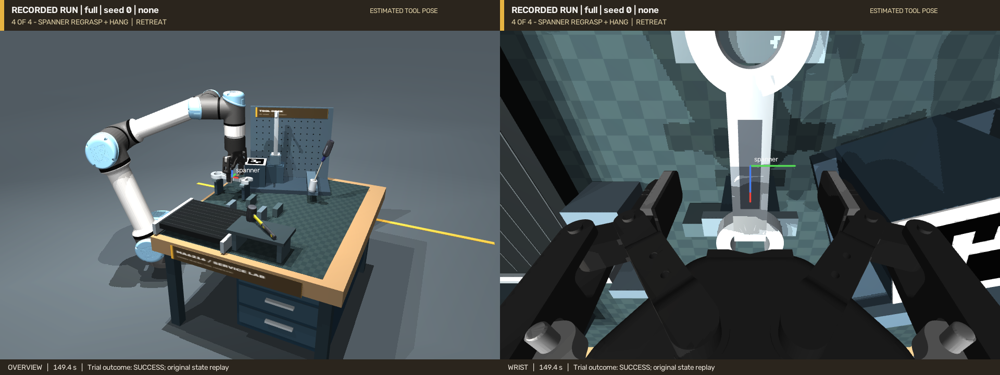

# 完整维修工具任务

**[完整全景＋腕部视频](videos/complete-workshop/overview-wrist.mp4)** · **[独立腕部视频](videos/complete-workshop/wrist.mp4)** · [验收与原始记录](results/complete-workshop/README.md)

`--task complete` 把锤子、运动螺丝刀、独立工具架和扳手放在同一个物理场景中，依次完成四个阶段。阶段之间不重置场景；先前放好的工具留在原位，并参与后续碰撞检查。

| 阶段 | 动作 | 位姿的用途 |
|---|---|---|
| 1 | 扫描锤子归位 | 用估计的工具坐标系抓取、转向并放到停放架 |
| 2 | 运动螺丝刀抓取、倾斜插架 | 从三次带时间戳的观察估计送料速度，预测抓取位置；腕部复测后将轴线对准倾斜 8° 的套筒 |
| 3 | 安装独立工具架 | 从横放姿态抓起，近景校正夹持关系，转为竖直并插入非对称底座；释放后重新定位 |
| 4 | 扳手松爪换抓、穿孔挂放 | 放到换抓台并实际松爪，重新观察和抓取，调整孔平面，穿过已安装支架的挂钩后释放 |



锤子和螺丝刀使用带扫描纹理的工具模型。“扫描”指提供给估计器的参考 RGB-D 重建，参考模型已经保存在仓库中；运行任务时使用官方 FoundationPose，不需要再次训练。物体 CAD 用于仿真与独立验收，物体估计和载荷碰撞规划使用重建表面。夹具与工作台的几何属于已测量的工作站信息。完整的 Model-free 输入边界见 [工作站说明](WORKSHOP.md)。

## 运行与录像

在仓库根目录、已安装依赖的环境中运行：

```bash
export MUJOCO_GL=egl PYOPENGL_PLATFORM=egl
FP_PYTHON=/path/to/foundationpose/env/bin/python
.venv/bin/python scripts/run_workshop.py --task complete --seed 0 \
  --trace --sensor-delay 1.0 --foundationpose-python "$FP_PYTHON" \
  --output artifacts/complete_new
```

输出目录必须尚不存在。`--sensor-delay 1.0` 为运动观察设置每次 1 秒的固定仿真延迟；送料台在这段时间及抓取过程中继续运动，命令速度为 3 mm/s。静态推理和离线规划期间仿真暂停，因此视频的仿真时长不等于程序墙钟耗时。

从这一次运行保存的状态导出全程双视角和独立腕部视频：

```bash
.venv/bin/python scripts/replay_trial.py --trial artifacts/complete_new \
  --output artifacts/complete_new_replay \
  --export artifacts/complete_new_overview_wrist.mp4 \
  --export-wrist artifacts/complete_new_wrist.mp4
```

回放使用原始 25 Hz 状态，不重新运行推理或替换轨迹。阶段标题来自同次运行的事件记录。也可在任务命令中增加 `--record` 直接录像，但渲染会增加墙钟耗时。

## 连续任务的检查

每次释放后检查接触承重、位姿、线速度和角速度；完成扳手挂放后再次检查锤子、螺丝刀和装好的支架，防止只记录前一阶段成功、忽略后续碰撞造成的移动。控制器保留双侧夹持、每个物理步的碰撞保护和插装接触保护。完整任务中锤子取料位置调整到独立区域，抬升距离为 80 mm；跨区域转运采用带载荷碰撞检查的关节路径。

完整场景的扳手取料位相对独立 `rack` 场景沿世界 X/Y 方向移动 −45/−15 mm，使下抓时腕部与已装支架之间留有余量，同时避开锤子源料位。安装好的支架仍是规划障碍和真实承重部件，既有的碰撞间距阈值不降低。初始布局检查同时验证物体互不穿透，且静置后不会被相邻工具撞离料位。

完整任务还对螺丝刀的腕部 FoundationPose 结果增加局部深度对齐：沿用工具架任务的有界点到平面 ICP，只输入重建表面、观察到的深度和标定参数，减少细轴尖端的对齐误差。初始网络输出和校正后的误差分别记录；保留 7 N 插入力保护。原 `all` / `insert` 任务仍使用其既有流程，历史评测不因本次演示修改而重算。

完整演示在扳手释放、夹爪撤离后保留 **10 秒自然稳定过程**，再检查线速度小于 5 mm/s、角速度小于 0.08 rad/s 等原有条件。调试中有一次实际挂住并承重，但在原 4 秒等待后仍摆动，已如实保留为失败。原 `rack` 单项评测继续使用 4 秒，不重算其结果，也不把完整演示的较长等待解释为控制精度提高。

独立末态检查可继续静置 30 秒，检验四个物体是否仍然稳定：

```bash
.venv/bin/python scripts/audit_rack_motion.py --trial artifacts/complete_new \
  --output artifacts/complete_new_audit.json
```

静置延长段是单独诊断，不改变原运行的成败，也不拼接进完整录像。单次完整演示不能用作随机任务成功率；已有的 [240 次评测](results/evaluation-v1/README.md) 和 [工具架修订版 40 次评测](results/rack-revision-v2/README.md) 各自保留版本边界。

原来的 `--task all` 仍对应固定挂钩的三工具任务，`--task rack` 对应独立支架与扳手任务。复现本页的四阶段连续流程应选择 `--task complete`。
