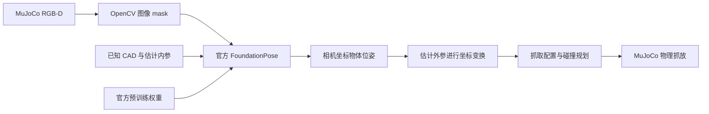

# FoundationPose 的来源与实际调用

本项目通过适配层直接调用 NVIDIA FoundationPose 的 Model-based 实现和预训练网络。官方算法与权重是运行依赖，本仓库承担仿真、标定、观测准备、推理适配和机器人控制集成。

## 1. 使用了哪些官方内容

官方仓库：[NVlabs/FoundationPose](https://github.com/NVlabs/FoundationPose/tree/a1b694b83e633c2cb6115b9063d940a687759392)，本机已验证提交为 `a1b694b83e633c2cb6115b9063d940a687759392`。

- [`estimater.py`](https://github.com/NVlabs/FoundationPose/blob/a1b694b83e633c2cb6115b9063d940a687759392/estimater.py) 提供 `FoundationPose`，执行初始注册 `register()` 和序列跟踪 `track_one()`。
- [`ScorePredictor`](https://github.com/NVlabs/FoundationPose/blob/a1b694b83e633c2cb6115b9063d940a687759392/learning/training/predict_score.py) 为位姿候选评分。
- [`PoseRefinePredictor`](https://github.com/NVlabs/FoundationPose/blob/a1b694b83e633c2cb6115b9063d940a687759392/learning/training/predict_pose_refine.py) 细化位姿候选。

两个预测器从官方仓库的 `weights` 目录加载预训练参数。本项目未重新训练或自行实现这两个神经网络；完整视觉流程需要已安装的官方 CUDA 环境和权重。

## 2. 在本项目哪里能看到调用

| 文件 | 可直接核对的行为 |
|---|---|
| [`src/ma6216/config.py`](../src/ma6216/config.py) | `foundationpose_dir()` 查找外部官方源码，支持 `MA6216_FOUNDATIONPOSE_DIR` 和 `third_party/FoundationPose`。 |
| [`FoundationPoseAdapter`](../src/ma6216/foundationpose.py#L203) | 将官方目录加入导入路径，`importlib.import_module("estimater")` 导入官方模块；创建官方估计器、评分器和细化器。 |
| [`estimate()`](../src/ma6216/foundationpose.py#L252) | 把 RGB、米制 depth、估计 K 和 mask 传给 `self.estimator.register(...)`，或对后续帧调用 `track_one(...)`。 |
| [`scripts/run_foundationpose.py`](../scripts/run_foundationpose.py) | 推理命令入口，解析观测目录、网格、内参和官方仓库位置，调用本项目的 `run_sequence()`。 |
| [`scripts/run_multi_pick_place.py`](../scripts/run_multi_pick_place.py) | 采集各物体的观测，调用推理入口，读取保存的相机坐标物体位姿，再交给物体抓取规划器。 |
| [`src/ma6216/vision.py`](../src/ma6216/vision.py#L67) | `compose_world_pose()` 用估计外参把相机坐标物体位姿变换到机器人安装坐标。 |



变换关系为 `world_T_object = world_T_camera_estimated @ camera_T_object`；这里的 `world` 是仿真安装参考坐标，真机接入仍需与实际机器人基座坐标对齐。

本项目还提供输入单位与矩阵校验、计算内存有界的网格直径、立方体对称性配置、近似直立物体的 24 个水平角初始候选和推理证据记录。初始姿态先验和数据适配属于本项目配置，评分、细化和位姿推理仍由官方实现完成。当前多物体演示对每次保存的观测进行注册；支持跟踪接口不等于演示已经实现运动中的连续视觉伺服。

## 3. 为什么源码和权重没有打包在本仓库

本仓库保存集成代码；官方源码、预训练权重及其 CUDA 扩展在外部目录配置，按对应许可单独获取。Menagerie 同样为 UR5e 和 Robotiq 提供外部机器人模型。组员克隆本仓库后仍需完成依赖配置，详见 [SETUP.md](SETUP.md) 和 [来源许可记录](../THIRD_PARTY_NOTICES.md)。

已有本机环境时可以设置：

```bash
export MA6216_FOUNDATIONPOSE_DIR="$HOME/projects/FoundationPose"
python scripts/check_setup.py --vision
```

官方目录应包含以下权重；预测器根据自身配置读取它们：

```text
weights/2023-10-28-18-33-37/model_best.pth
weights/2024-01-11-20-02-45/model_best.pth
```

## 4. 如何核对实际运行

正常视觉模式会保存 `foundationpose.log`、推理目录的 `summary.json` 和 `poses/000000.txt`。推理摘要记录 `repository_commit`、输入哈希、CUDA/GPU、候选数量和完成帧数，可据此追溯来源。开发机已完成的三工件及扫描锤子试验均记录上述官方提交、`inference_completed`，且 `ground_truth_used_for_inference` 为 `false`。

`--ground-truth` 是独立物理对照模式，该次运行跳过 FoundationPose，不能作为官方网络已参与视觉控制的证据。仿真物体真值在正常视觉流程中仅用于独立误差评价。
