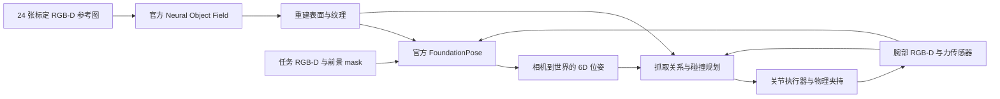

# Model-free 6D 位姿驱动的三个操作任务

分支 `feat/model-free-manipulation` 继承原仓库 `main` 的码垛代码和
`feat/6d-pose-insertion` 的倾斜抓取、腕部相机。新增以下三个独立场景：

| 入口参数 | 操作链 | 6D 位姿的作用 |
|---|---|---|
| `--task assembly` | 倾斜取件 → 腕部消除朝向歧义 → 夹具移位 → 接触保护 → 重新定位并重试插装 | 完整 SE(3) 抓取关系、工件与夹具的相对朝向、接触后的重新对准 |
| `--task clutter` | 识别被遮挡工件 → 搬走障碍物 → 侧抓 → 翻转放上支架 → 松爪并换抓姿 → 插装 | 从平躺姿态构造侧抓关系，并通过支架改变手与工件的相对姿态 |
| `--task conveyor` | 连续 RGB-D 定位与跟踪 → 估计速度 → 预测接触时刻位置 → 在送料台运动中夹取 → 插装 | 带时间戳的 6D 跟踪、考虑推理延迟的接触位置预测、腕部装配校正 |

颜色仅生成前景 mask，不决定装配位置或物体朝向。

## Model-free 的范围

采用 [FoundationPose 官方 few-shot model-free 路线](https://github.com/NVlabs/FoundationPose/tree/a1b694b83e633c2cb6115b9063d940a687759392#run-on-public-datasets-linemod-ycb-video)：
先从参考图训练 Neural Object Field，再将其重建表面交给同一套官方
`register()` / `track_one()`。这里的 model-free 指**感知不需要输入工件 CAD**；
仍然需要少量参考 RGB-D、mask、相机标定和预训练位姿网络。



`simulation_objects.py` 的几何只用于仿真、参考图渲染及单独的真值评价；
重建脚本和推理 worker 不导入该模块。碰撞规划使用重建表面的凸包。
提供 [重建模型包](../assets/reconstructed/README.md)，并在加载时检查来源声明和文件哈希。

扫描图集采用固定物体和理想标定的合成相机轨迹。固定任务相机沿用棋盘格估计标定，
腕部相机现采用[图像估计内参与手眼变换](CALIBRATION_LOCALIZATION.md)和机器人正运动学；本文历史演示仍对应当时的理想腕部标定。夹具由
RGB-D ArUco 平面估计定位，其标记安装关系与夹具几何已知。因此，当前实验
不等同于无参考、无标定、未知夹具的通用装配。
扫描坐标系同时作为工件操作坐标系，装配轴和抓取面由任务约定；尚未实现从任意扫描自动推断装配语义。

## 运行

先完成 [仿真环境和官方 FoundationPose 安装](SETUP.md)。本次验证使用：
MuJoCo 3.17.0、Python 3.11.14 仿真进程，以及 Python 3.9.23、
PyTorch 2.4.1+cu121、Kaolin 0.16.0 的独立 GPU 进程，显卡为 16 GB RTX 2000 Ada。
已有可运行的 FoundationPose 环境可直接通过 `--foundationpose-python` 指定。

```bash
export MUJOCO_GL=egl
export PYOPENGL_PLATFORM=egl
FP_PYTHON=/path/to/foundationpose/env/bin/python

python scripts/run_model_free_task.py --task assembly \
  --plug-model assets/reconstructed/plug \
  --foundationpose-python "$FP_PYTHON" \
  --output artifacts/assembly_demo --record

python scripts/run_model_free_task.py --task clutter \
  --plug-model assets/reconstructed/plug \
  --blocker-model assets/reconstructed/blocker \
  --foundationpose-python "$FP_PYTHON" \
  --output artifacts/clutter_demo --record

python scripts/run_model_free_task.py --task conveyor \
  --plug-model assets/reconstructed/plug --belt-speed .004 \
  --foundationpose-python "$FP_PYTHON" \
  --output artifacts/conveyor_demo --record
```

默认官方源码位于 `third_party/FoundationPose`，可用
`--foundationpose-repository /path/to/FoundationPose` 改写。每次选择新输出目录。
`--seed` 改变初始摆放；未逐个验证的 seed 不应计入成功率。
本入口输出录屏，不依赖交互式 viewer。

结果包括 `summary.json`、逐次 RGB-D 观测、推理请求与输出、规划关节路径、
腕部力记录，以及 `video/overview_wrist.mp4`、`wrist.mp4` 和 `overview.mp4`。
例如在 Linux 打开同步视频：

```bash
xdg-open artifacts/assembly_demo/video/overview_wrist.mp4
```

MP4 是数据文件，使用播放器打开，不直接把路径作为终端命令执行。
供组员下载的压缩版视频和校验信息见 [仓库视频目录](videos/README.md)。

## 自行重建参考物体

使用已有模型包只需位姿推理依赖；重新训练 Neural Object Field 还需要
Kaolin、BundleSDF 的 `common` / `gridencoder` 扩展、xatlas 和 Open3D。
按固定提交的[上游安装说明](https://github.com/NVlabs/FoundationPose/blob/a1b694b83e633c2cb6115b9063d940a687759392/readme.md)
构建相应扩展，不要直接复制另一 Python 或 CUDA 版本的二进制文件。

```bash
MUJOCO_GL=egl python scripts/capture_model_free_references.py \
  --object plug --output artifacts/references_plug

PYOPENGL_PLATFORM=egl "$FP_PYTHON" scripts/reconstruct_neural_object.py \
  --references artifacts/references_plug --repository third_party/FoundationPose \
  --output artifacts/reconstructed_plug --steps 1500 --mesh-resolution-mm 1.5
```

障碍物将 `--object` 改为 `blocker`，使用另一组输出目录。本仓库附带障碍物模型
采用 `--steps 1000 --mesh-resolution-mm 1.5 --optimize-reference-poses`。
重建使用 24 个视角，程序只向重建端交付图像、米制深度、mask 和扫描标定。
训练随机性、GPU 和上游依赖差异可能导致不同网格哈希；请验证新模型后再用于操作。

本机原生 CUDA/OpenGL 扩展曾在**完成导出后**的解释器析构阶段报
`free(): invalid pointer`。一次性重建进程因此采用导出回读校验、CUDA 同步、
落盘和日志刷新后 `os._exit(status)` 的退出策略；失败仍返回非零状态并保留
`model_free.json`。这项兼容处理不会绕过训练或导出校验，策略也写入模型清单。

## 控制、判据与限制

- 使用关节位置执行器、双侧指垫接触和摩擦保持工件；操作期间不写物体实时 qpos，
  不使用焊接、吸附或物体重力补偿。机器人的自身重力补偿已启用。
  规划检查重建凸包与环境的碰撞，只豁免当前阶段预期的支撑面和插装接触；
  MuJoCo 接触监控还会检查实际机器人和载荷的非预期接触。
- 完整旋转搜索保留 252 个初始候选。为适配 16 GB 显卡，推理输入从
  1280×960 缩放到 800×600，并同步转换内参；夹具定位保留原始分辨率。
- 远景中近似长方体可出现 180° 朝向歧义；抓起后用腕部近景再次完整注册，
  再根据实际估计的手—物关系调整朝向。无纹理障碍物的等价朝向通过选取
  观测几何中朝上的抓取面处理，不强制使用仿真朝向。
- 装配夹具在首次插入开始时平移 12 mm / 4 mm、绕世界 Z 转动 7°，
  这是显式场景扰动；控制器不接收扰动量。8 N 的腕部力增量触发撤退，
  再观察夹具和夹持工件，最多尝试三次。这是带力保护的分段位置控制，
  尚未实现连续阻抗或导纳控制。
- 定位槽深 25 mm、每侧间隙 3 mm。按重建表面规划插入，最后少量高度差
  在松爪后由重力落座。分别报告松爪前和松爪后的结果，不能将最终落座误差
  当作 FoundationPose 的定位误差。
- 送料台用滑动关节与速度执行器模拟一段移动传送面，默认 4 mm/s，
  不是闭环循环皮带。物体由接触摩擦带动，夹持和抬升期间台面保持运动。
  运动目标采集阶段的推理等待期间，物理时间继续推进；速度仅由图像位姿和采集时间拟合，
  预测使用预计接触时间。当前 IK 规划仍同步计算，尚未验证工业节拍或硬实时。
- 最终验收同时要求位置误差 <4 mm、旋转误差 <5°、槽壁余量 >−0.5 mm、
  槽底高度差 <1.5 mm、指定底面支撑力 >0.2 N，以及松爪后低速稳定。
  真值只用于这些评价或显式 `--ground-truth` 诊断模式。

## 检查与对照

```bash
python scripts/check_model_free_tasks.py
python scripts/run_model_free_task.py --task assembly \
  --plug-model assets/reconstructed/plug --ground-truth \
  --output artifacts/assembly_physics
```

检查覆盖模型哈希篡改、CAD 来源声明、带推理延迟的运动预测、时间戳非法输入、
对称箱体的抓取方向，以及“悬空”和“错误朝向”不能通过落座验收。
`--ground-truth` 输出明确标记为控制诊断，不计为 model-free 视觉结果。
`--disable-recovery` 保留同一夹具扰动，在接触保护触发后停止，用于恢复机制对照；
`--no-disturbance` 可检查静态夹具的基本流程。

实际完成的运行、误差和演示视频对应关系记录在
[model-free-tasks.json](results/model-free-tasks.json)。这些是有限场景的复现证据，
不是对随机遮挡、任意速度、未知物体或真机泛化成功率的统计结论。

本工作站 seed 0 的最终录像结果如下；误差均为松爪、稳定后的物理落座误差。

| 运行 | 验收 | 位置误差 | 姿态误差 | 可观察证据 |
|---|---|---|---|---|
| 装配与恢复 | 通过 | 0.19 mm | 0.35° | 首次 8.00 N 力增量触发保护，第二次插入完成 |
| 部分遮挡与重抓 | 通过 | 2.88 mm | 0.39° | 可见像素 4478 → 5360；三次实际夹持包含障碍物与两种工件抓姿 |
| 运动目标抓取 | 通过 | 0.54 mm | 0.43° | 视觉速度约 3.99 mm/s，抓取期间送料命令保持 4 mm/s |
| 关闭自动恢复 | 预期失败 | — | — | 同样的首次接触触发后停止，无第二次插装 |

三个成功运行的搬运过程均保持双侧承载接触，最终槽底支撑力约 0.98 N。
装配任务的初次远景朝向误差约 179°，腕部完整重定位后约 0.90°，恢复时跟踪约 0.64°；
这些感知误差与表中的落座误差分别记录。部分遮挡示例仅有约 0.01 mm 的最小几何槽壁余量，
不能据此宣称对更大噪声或不同布局已经稳健。
