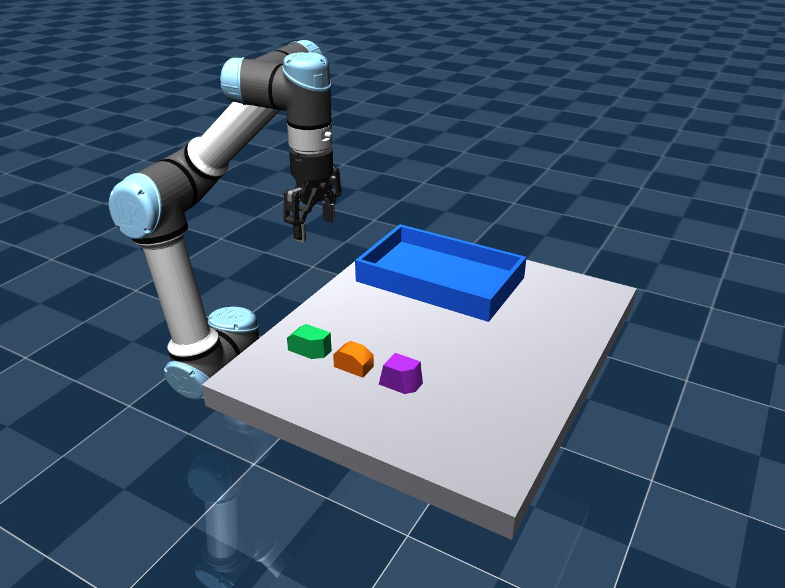
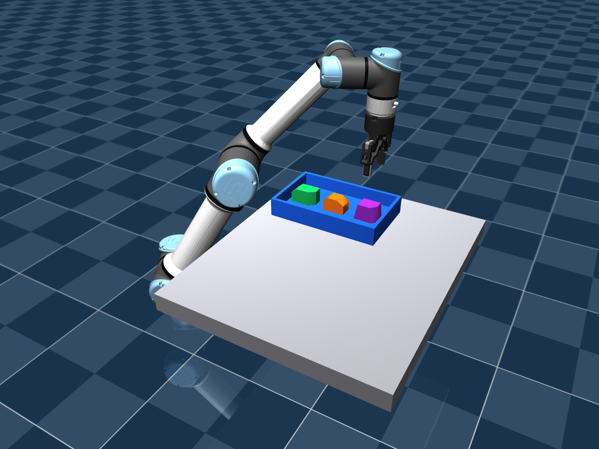

# 三工件视觉抓放

2026-11-06：新增三个独立自由物体在同一个 MuJoCo 场景中连续抓放。此版本是单层分槽放置；没有实现堆叠。原单工件入口和原始模型定义保留。



| 工件 | 几何 | 尺寸 XYZ / mm | 初始 XY / m | 目标 XY / m |
|---|---|---|---|---|
| green | 原绿色非对称双斜角工件 | 74 × 40 × 44 | (0.37, -0.18) | (0.37, 0.18) |
| orange | 带双斜肩的六边形截面棱柱 | 64 × 38 × 42 | (0.47, -0.18) | (0.47, 0.18) |
| purple | 不对称切角渐缩定位块 | 68 × 42 × 48 | (0.57, -0.18) | (0.57, 0.18) |

三者都是封闭凸体，保留适合平行夹爪夹持的相对侧面。它们比方块复杂，但不代表已经支持有孔、深凹槽、柔性、透明或任意输入网格。凸体的视觉网格与碰撞外形一致；引入凹体需要重新设计碰撞模型，不能依赖单个 mesh 的凸包表示孔洞。

## 在已有 WSL 环境复现

```bash
cd /home/loutasaiya/projects/MA6216-VISION
conda activate foundationpose
RUN="artifacts/multi_$(date +%Y%m%d_%H%M%S)"
python -u scripts/run_multi_pick_place.py --output "$RUN" --record --viewer
```

每轮使用新的输出目录。去掉 `--viewer` 可无窗口运行，仍可用 `--record` 生成录像。初次推理结束后窗口才打开，后续重观测/推理期间仿真暂停，窗口可能暂时没有更新。不要提前关闭窗口。

默认沿用仓库中已经估计得到的 `demo_data/calibration/estimated`。多工件布局没有改变相机；若修改相机，重新执行 `scripts/run_camera_calibration.py`，再传入 `--calibration 新目录/calibration/estimated`。保留旧标定数据和成功输出。

纯物理诊断可使用：

```bash
python -u scripts/run_multi_pick_place.py --ground-truth \
  --output "artifacts/multi_physics_$(date +%Y%m%d_%H%M%S)"
```

此模式跳过 FoundationPose，明确以仿真真值控制，只能作为物理对照。

## 代码和数据流

- `src/ma6216/parts.py` 定义三个模型、颜色分割、抓取高度偏移、初始位置和目标槽位；同一几何产生仿真 mesh、感知 OBJ 和打印 STL。
- `src/ma6216/multi_object.py` 建立同一场景中的三个自由物体及加宽托盘，按当前工件配置控制器和独立验收。
- `scripts/run_multi_pick_place.py` 首先从同一帧 RGB-D 中分别生成三类颜色 mask，再对每个已知 CAD 执行官方 FoundationPose Model-based 注册。每完成一件，重新观察剩余工件：推理次数为 3 + 2 + 1。
- 相机内参、相机到安装坐标的外参均使用标定估计值。估计物体位姿经过坐标变换和工件专用抓取偏移，生成垂直接近、抬升、横移、低位释放及撤离路径。IK、碰撞预检查和执行仍沿用已有 Python/MuJoCo 实现。
- 非当前工件也参与碰撞检查。待抓物体使用本轮估计位姿；已放置物体使用目标槽位和已知托盘支撑高度建立规划障碍。执行期间保留所有物体的真实接触动力学，并检查异常接触。
- 仿真真值只在正常视觉模式的离线误差和最终结果评价中使用。没有在抓取过程中改写物体位置、焊接夹爪或施加辅助外力。初始条件设置和规划器私有 scratch 数据中的位置赋值不属于物理执行。

先前沿 Y 间隔 80 mm 的布局在下降时发生夹爪外连杆与邻件碰撞；改为沿 X 间隔 100 mm。曾试过 X=0.68 m，发现高位搬运超出本姿态分支的可达范围；最终保留上表布局，没有放宽 IK 和接触验收阈值。

FoundationPose 仍使用直立桌面先验和 24 个水平角候选。颜色用于选择对象和对应 CAD，不等于根据颜色直接得到三维位置。当前每一类别只选择最大连通域；同色多实例、严重遮挡、混杂堆料和自动通用抓取生成尚未实现。每轮抓取前重观测不等于课程 bonus 所说的运动中连续视觉伺服。

## 本轮实测

本机使用已有 foundationpose 环境，没有重建环境。保存结果：`artifacts/multi_vision_trial01/summary.json`，精简可共享结果：[multi-object.json](results/multi-object.json)。

| 工件 | 初次 mask IoU | 实际用于该次抓取的位姿误差 / mm、deg | 最终槽位 XY 误差 / mm |
|---|---|---|---|
| green | 0.9930 | 4.261 / 0.708 | 1.288 |
| orange | 0.9904 | 4.179 / 0.553 | 1.000 |
| purple | 0.9949 | 3.985 / 0.901 | 1.098 |

一次连续视觉场景完成 3/3；三个工件最终均位于托盘内、由托盘底板支撑，支撑力约 0.981 N，且满足静止阈值。搬运期间双指有载相向接触比例均为 1.0。最大非预期机器人接触穿透约 0.033 mm，低于已有 0.5 mm 中止阈值。不能把该数字写成“完全无接触”或把一次固定布局写成通用成功率。

纯物理三工件对照也为 3/3。公共运动模块修改后，原绿色工件与红方块各完成一次物理回归；本轮没有重跑其全部历史视觉摆放试验。



[完整连续抓放视频](media/multi-object-pick-place.mp4)。本轮总仿真时间约 87.6 s，视频只拼接三个物理执行段，省略初始稳定、推理等待及最后额外稳定时间；视频不代表实际推理墙钟耗时。

模型导出及真机交接见 [PRINTING.md](PRINTING.md)。当前四料块码垛的实现与验证见 [PALLETIZING.md](PALLETIZING.md)；早期选型评估保留在历史文档中。
