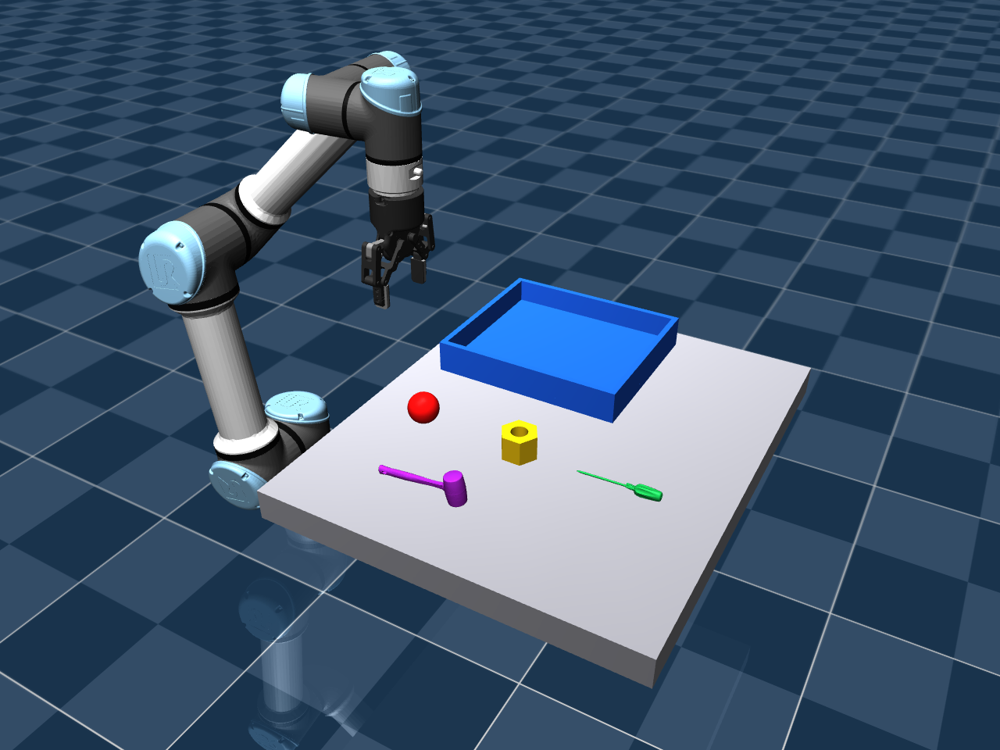
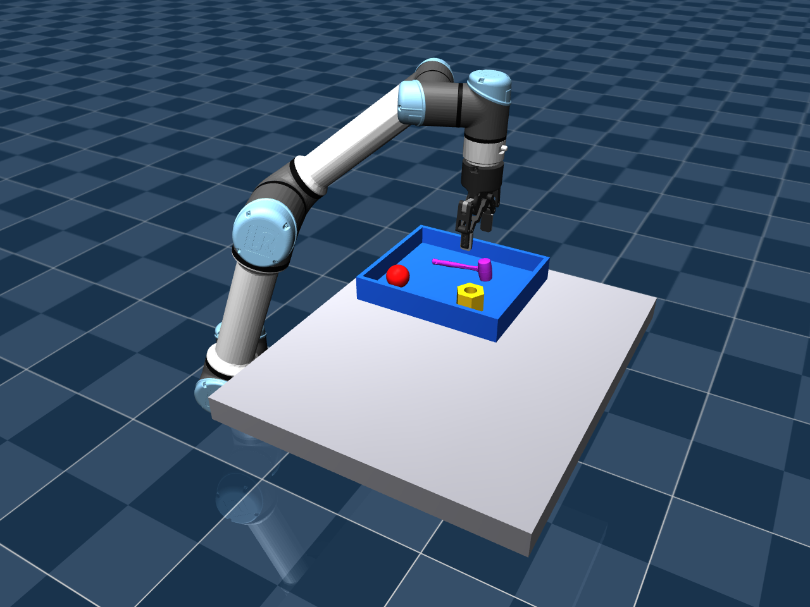

# 多种类物件与已有模型库

2026-11-06：新增球体、中空六角螺母、真实扫描锤子和真实扫描十字螺丝刀。原三个工件及运行入口仍保留。本轮没有实现码垛。

自动抓放场景 `--collection diverse` 只包含锤子、球和螺母；绿色螺丝刀只在下面的四物件预览入口中显示，尚未验证抓取。两个阶段的 GitHub 版本与拉取命令见 [VERSIONS.md](VERSIONS.md)。



## 找到的来源及实际采用范围

| 来源 | 已核验内容 | 当前采用情况 |
|---|---|---|
| 本机 MuJoCo Menagerie | 主要提供机器人、夹爪等设备；不能把它当成完整的通用物品库 | 继续用于 UR5e 和 Robotiq |
| 本机 FoundationPose `demo_data/mustard0/mesh/textured_simple.obj` | 已有芥末瓶网格 | 本轮未导入抓取场景 |
| [Google Scanned Objects 的 MuJoCo 转换库](https://github.com/kevinzakka/mujoco_scanned_objects) | 真实家用品扫描网格、纹理、MJCF 和 V-HACD 碰撞分解 | 实际引入锤子和十字螺丝刀 |
| [robosuite](https://github.com/ARISE-Initiative/robosuite/tree/5ce6643f3092639d08f7b0f90ed1c6a84f50552c/robosuite/models) | 有参数化 HammerObject、带孔螺母、瓶子等 | 查阅候选，未安装 robosuite，也没有使用其锤子代替扫描模型 |
| [YCB 物品清单](https://www.ycbbenchmarks.com/object-set-purchase-links/) | 列有扳手、螺丝刀、锤子、夹具、球类等 | 后续候选，本轮未下载其模型；引入时另核对具体文件和许可 |

本次 GSO 来源固定在 `6ff8d275cebfd5b47e49685e3cfbe64b20e49a3c`。实际下载 71 个文件，总计 1,437,211 bytes，没有克隆整个扫描库或安装新环境。原件在 `assets/library/gso`；`SOURCE.json` 记录 URL、提交、SHA256 和许可。网格、纹理为 CC-BY-4.0，MJCF 为 MIT。原始数据作者为 Google Scanned Objects / Downs 等，MuJoCo 转换由 Kevin Zakka 提供。

## 新对象的几何、物理与状态

| 对象 | 来源和尺寸 XYZ / mm | 碰撞模型 | 已验证状态 |
|---|---|---|---|
| 红色球体 | 项目生成，直径 50 | 真实球形 geom；视觉 CAD 为球面三角网格 | 连续物理与视觉抓放通过 |
| 黄色六角螺母 | 项目生成，60 × 51.962 × 40；通孔直径 26 | 48 个环壁凸体，中央没有碰撞体 | 连续物理与视觉抓放通过；探针穿孔检查通过 |
| 紫色锤子 | GSO `Cole_Hardware_Hammer_Black`；145.854 × 30.016 × 48.033 | 使用原库 32 个碰撞子网格，视觉保留扫描外形 | 连续物理与视觉抓放通过 |
| 绿色十字螺丝刀 | GSO `Craftsman_Grip_Screwdriver_Phillips_Cushion`；130.216 × 18.164 × 18.946 | 使用原库 32 个碰撞子网格 | 已载入四物件预览、导出打印副本；尚未验证抓取 |

扫描工具统一缩小至原尺寸的 50%，并把包围盒中心作为本项目 CAD 原点；两个工具都明确不是原尺寸。原始网格和纹理仍保留。当前抓取场景给物品使用不同的哑光颜色，以复用图像 HSV 分割；未验证从原始纹理或真实照片自动识别工具类别。

所有对象仍是独立自由刚体。本轮按测试质量 0.10 kg 和近似碰撞惯量运行，摩擦也为仿真假设，不代表打印实物。球体使用 `condim=6`，使已设定的扭转和滚动摩擦生效，仍由接触运动，没有锁定球体或加辅助力。螺母孔洞不是用单个凸包封起来的假孔。

锤子使用已知 CAD 中的锤头夹持区，物体坐标下偏移为 `(55, 0, 7)` mm，另有 3 mm 抓取高度偏移。它不是把模型中心直接当成手柄中心。球体采用单独的 10 mm 高度偏移，并选择固定水平夹爪方向。所有目标均来自估计物体位姿和事先定义的 CAD 抓取配置，尚没有自动通用抓取点搜索。

普通均匀球的绝对朝向不可唯一观测，因此球的旋转误差记为 `null`，不把 FoundationPose 任意输出的方向用于夹爪朝向。六角螺母的等价水平角按 60° 周期处理；本轮约 59.80° 的原始旋转差对应约 0.22° 的对称性误差。

## 运行

继续使用已有 WSL 环境：

```bash
cd /home/loutasaiya/projects/MA6216-VISION
conda activate foundationpose
RUN="artifacts/diverse_$(date +%Y%m%d_%H%M%S)"
python -u scripts/run_multi_pick_place.py \
  --collection diverse --output "$RUN" --record --viewer
```

该命令先把锤子放到托盘后排，再放球体和螺母。三件从开始就在同一场景中，途中不重置物体。仍使用估计内外参和 FoundationPose Model-based；每次操作后重新观测剩余物体。去掉 `--viewer` 可无窗口运行。

原三工件继续使用默认 `--collection workpieces` 或省略该参数。诊断物理流程时加 `--ground-truth`，输出会明确标注使用真值；该模式不能作为视觉任务证据。

四类物品共存的模型检查窗口使用独立入口：

```bash
python scripts/preview_object_library.py \
  --output "artifacts/library_preview_$(date +%Y%m%d_%H%M%S)" --viewer
```

该入口只保持机械臂待机并显示物品，关闭窗口结束，不执行抓取。螺丝刀不在已验证自动抓取集合中。

## 实测和失败记录

完整视觉输出为 `artifacts/diverse_vision_trial02`，可共享的精简结果为 [diverse-object.json](results/diverse-object.json)。一次固定布局完成连续 **3/3**，三个物品最终都在托盘内、与底板有支撑接触且静止。

| 对象 | 用于本次抓取的 mask IoU | 位姿平移误差 / mm | 对称性旋转误差 / deg | 最终槽位 XY 误差 / mm |
|---|---|---|---|---|
| 锤子 | 0.9880 | 3.933 | 1.190 | 2.500 |
| 球体 | 0.9683 | 4.144 | 不适用 | 2.225 |
| 螺母 | 0.9923 | 3.908 | 0.218 | 0.713 |

三件搬运期间双指有载接触比例均为 1.0。最大非预期机器人接触穿透为 0.161 mm，低于保留的 0.5 mm 中止阈值。工件与桌面/托盘的最大软接触穿透约为 2.64–4.17 mm，记录在摘要中，不能将结果描述成零穿透或把落盘中心误差当成真机精度。

纯物理对照 `artifacts/diverse_gt_trial02` 也完成 3/3。原绿色工件、红方块和原三工件默认集合的物理回归另行保留；本轮没有重跑其全部历史视觉试验。

失败记录也保留：

- 首版球体夹持高度导致球上滑，触发相向夹持法线判据；升高到已验证的球体夹持高度。原来三维接触未启用滚动阻力，落盘后角速度未达阈值；改为六维球面接触，未放宽成功阈值。
- 首轮视觉中青色球与 UR5e 外壳同色，最大连通域选错，IoU 为 0；估计位置不合法时中止，没有进入机械执行。改为红球后通过。颜色分割存在此真实局限，并非已经实现任意类别识别。
- 本轮仅固定布局、已知模型、已选抓取部位、近似直立/平放姿态。混杂堆料、未知工具、同色多实例和其他工具抓取仍需验证。



[完整抓放录像](media/diverse-object-pick-place.mp4)。录像不包含推理等待，不用于报告端到端墙钟速度。

## 打印交接

四件的米制 OBJ、毫米制 STL 和清单在 `assets/printable_library`。原绿色工件文件仍在 `assets/printable`，不受本轮影响。

扫描网格载入时因纹理接缝存在重复顶点，最初报告为不封闭。打印副本仅合并重合顶点，未改变三角面位置：锤子合并 224 个重复顶点，螺丝刀合并 691 个。四件均通过封闭性、绕向、正体积及 STL 重新载入后的尺寸检查；源文件保持 SHA256 不变。几何合并与机器人关节焊接无关。

切片导入 `*_print_mm.stl`，单位毫米、缩放 100%，以表中尺寸复核。STL 不带颜色；球体打印和细长工具的支撑/摆放由切片预览确定，不能沿用绿色平底工件的全部参数。未进行实物打印验证。感知继续使用 `*_model_m.obj`，不要直接用毫米制 STL 替换。

重新导出需新目录：

```bash
python scripts/export_library_objects.py \
  --output "artifacts/library_print_$(date +%Y%m%d_%H%M%S)"
python scripts/check_object_library.py
```

检查入口验证 71 个原始文件哈希，并在独立 MuJoCo 场景中验证：直径 10 mm 探针位于通孔内无碰撞，移动至螺母环壁后产生碰撞，组合质量等于配置值。

库文件已随项目保存，复现无需再下载。仅在资产目录缺失时，可运行 `scripts/fetch_scanned_objects.py` 获取固定提交的两件模型；脚本不覆盖已有目录。
