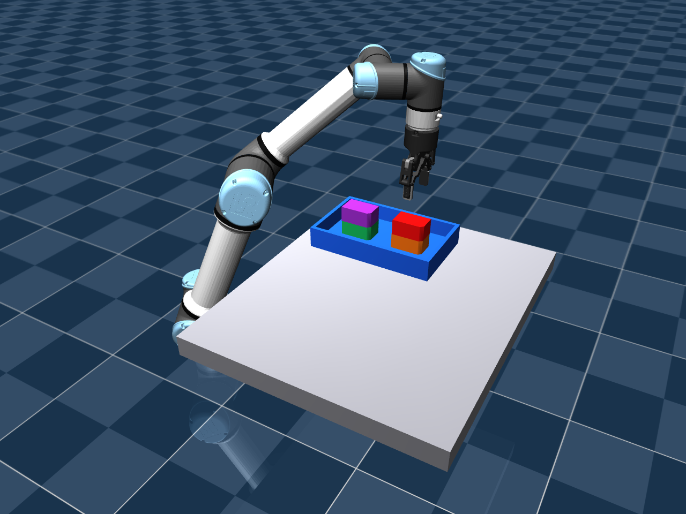

# 四料块、两列两层视觉码垛

本功能在同一 MuJoCo 场景中依次抓取四件独立自由刚体，形成两列、每列两层的堆垛。感知使用官方 FoundationPose Model-based、RGB-D 及估计标定参数，机械臂为 UR5e，夹爪为 Robotiq 2F-85。项目沿用原仓库，开发分支为 `feat/palletizing`，固定版本为 `v0.4.0`。



[完整视觉码垛录像](media/palletizing.mp4) · [实测摘要](results/palletizing.json) · [课程任务、文献比较与实验说明](PROJECT1_PALLETIZING.md)

## 1. 为什么选择这个模型

使用本项目生成的平顶料块：80 × 50 × 40 mm，沿整个高度切去一个角的 8 × 8 mm 三角区域。顶面和底面保持平整，夹持宽度为 50 mm，适合当前夹爪，并保留用于区分水平朝向的不对称几何。原来的斜顶工件、球体和工具仍保留在 Pick-and-Place 场景中。

四件几何相同，分别为绿、橙、紫、红，以图像颜色 mask 区分实例。测试质量为每件 0.10 kg，摩擦和惯量为仿真假设。实际打印需四份同一 STL，核对尺寸、质量、表面和外观后再用于硬件实验。

文件位于 `assets/palletizing`：

- `stack_block_print_mm.stl`：毫米制封闭打印实体，底面 Z=0，打印四份。
- `green_model_m.obj`、`orange_model_m.obj`、`purple_model_m.obj`、`red_model_m.obj`：米制、保留物体原点的感知 CAD。
- `manifest.json`：尺寸、体积、坐标平移、质量假设和文件 SHA256。

STL 按毫米、100% 缩放导入切片软件；模型不包含颜色。打印坐标为 `p_print_mm = 1000 * p_model_m + [0,0,20]`，不能把打印 STL 直接替换米制感知 OBJ。未进行实物打印或真机试验。

## 2. 复现

使用已有 WSL 环境，不需要重建 FoundationPose：

```bash
cd /home/loutasaiya/projects/MA6216-VISION
conda activate foundationpose
RUN="artifacts/pallet_$(date +%Y%m%d_%H%M%S)"
python -u scripts/run_palletizing.py --output "$RUN" --record --viewer
```

每次使用新的输出目录。`--viewer` 在首轮观测推理完成后打开实时窗口；后续推理期间仿真暂停。无窗口运行时去掉该参数。

默认复用 `demo_data/calibration/estimated`。码垛模型和托盘布局没有改变固定相机，因此仍使用已通过独立验证的估计内外参。修改相机后重新标定：

```bash
RUN="artifacts/pallet_calibrated_$(date +%Y%m%d_%H%M%S)"
python scripts/run_camera_calibration.py --output "$RUN/calibration" && \
python -u scripts/run_palletizing.py --calibration "$RUN/calibration/estimated" \
  --output "$RUN/demo" --record --viewer
```

第二组位置和朝向扰动用 `--layout 1`。在不同组员机器上先按 [SETUP.md](SETUP.md) 安装外部机器人模型和官方权重，再运行 `python scripts/check_setup.py --vision`。

纯物理对照与专门验收检查：

```bash
python scripts/run_palletizing.py --ground-truth --layout 1 \
  --output "artifacts/pallet_physics_$(date +%Y%m%d_%H%M%S)"
python scripts/check_palletizing.py
```

`--ground-truth` 明确使用仿真物体状态作为诊断控制输入，跳过 FoundationPose，不能代替视觉试验。

## 3. 任务、坐标与控制

| 次序 | 工件 | 初始 XY / m，布局 0 | 目标列 XY / m | 层号 | 直接支撑体 |
|---|---|---|---|---|---|
| 1 | green | (0.38, -0.25) | (0.40, 0.18) | 0 | 托盘 |
| 2 | orange | (0.54, -0.25) | (0.54, 0.18) | 0 | 托盘 |
| 3 | purple | (0.38, -0.08) | (0.40, 0.18) | 1 | green |
| 4 | red | (0.54, -0.08) | (0.54, 0.18) | 1 | orange |

布局 1 的初始 XY 相对上表交替增加/减小 3 mm 的 X 偏移，并增加 4 mm 的 Y 偏移；初始水平角分别为 12°、-12°、8°、-8°。两个布局都将放置朝向对齐至 0°。

1. 图像 mask 来自 RGB 颜色分割。FoundationPose 输入 RGB、米制深度、mask、同一料块 CAD 和估计内参，输出相机坐标位姿。
2. `world_T_object = world_T_camera_estimated @ camera_T_object`。`world` 是机器人安装参考坐标，真机接入仍需对齐实际基座坐标。
3. 每次取料前重新估计剩余工件。放上层前，还重新观察其直接支撑块，用估计的支撑块 XY 对齐目标；每组完成 12 次官方注册。
4. 托盘支撑面为已知工作站几何 Z=0.389 m，层高由 CAD 的 40 mm 给出，名义层中心分别为 0.409、0.449 m。这是任务和支撑平面先验；没有把模拟器物体位置用于视觉目标生成。
5. 源抓取位姿、物体到 TCP 的规划关系和目标朝向共同决定放置位姿。带载转动在横移阶段平滑完成；离线求解连续关节轨迹，并对手臂、载荷和已有堆垛进行采样碰撞检查。
6. 在支撑面上方设置 16 mm 的规划释放间隙，随后开爪，由接触物理完成落下和支撑。该值是规划间隙，实际释放高度还受估计和跟踪误差影响。

正常视觉模式的规划障碍来自估计位姿或此前的目标放置位姿。模拟器状态只用于图像渲染、控制器反馈、安全检查和独立评价，不为视觉流程提供物体目标真值。物体 qpos 只在场景初始化和规划器私有 scratch 数据中赋值；执行通过关节/夹爪 actuator 驱动，没有物体焊接、瞬移或辅助外力。

当前为抓取间重新观测、单次操作内固定视觉目标。没有实现运动中的连续 IBVS/PBVS，不能报告为课程闭环 bonus。

## 4. 层叠成功怎样判定

上层必须与指定的下层发生真实支撑接触，不能沿用“托盘底板直接支撑”的旧验收。每件同时满足：

- 指定支撑体接触力大于 0.2 N，底面距实际支撑表面的差小于 3 mm。
- 所有顶点在托盘内，名义槽位 XY 误差小于 10 mm、层中心高度误差小于 4 mm。
- 质心投影位于支撑多边形内，至少有 8 mm 边缘余量。
- 倾斜小于 3°，水平角误差小于 5°，线速度小于 5 mm/s、角速度小于 0.05 rad/s，夹爪已释放。
- 整垛额外观察 5 秒，最大位置漂移小于 1 mm；各工件从自身放置完成起的位移小于 5 mm。

运输中保持原双指相向、有载接触检查和 0.5 mm 非预期接触中止阈值，并新增实际载荷与非指定支撑体/障碍的意外接触检查。独立检查脚本验证：即使上层几何位置对齐，只要悬空且没有支撑力，仍会失败；自由落稳后才通过。

## 5. 已执行结果

| 布局 | 物理对照 | 完整视觉码垛 | 视觉最终槽位 XY 误差 / mm | 5 秒最大漂移 / mm |
|---|---|---|---|---|
| 0 | 4/4 | 4/4 | 1.612、1.154、5.094、2.061 | 0.155 |
| 1 | 4/4 | 4/4 | 1.319、2.275、5.374、2.299 | 0.160 |

整垛视觉试验为 2/2，单件操作共 8/8，均为指定的两个确定性布局。用于抓取的位姿平移误差约 3.75–4.37 mm，方向误差约 0.34–0.54°。每件搬运期间的双指有载接触比例为 1.0。

完成后，上层支撑力约 0.981 N；底层托盘支撑力约 1.962 N，反映各列两件的总重量。软接触造成的最终支撑面差和过程中的最大穿透均记录在 [结果摘要](results/palletizing.json)，不将其描述成零穿透或真机精度。有限样本不代表随机混杂环境的通用成功率。

原单物体、三工件和锤子/球/螺母的物理入口均通过回归。共享执行器仅提取默认放置验收为可覆盖方法，旧默认验收逻辑保留。

## 6. 输出与源码

每轮输出有 `summary.json`、初末场景图，以及每件的 RGB-D/mask、FoundationPose 输出、`motion/plan.json`、`motion/result.json`、`motion/samples.csv` 和放置后的截图。使用 `--record` 时生成完整 `palletizing.mp4`，录像不包括推理等待，不能作为端到端墙钟速度。

核心文件：`src/ma6216/palletizing.py`、`scripts/run_palletizing.py`、`scripts/check_palletizing.py`、`scripts/export_pallet_blocks.py`。重新导出模型时为导出入口指定新目录。

本轮不包含实物打印、真机驱动、随机混杂抓取或同色多实例识别的验证。硬件组应按同尺寸打印件、实际质量与摩擦、相机内外参、TCP、基座变换和控制接口重新验证。
