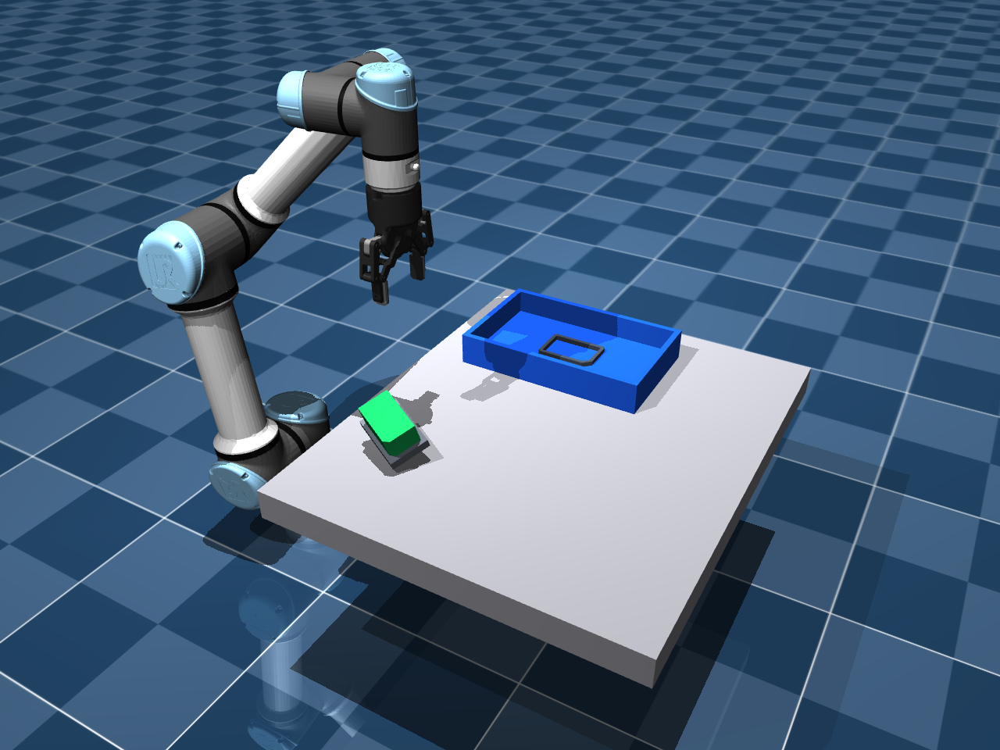
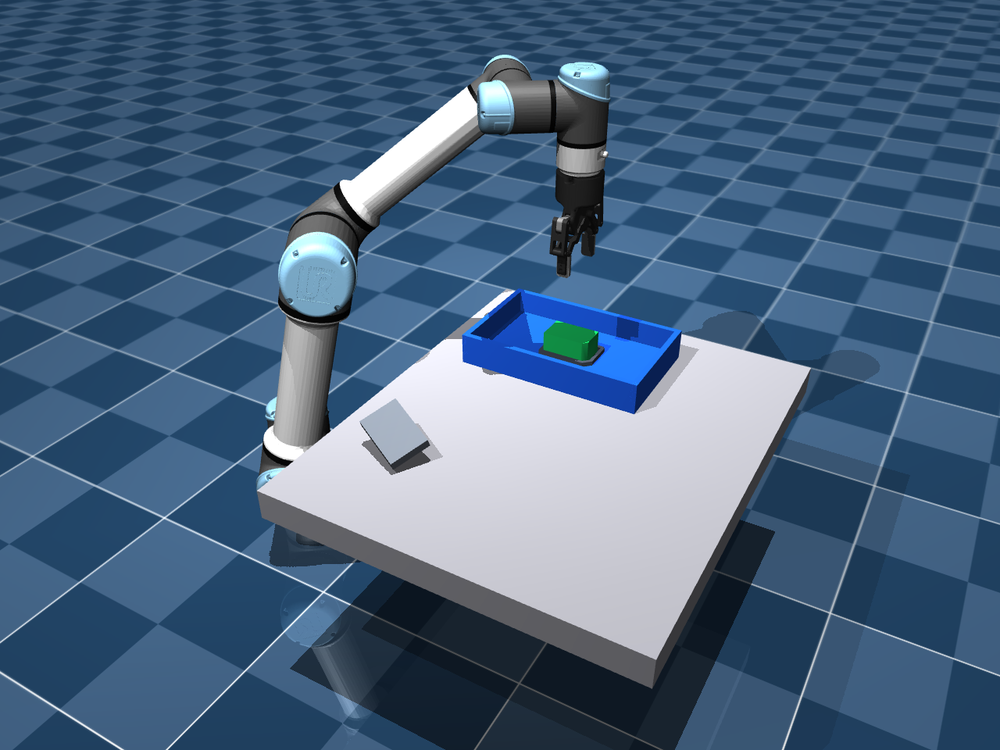

# 6D 位姿引导的倾斜取件与定向入槽

本扩展从 `v1.0.0` / `feat/palletizing` 的提交 `2d784021` 开始，沿用
UR5e、Robotiq 2F-85、固定 RGB-D 相机、估计标定、官方 FoundationPose
Model-based，以及原来的 80×50×40 mm 缺角料块。

任务：从倾斜料架抓起自由刚体料块，改变其三维朝向，放入与缺角匹配的浅槽。
颜色仅用于生成前景 mask，不决定目标位置或完成条件。

## 相比原码垛增加了什么

- 原码垛把工件视为近似直立，主要规划 XY、层高和 yaw。本任务的输入有
  X、Y、Z、roll、pitch、yaw，三个布局含非零 roll 和 pitch。
- FoundationPose 使用官方完整 SO(3) 初始候选；不传 `--upright-extrinsic`，
  不把料架朝向或物体真值当作网络的初始姿态。
- `world_T_tcp = world_T_object_estimated @ object_T_tcp`，抓取位置偏移和
  夹爪姿态都跟随估计的完整旋转。放置使用相同的物体—TCP 关系进行变换。
- 目标是已测量的固定夹具，其位置和 CAD 坐标是任务输入。感知评估用到的
  物体仿真真值不参与正常视觉控制。
- 五段槽壁保留缺角方向约束；最终同时验收完整旋转误差、位置、壁内间隙、
  底部支撑力、速度、夹爪释放和五秒稳定性。

这是 **8 mm 深浅槽、每侧默认 2.5 mm 间隙的定向落座**。机械臂在底面上方
12 mm 的规划高度开爪，由接触和重力落座；不包含力控插入、亚毫米配合或连续
视觉伺服。工件不使用焊接约束、运动中 qpos 赋值或辅助外力。

## 场景与控制范围

| 布局 | 初始中心 XYZ / m | 初始 roll / pitch / yaw / ° |
|---|---|---|
| 0 | (0.42, -0.18, 0.430) | (0, 0, 18) |
| 1（默认） | (0.43, -0.19, 0.440) | (10, -8, 22) |
| 2 | (0.35, -0.14, 0.435) | (-18, 16, -18) |
| 3 | (0.38, -0.20, 0.435) | (20, 14, -25) |

表中是场景初始化值；实际观测在物理沉降后采集。固定目标中心默认
(0.49, 0.18, 0.409) m，朝向为单位旋转。料架和槽壁由代码生成，料块的
打印文件仍在 `assets/palletizing`；本分支没有验证实体夹具打印或真机操作。

新场景启用机械臂及夹爪自身的重力补偿，工件的重力补偿保持为 0，并采用
椭圆摩擦锥与 `impratio=10`。这改善窄槽任务中的静态跟踪和倾斜面接触，
与视觉、物理对照和 yaw-only 对照共同使用。原抓放/码垛入口的物理设置保留。
仍用原 actuator 执行、相向双指有载检查及机器人非预期穿透中止规则。

## 运行

依赖按 [SETUP.md](SETUP.md) 配置。完整视觉路线需要官方源码、两个预训练
权重及 CUDA 扩展；只安装 `requirements-sim.txt` 可以先跑物理对照。
每轮必须使用新的输出目录。

```bash
# 物理对照：不调用 FoundationPose，不能当作视觉结果。
python scripts/run_pose_insertion.py --ground-truth --layout 1 \
  --output artifacts/pose_insertion_physics_01

# 完整视觉：从 RGB-D / mask / CAD 估计，再实际抓放。
python scripts/run_pose_insertion.py --layout 1 \
  --output artifacts/pose_insertion_vision_01 --record --viewer

# 检查三维抓取变换及“悬空/方向错误不通过，正确落座通过”。
python scripts/check_pose_insertion.py
```

无桌面机器去掉 `--viewer`；需要离屏渲染时可在支持 EGL 的环境中设置
`MUJOCO_GL=egl`。窗口和录像在估计、离线规划完成后开始，不包含推理等待。
总墙钟耗时另记录在 `summary.json`。

仿真与推理也可以用两个独立 Python 环境，避免改动已有 CUDA 软件栈：

```bash
python scripts/run_pose_insertion.py --layout 1 \
  --foundationpose-python /path/to/foundationpose-env/bin/python \
  --foundationpose-repository /path/to/FoundationPose \
  --output artifacts/pose_insertion_vision_separate_01 --record
```

若省略上述参数，沿用当前 Python 和 `MA6216_FOUNDATIONPOSE_DIR` /
`third_party/FoundationPose` 的原配置。推理仍由本仓库的
`scripts/run_foundationpose.py` 调用官方实现。`--capture-only` 只保存观测，
其摘要为 `status: observation_captured, success: null`，不表示完成操作。

## 对照与验收

`--pose-mode yaw-only` 保留输入平移和 yaw，丢弃 roll/pitch；与完整位姿使用
相同场景、机器人、执行器和验收。可以分别与 `--ground-truth` 或正常视觉
组合，区分控制策略差异和估计误差。

```bash
python scripts/run_pose_insertion.py --ground-truth --layout 3 \
  --pose-mode yaw-only --output artifacts/pose_insertion_yaw_only_03
```

轻微倾斜时，夹爪接触及槽内落座可能被动纠正姿态，所以不能预先假定
yaw-only 每次都会失败。应报告全部测试布局，保留成功和失败记录。

成功同时要求：中心位置误差 < 3 mm；完整 SO(3) 旋转误差 < 5°；所有顶点
处于槽壁半空间内（允许 0.3 mm 接触容差）；底面与槽底之差 < 1.5 mm；
槽底支撑力 > 0.2 N；线速度 < 5 mm/s；角速度 < 0.05 rad/s；夹爪已释放。
另运行五秒，位置最大漂移必须 < 1 mm，并重新检查落座条件。

本任务不使用姿态对称性折算：料块的缺角是方向标识。只看 XY 接近或物体
落在托盘中，不足以通过该验收。

## 本工作站实测（2026-11-07）

以下三个倾斜布局各运行一次完整视觉和一次 yaw-only 对照，使用同一标定、
2.5 mm 单侧间隙及 0° 目标 yaw。每个布局两种策略的估计位姿文件 SHA-256
一致，区别在于规划是否保留 roll/pitch。它们是有限确定性案例，不能据此
推算随机场景成功率。

| 布局 | FoundationPose 平移 / 旋转误差 | 完整位姿：落座 / 中心误差 | yaw-only：落座 / 中心误差 |
|---|---|---|---|
| 1：(10°, -8°, 22°) | 3.83 mm / 0.72° | 通过 / 1.92 mm | 通过 / 1.44 mm |
| 2：(-18°, 16°, -18°) | 4.27 mm / 0.42° | 通过 / 2.42 mm | 失败 / 7.18 mm |
| 3：(20°, 14°, -25°) | 4.48 mm / 1.96° | 通过 / 2.35 mm | 失败 / 6.15 mm |

通过项报告额外五秒沉降后的指标；失败项报告执行验收失败时的物理状态，
没有继续五秒稳定性检查。两个失败项的完整旋转误差分别为 6.14°、6.09°，
均有顶点越出槽壁边界。完整位姿的三个案例均保持双指有载运输，额外五秒
最大漂移 < 0.001 mm。

四个布局的真值物理对照均通过，中心误差为 0.12–0.39 mm；布局 3 的
真值 yaw-only 对照也通过，中心误差 2.80 mm。这说明接触可能被动修正姿态，
不能声称只用 yaw 必然失败。视觉布局 1 中 yaw-only 的最终位置误差还更小。
最终落座朝向也受接触与重力影响，不能把落座旋转误差当成网络估计精度。

仿真使用 Python 3.11.14 / MuJoCo 3.17.0；官方推理使用独立 Python 3.9.23 /
PyTorch 2.4.1+cu121 环境和 RTX 2000 Ada GPU。实际运行官方完整的 252 个初始
旋转候选。固定外部仓库版本、各轮指标和原始摘要哈希见
[实验摘要](results/pose-insertion.json)。

布局 3 的真实仿真画面：

| 倾斜取件前 | 完整位姿落座后 | yaw-only 验收失败 |
|---|---|---|
|  |  |  |

完整演示录像在本轮本地输出的 `motion/physical_pick_place.mp4`；原始录像不进入 Git。
`--clearance-mm` 和 `--target-yaw-deg` 可用于下一步实验，当前实测不覆盖更紧
间隙或非零目标 yaw。

## 代码与证据

- `src/ma6216/pose_insertion.py`：倾斜料架、缺角槽、完整位姿规划及落座评价。
- `scripts/run_pose_insertion.py`：独立任务入口、官方推理、物理执行与稳定性评价。
- `scripts/check_pose_insertion.py`：坐标关系与物理验收的正/负例检查。
- 每轮输出：`observation/`、`foundationpose/`、`foundationpose.log`、
  `world_T_object_estimated.txt`、`motion/plan.json`、`motion/result.json`、
  `motion/samples.csv` 和 `summary.json`。`--record` 另保存初末截图及录像。
- 若执行失败，摘要保存 `failure_evaluation_only`，录制模式另保存
  `failed_scene.png`，不把失败帧当成稳定落座结果。

实验摘要随本分支保存于 `docs/results/pose-insertion.json`。它记录实际执行的
有限布局，不代表随机混杂场景成功率或真机精度。所有原始运行文件留在
Git 忽略的 `artifacts/` 中。
