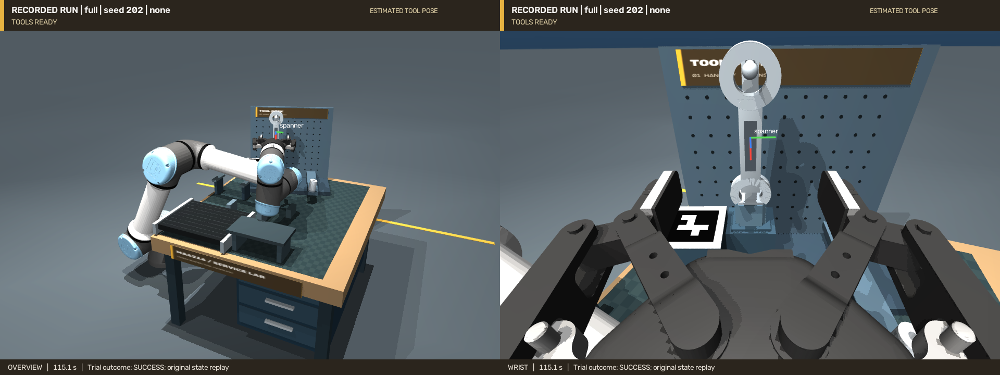

# 工具架自装配与承重挂放

`--task rack` 把工作站原来固定的挂钩换成一个可抓取的独立 L 形支架。机器人需要先装好它，再把扳手挂上去；安装结果会成为后续动作的真实障碍物和承重部件。

[当前评测报告](results/rack-revision-v2/README.md) · [全景＋腕部视频](videos/rack-revision-v2/rack__full__none__202.mp4) · [独立腕部](videos/rack-revision-v2/rack__full__none__202__wrist.mp4)

当前主视频为动作修复后的正式试验 seed 202，约 114 秒，包含装架、实际换抓和穿孔挂放。换抓后的转向约 12 秒，底座转动约 29°；[独立复核](results/rack-revision-v2/main-video-motion-audit.json)确认松手后无夹爪支撑，额外静置 30 秒仍稳定。修订后每配置 10 次的结果单独汇总，不能将成功视频当作全部试验结果。

本轮完整方法无扰动 **3/10**、有扰动 **2/10**，关闭腕部观测均 **0/10**；完整方法的 Wilson 95% 区间分别为 **10.8%–60.3%** 和 **5.7%–51.0%**。随机布局可靠性仍不足，失败主要为取扳手时的碰撞规划拒绝及释放后稳定性未达标。



上图直接取自原试验状态回放；夹爪已经释放，扳手由新安装的挂钩承载。

首轮动作修复前的工具架结果为完整系统无扰动/有扰动各 7/10，关闭腕部观测各 0/10；该轮 seed 101 录像存在绕行与停顿，现保存在 [首轮评测](results/evaluation-v1/README.md) 中作为历史记录。修复原因与版本边界见 [动作修复说明](RACK_MOTION_REVISION.md)。

## 操作过程

1. 固定 RGB-D 相机定位横放的支架、扳手和底座标记。
2. 夹起支架，使用腕部 RGB-D 纠正持物关系；从横放转到竖直，按完整 6D 变换对准非对称插口。
3. 以 2 mm 插入步长、7 N 接触力增量保护插入，实际松爪并等待稳定。
4. 重新观察装好的支架，将其重建表面加入后续碰撞规划。
5. 夹起扳手，放到两根轨道上，实际释放、重新观察、换抓。
6. 调整扳手孔平面，缓慢穿过新挂钩，再释放并检查扳手和支架的稳定性。

物体位姿来自官方 FoundationPose 的参考图像重建流程。支架的局部深度配准使用测量点云和重建表面，原始网络结果另存。装后支架与同图夹具标记的相对位姿用于消除共享外参误差；夹具的最新腕部观测提供全局定位。

自由转向的规划为装后支架保留 20 mm 间距，慢速接近保留 4 mm。支架释放后先沿原方向撤离 85 mm，再转向；这次转向已经纳入支架障碍检查。扳手两次抓取选用相互衔接的对向抓姿，减少机械臂切换肘部姿态造成的绕行。

关节路径加入执行器阻尼对应的速度前馈，补偿位置伺服跟随移动参考时的滞后，不改变执行器增益、限幅或碰撞阈值。跟踪偏差超过 0.010 rad 时仍暂停推进并等待收敛；依据关节编码器，不读物体真值。计划参考与实际执行器输入分别保存，执行误差对比计划参考。详见 [装架后动作修复](RACK_MOTION_REVISION.md)。

## 运行与录像

```bash
export MUJOCO_GL=egl PYOPENGL_PLATFORM=egl
FP_PYTHON=/path/to/foundationpose/env/bin/python

.venv/bin/python scripts/preview_workshop.py --rack-assembly \
  --output artifacts/rack_preview

.venv/bin/python scripts/run_workshop.py --task rack --trace --record \
  --foundationpose-python "$FP_PYTHON" --output artifacts/rack_new

xdg-open artifacts/rack_new/video/overview_wrist.mp4
```

交互预览加 `--viewer`，需要桌面显示。输出目录必须是新目录。`--ground-truth` 仅供明确标记的机械诊断，不能进入视觉评测。

`--trace` 保存原试验的 25 Hz 状态，可用 [`replay_trial.py`](../scripts/replay_trial.py) 输出全景与腕部 H.264 视频。回放不重新推理、不重新运行物理试验；不能将回放过程中的状态写入当成控制器搬运物体。

## 几何与验收

支架总质量假设为 0.15 kg，扳手为 0.10 kg。支架榫头截面约 24×18 mm，带非对称切角，插入段长 36 mm，插口边界间隙 1.5 mm；立柱和挂钩完全通过接触保持，没有焊接到基座，也没有抓取附件约束。

支架验收要求位置误差 <4 mm、方向误差 <8°、底部间隙绝对值 <2 mm、槽壁侵入不超过 0.7 mm、接触法向力合计 >0.2 N，以及无夹爪接触和足够小的线/角速度。挂上扳手后再次验收支架。扳手还须通过孔的位置、孔平面方向、挂钩承重接触和松爪稳定性检查；仅靠近挂钩、浮在空中或靠在立柱上都不算成功。

阶段验收和安全停止使用仿真几何、接触与速度真值；不达标会终止该次试验。这些检查不向位姿网络或运动目标生成提供真值位姿，也不生成纠偏动作。真机仍需用实际视觉、力觉等观测实现对应的验收与安全检测。

支架重建包见 [`assets/reconstructed/workshop/rack_frame`](../assets/reconstructed/workshop/rack_frame)：24 组 480×480 RGB-D、官方 Neural Object Field 1500 步、0.8 mm 提取分辨率。它不是直接复制的仿真 CAD，也不是打印模型。插口、工位和参考操作坐标系由任务定义。

质量分配、指垫摩擦、接触柔顺和理想深度属于仿真假设，尚未经实物标定。接触法向力合计可能包含侧壁力，不能直接解释为竖直载荷。全部成功率、误差、频率和失败样例按 [统一评测协议](EVALUATION.md) 汇总。
