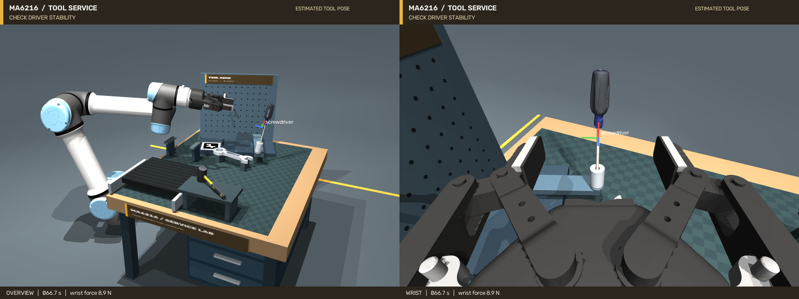
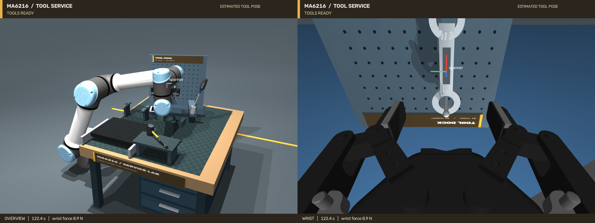

# 维修工具工作站

本场景在原 UR5e＋Robotiq 2F-85 工作站上增加扫描锤子、扫描螺丝刀、带通孔的扳手、送料台、换抓支架和工具挂架。
螺丝刀需要调整完整朝向后插入倾斜套筒；扳手需要在支架上实际松爪、重新观察与换抓，再把孔穿过水平挂钩。

## 已验证的连续视觉演示

[完整全景＋腕部录像](videos/workshop-overview-wrist.mp4) · [独立腕部录像](videos/workshop-wrist.mp4) · [机器可读结果](results/workshop.json)

一次 seed 0 连续运行完成锤子归位、运动螺丝刀抓取与插入、扳手换抓与悬挂。两项装入／挂放都在松爪和稳定等待后验收：

| 项目 | 本次结果 |
|---|---|
| 螺丝刀插入深度 / 轴线误差 | 36.41 mm / 2.83° |
| 螺丝刀尖端横向距套筒轴线 | 0.74 mm |
| 扳手孔平面误差 / 挂钩支撑法向力 | 0.31° / 0.982 N |
| 送料视觉速度 / 设定速度 | 3.14 / 3.00 mm/s；夹取时送料仍开启 |
| 实际夹持 | 4 次夹持、4 次释放；搬运期间双侧承载接触比例 100% |
| 录像 / 实际运行耗时 | 121.4 s、3035 帧 / 本工作站约 283 s |
| 回归检查 | 工作站 6 项＋原任务 7 项，通过 |

以上插入和挂放指标是实际物理结果，不能当作视觉估计精度。独立腕部估计的工具位置误差为 0.53–1.40 mm，旋转误差为 0.87–1.90°，逐次观测记录见结果 JSON。
整段动作结束后的保存状态还进行了独立复核：螺丝刀和扳手仍通过验收，锤子由停放架提供约 0.981 N 支撑。
这些数字来自列出的单次配置演示，不是多随机种子成功率；推理和规划的耗时不能用视频播放时长代替。





## 运行

使用项目仿真环境安装 `requirements-sim.txt`；本扩展新增 Pillow 和 Shapely，分别用于纹理模型与重建网格分片。
本次仿真环境为 Python 3.11.14；MuJoCo 3.17.0、NumPy 2.4.6、SciPy 1.17.1、OpenCV 5.0.0、trimesh 5.2.0。
FoundationPose 仍使用独立的 GPU 环境，安装方法见 [SETUP.md](SETUP.md) 和 [MODEL_FREE_TASKS.md](MODEL_FREE_TASKS.md)。

```bash
export MUJOCO_GL=egl
export PYOPENGL_PLATFORM=egl
FP_PYTHON=/path/to/foundationpose/env/bin/python

python scripts/preview_workshop.py --output artifacts/workshop_preview
python scripts/run_workshop.py --task all \
  --foundationpose-python "$FP_PYTHON" \
  --output "artifacts/workshop_$(date +%Y%m%d_%H%M%S)" --record
```

`--task insert` 和 `--task hang` 可分别运行插架与挂钩；`--stationary-feed` 禁用移动送料，便于定位问题。
`--ground-truth` 仅用于明确标记的物理诊断，不作为视觉结果。
交互预览用 `python scripts/preview_workshop.py --viewer`，需要桌面显示环境。

每次实验使用新输出目录，包含 `summary.json`、RGB-D 与 mask、官方位姿推理记录、完整动作日志，以及 `video/overview_wrist.mp4`。
录像叠加的三色坐标轴来自最新视觉估计；夹持期间由机器人 FK 和腕部测得的夹持关系传播。它不是逐帧物体真值，松爪后也不自动切换为真值。
Linux 可以用 `xdg-open 路径/video/overview_wrist.mp4` 打开录像。

## 感知与操作

1. **参考扫描**：每件工具使用 24 组 RGB-D、深度前景 mask 和标定扫描相机位姿。保留原始工具纹理。
2. **Model-free 重建**：调用官方 FoundationPose Neural Object Field；不向重建或位姿估计进程导出仿真 CAD。
3. **场景分割**：固定相机使用空工作台深度观测做背景差分，在事先标定的取件区域内选取前景；不使用仿真物体 ID、物体真值位姿或 HSV 涂色。
4. **位姿与跟踪**：官方 `register()`／`track_one()`；腕部跟踪的搜索区域来自上一视觉位姿和机械臂 FK。
5. **操作特征**：从重建表面提取螺丝刀轴线、尖端和扳手孔；抓取部位按工具任务定义。工具架通过 RGB-D ArUco 及已测量的标记安装关系定位。
6. **碰撞规划**：对重建表面进行局部分片并分别取凸包，保留扳手孔的空区。规划使用私有仿真状态；碰撞与约束计算保持启用，实际执行使用完整接触动力学。大幅转腕先验证关节插值路径，必要时使用 RRT-Connect；接近、插入和穿孔保持笛卡尔路径。
7. **物理执行**：关节执行器驱动，双指接触力监控，接触力增量保护；搬运期间不写工具位置、不添加抓取焊接约束。

## 道具与尺寸

锤子和螺丝刀来自已有的 [Google Scanned Objects MuJoCo 转换资产](https://github.com/kevinzakka/mujoco_scanned_objects)，继续使用仓库固定版本。
锤子采用原尺寸的 50%，螺丝刀采用 75%；原 `diverse` 任务的 50% 螺丝刀和模型保持独立。
模型及纹理的许可为 CC BY 4.0，详细归属见 [THIRD_PARTY_NOTICES.md](../THIRD_PARTY_NOTICES.md) 和 `assets/library/gso/SOURCE.json`。

扳手是项目生成的金属工具形状，环孔和开口钳口都采用分段碰撞几何。工具架的挂钩半径 4 mm，套筒内半径 4.5 mm、深度 36 mm，套筒倾斜 8°。
三件工具的测试质量均为 0.10 kg；惯量、摩擦和理想深度属于仿真假设。当前腕部内参和手眼变换已改为[图像估计标定](CALIBRATION_LOCALIZATION.md)，本文历史视频保留其原有理想腕部标定条件。
本场景对硅胶指垫启用 `condim=6`，滑动／扭转／滚动摩擦系数为 `0.9 / 0.005 / 0.001`，用于近似有限指垫接触面的抗转动能力。
没有锁定工具姿态或增加工具与夹爪之间的约束；这些接触参数尚未经真机标定。

## 重建复现

以下命令以螺丝刀为例；另外两件工具分别使用 `hammer` 和 `spanner`。

```bash
python scripts/capture_model_free_references.py --object screwdriver --size 480 \
  --output artifacts/references_screwdriver_new
"$FP_PYTHON" scripts/reconstruct_neural_object.py \
  --references artifacts/references_screwdriver_new \
  --repository third_party/FoundationPose \
  --output artifacts/reconstruction_screwdriver_new \
  --steps 1500 --mesh-resolution-mm 0.8
```

随仓库提供的 `assets/reconstructed/workshop/` 包含重建表面、纹理、参考清单、训练配置和文件哈希；完整原始参考图与训练中间文件保存在实验目录中。
锤子训练 1200 步，螺丝刀和扳手各 1500 步。所有模型均未按仿真 CAD 尺寸事后缩放。

## 验收与适用范围

螺丝刀验收检查尖端入筒深度、相对轴线角度、实际套筒支撑、松爪后速度与无夹爪接触。
扳手验收检查孔与挂钩的空间关系、孔平面朝向、实际挂钩支撑和松爪后稳定性。
螺丝刀要求入筒 22–39 mm、尖端距轴线小于 4.5 mm、轴线误差小于 12°；扳手要求孔平面误差小于 20°，并处于挂钩有效支撑区。
两项都要求实际支撑力超过 0.2 N、线速度小于 5 mm/s、角速度小于 0.08 rad/s，且已与夹爪脱离。
物体真值只进入单独的误差评估和明确指定的物理诊断模式；物理接触监控独立于视觉控制。

```bash
python scripts/check_workshop.py
python scripts/check_model_free_tasks.py
```

这是一组经过场景设计的工具任务，取件区域与工具类别对应关系已知，不是任意杂物堆中的开放类别识别。
螺丝刀的近圆柱形手柄存在轴向旋转歧义；初始抓取利用完整估计位姿变换手柄中心和轴线，再选择上方接近方向。
插入使用重建尖端和轴线，并在翻转后重新测量夹持关系；不会将手柄绕轴的原始旋转误差当成已解决。
送料装置是有限行程的平移台；速度由连续视觉观测估计，并投影到已测量的直线导轨方向，防止深度噪声被长时外推为竖直漂移。预测保留最近一次观测的高度和完整朝向，不使用设定速度替代测量。
视频按仿真时间采样，不能据此宣称端到端实时性能。
套筒任务是插入和落座，不模拟螺纹旋紧；扳手是归位悬挂，不执行螺栓拧紧。
