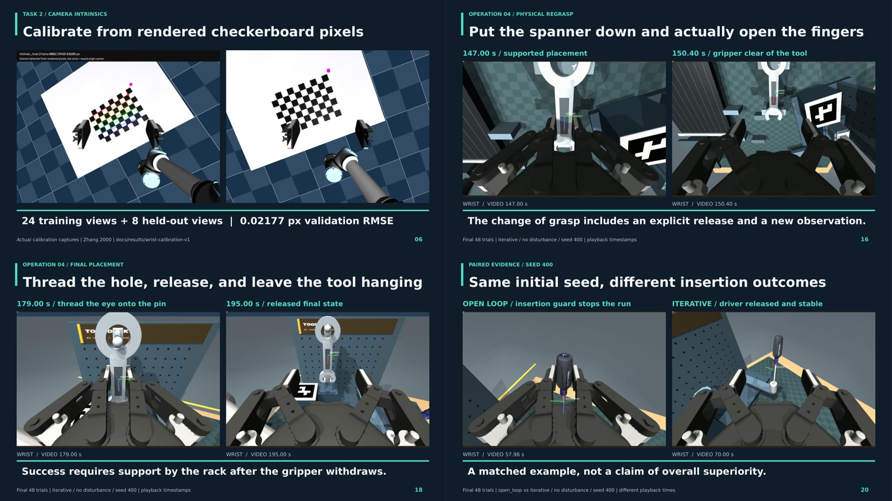

# Final project presentation — English, image-led revision



- [Editable PowerPoint](vision_guided_manipulation.pptx)
- [PDF viewing copy](vision_guided_manipulation.pdf)
- [English speaker notes](speaker_notes.md), also embedded in PowerPoint
- [Slide content and image placements](slides.json) · [Asset provenance](provenance.json)
- [Presentation validation](validation.json)
- [Screenshot source manifest](frames/manifest.json): original video, SHA-256, frame index, playback time and camera-panel crop
- [Course requirement and evidence map](../FINAL_PROJECT.md)
- [Technical selection and references](../LITERATURE_AND_SELECTION.md)
- [Final 48-attempt evaluation](../results/visual-feedback-calibrated-v1/README.md)
- [Original complete and failure videos](../videos/visual-feedback-calibrated-v1/README.md)

This revision **replaces the previous deck at the same paths**. It contains 26 English slides: 24 main slides for approximately 12–15 minutes and two backup slides. All 26 slides contain actual simulation or calibration images. There are 52 runtime/calibration image placements and only one statistical chart. The original source package contains 66 extracted stills; the deck selects 38 distinct image assets, including calibration, segmentation and the single statistical chart.

The main visual story follows hammer return, moving screwdriver pickup and tilted insertion, independent rack installation, relocalization, physical spanner release/regrasp and through-hole hanging. Wrist views and overview views show complementary details. Success/failure pairs use the same seed; captions identify their different playback times. The iterative method's own failure is retained.

The pulse-correction example comes from the separately archived calibration integration run, and the background-mismatch image is a separate localization diagnosis. Neither is added to the final 48-trial statistics. Correction residuals are logged visual estimates, not geometric errors inferred from the screenshots. Small or invisible contact violations are explained from the original failure logs.

Images are real recorded simulation renders: camera panels are cropped from the original videos, and localization details are enlarged with recorded rectangular crops. No generated imagery or changed physical outcome is used. Text, labels and image placements are editable PowerPoint objects. Detailed methods and caveats are in the English notes rather than covering the images with paragraphs. The statistical plot's [SVG/PDF and source data](../results/visual-feedback-calibrated-v1/figures/README.md) remain available separately.

Complete videos remain separate for review; the deck does not embed large movies. The playback timestamps are simulation replay times, not wall-clock processing times. Add actual group member names and course identifiers before submission if required.

```bash
# Regenerate the still-image package from the published videos.
python3 scripts/extract_presentation_frames.py

# Rebuild the presentation from the final report and traceable images.
python3 scripts/build_project_presentation.py \
  --results docs/results/visual-feedback-calibrated-v1 \
  --output artifacts/presentation_rebuilt
```

The tools require ffmpeg, Python with python-pptx and Pillow. PDF export uses LibreOffice. Presentation dependencies are separate from the simulation environment. All final files are included for immediate viewing.
