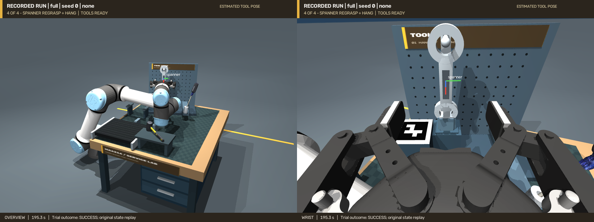

# 完整连续任务：单次视觉演示记录

**[完整视频](../../videos/complete-workshop/overview-wrist.mp4)** · [独立腕部](../../videos/complete-workshop/wrist.mp4) · [任务与复现](../../COMPLETE_WORKSHOP.md)

原始运行：`artifacts/complete_workshop_visual_dev6`；任务 `complete`，固定布局 seed 0，方法 `full`，无外加扰动。控制提交 `e793440a18d46b19c1c30be824dd9b704370599e`，41 个控制源码、标定及参考模型清单的校验值在运行前后保持一致。

官方 FoundationPose 参考重建路线连续完成：扫描锤子归位 → 运动螺丝刀抓取及倾斜插架 → 独立支架安装、释放后重定位 → 扳手放台松爪、重新观察、换抓及穿孔挂放。视频 **3 分 14.36 秒**，程序墙钟耗时约 **287.3 秒**；后者不是独占硬件的性能基准。

## 最终物理验收

以下是实际末态的放置、装配和稳定性指标，不是网络位姿预测误差。每次网络输出、深度校正、标定、运动和耗时指标均保存在 [summary.json](summary.json)。

| 物体 | 最终几何指标 | 支撑力 | 结果 |
|---|---|---|---|
| 锤子 | 停放位移误差 3.24 mm；旋转误差 2.01° | 0.981 N | 通过 |
| 螺丝刀 | 插入深度 36.53 mm；轴线误差 8.90° | 4.411 N | 通过 |
| 支架 | 带载位移误差 2.03 mm；旋转误差 5.55° | 4.967 N | 通过 |
| 扳手 | 孔平面误差 0.82°；线速度 1.90 mm/s；角速度 0.021 rad/s | 0.979 N | 通过 |

扳手最终松爪后由新安装的挂钩承载；完成末段动作后重新检查此前放好的锤子、螺丝刀和支架。没有用固定连接代替夹持或承重。

## 连续性与独立复核

- [原始轨迹](motion/trajectory_evaluation_only.npz)、[阶段事件](motion/events.json)、[末态](final_state_evaluation_only.npz) 和 [运行日志](console.log) 已随仓库保存。两段视频只回放这一份连续轨迹。
- [独立检查](motion-audit.json)复核 4859 个原始快照，未发现超过 0.01 mm 的非预期机械臂穿透，也未发现最终释放后由夹爪继续承重。接触抽查为 25 Hz；在线控制器另在每个 500 Hz 物理步执行保护。
- 独立静置延长 30 秒，每 5 秒检查一次，四个物体均保持通过。这一延长段不计入原运行，也不拼接进视频。
- [27 项回归检查日志](validation/)：工作站 8、原任务 7、评测 10、关节速度前馈 2。完整布局检查覆盖四个独立自由关节、初始碰撞及静置后仍在料位。
- [来源及文件哈希](evidence_manifest.json)与[视频完整解码验证](video_validation.json)用于核对版本、帧数、时长和文件一致性。

## 开发记录与统计边界

这是经过调试的固定布局演示，**不属于独立成功率评测**。此前 [九次开发诊断](development_history.json)包含真值机械调试及失败的视觉运行，布局和代码曾变化，不据此计算成功率或置信区间。

特别保留了 [四秒等待时的原始失败摘要](development/short_wait/summary.json)及[轨迹](development/short_wait/motion/trajectory_evaluation_only.npz)：工具实际挂住并承重，但速度仍超过原验收限值。其[独立静置诊断](development/short_wait/settling_diagnostic.json)表明摆动会自然衰减。本演示重新从头运行，并明确使用十秒稳定等待；没有把旧结果重标为成功，也没有降低速度或力阈值。

[历史 240 次评测](../evaluation-v1/README.md)与[工具架修订版 40 次评测](../rack-revision-v2/README.md)保留原结果和版本，不与本次演示合并统计；独立 `rack` 任务继续使用原四秒稳定窗口。
