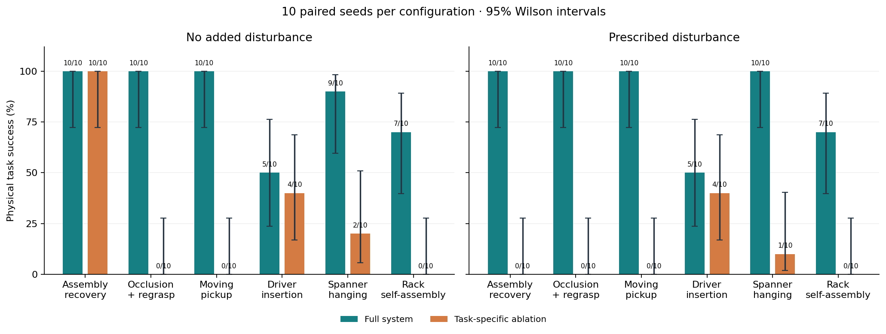
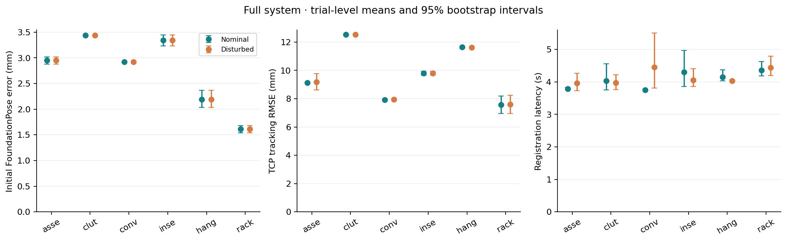

# 六类任务配对评测结果

已完成 **240 次**：六类任务 × 两种方法 × 两种环境 × 每配置 10 次。固定种子 100–109；每个任务/种子的四组初始物理状态 SHA-256 一致性检查已通过。开发种子 0 不计入统计；任务失败全部保留。

控制版本：`9a28b31eb5c675eca6260f865da04829831857aa`；协议创建时间：`2026-11-07T12:51:15.377931+00:00`。本机并行试验数：8，GPU 推理串行共享。版本、权重与源文件校验值见 [protocol.json](protocol.json)，本机设备信息见 [hardware.json](hardware.json)。

[评测方法与复现](../../EVALUATION.md) · [全部 240 条试验 CSV](trials.csv) · [逐观测位姿 CSV](pose_observations.csv) · [完整统计 JSON](summary.json) · [原始试验摘要](trials/) · [录像清单](../../videos/evaluation-v1/README.md)

基础设施修复记录：保留 70 次已完成有效试验，另有 1 次共享纹理 PNG 初始化异常未计分并补跑。修复提交 `e4b9de8d88ab6a29170bdb5ed9c44c49a10b3d40` 只将缓存写入改为原子替换；两张 PNG 修复前后字节哈希一致。另核对 seed 102 修复前后四次初始观测的 RGB、深度和 mask，12 个文件逐字节相同。控制策略、场景几何、验收阈值与种子未改。旧协议、异常日志及修复前后源码哈希均保存在 [infrastructure_incidents/](infrastructure_incidents/)。有效任务失败没有重跑或替换。

## 任务成功率

数字为成功数/试验数、百分比及 **Wilson 95% 置信区间**。10/10 仍只有约 [72.2%, 100%]，0/10 仍有约 [0%, 27.8%]；小样本不能证明某方法永不失败。

| 任务 | 扰动 | 完整系统 | 模块消融 | 消融结果 |
|---|---|---|---|---|
| 装配恢复 | 无 | 10/10 · 100% [72.2, 100.0] | no_recovery | 10/10 · 100% [72.2, 100.0] |
| 装配恢复 | fixture_shift | 10/10 · 100% [72.2, 100.0] | no_recovery | 0/10 · 0% [0.0, 27.8] |
| 遮挡换抓 | 无 | 10/10 · 100% [72.2, 100.0] | yaw_only | 0/10 · 0% [0.0, 27.8] |
| 遮挡换抓 | grasp_impulse | 10/10 · 100% [72.2, 100.0] | yaw_only | 0/10 · 0% [0.0, 27.8] |
| 运动抓取 | 无 | 10/10 · 100% [72.2, 100.0] | no_prediction | 0/10 · 0% [0.0, 27.8] |
| 运动抓取 | grasp_impulse | 10/10 · 100% [72.2, 100.0] | no_prediction | 0/10 · 0% [0.0, 27.8] |
| 螺丝刀插架 | 无 | 5/10 · 50% [23.7, 76.3] | no_wrist | 4/10 · 40% [16.8, 68.7] |
| 螺丝刀插架 | grasp_impulse | 5/10 · 50% [23.7, 76.3] | no_wrist | 4/10 · 40% [16.8, 68.7] |
| 扳手挂放 | 无 | 9/10 · 90% [59.6, 98.2] | no_wrist | 2/10 · 20% [5.7, 51.0] |
| 扳手挂放 | grasp_impulse | 10/10 · 100% [72.2, 100.0] | no_wrist | 1/10 · 10% [1.8, 40.4] |
| 工具架自装配 | 无 | 7/10 · 70% [39.7, 89.2] | no_wrist | 0/10 · 0% [0.0, 27.8] |
| 工具架自装配 | grasp_impulse | 7/10 · 70% [39.7, 89.2] | no_wrist | 0/10 · 0% [0.0, 27.8] |

## 6DOF 位姿预测

取每次试验每个目标的**第一张固定相机图像**；工具架任务先在两个目标间求均值，再以试验为统计单位。下表连续量为试验均值 [bootstrap 95% 区间]。准确率要求本任务所有初始目标均在 5 mm/5° 内，缺失预测计未通过，采用 Wilson 区间。这里衡量初始定位；后续腕部改进在逐观测 CSV 中单列。

| 任务 | 方法 | 扰动 | 原始平移/mm | 原始旋转/° | 原始 ADD/mm | 原始 ADD-S/mm | 原始准确率 |
|---|---|---|---|---|---|---|---|
| 装配恢复 | full | 无 | 2.95 [2.88, 3.02] | 179.21 [179.07, 179.37] | 61.42 [61.42, 61.43] | 3.61 [3.58, 3.64] | 0/10 · 0% [0.0, 27.8] |
| 装配恢复 | full | fixture_shift | 2.95 [2.88, 3.02] | 179.21 [179.07, 179.37] | 61.42 [61.42, 61.43] | 3.61 [3.58, 3.64] | 0/10 · 0% [0.0, 27.8] |
| 装配恢复 | no_recovery | 无 | 2.95 [2.88, 3.02] | 179.21 [179.07, 179.37] | 61.42 [61.42, 61.43] | 3.61 [3.58, 3.64] | 0/10 · 0% [0.0, 27.8] |
| 装配恢复 | no_recovery | fixture_shift | 2.95 [2.88, 3.02] | 179.21 [179.07, 179.37] | 61.42 [61.42, 61.43] | 3.61 [3.58, 3.64] | 0/10 · 0% [0.0, 27.8] |
| 遮挡换抓 | full | 无 | 3.44 [3.44, 3.44] | 1.19 [1.19, 1.19] | 3.50 [3.50, 3.50] | 2.99 [2.99, 2.99] | 10/10 · 100% [72.2, 100.0] |
| 遮挡换抓 | full | grasp_impulse | 3.44 [3.44, 3.44] | 1.19 [1.19, 1.19] | 3.50 [3.50, 3.50] | 2.99 [2.99, 2.99] | 10/10 · 100% [72.2, 100.0] |
| 遮挡换抓 | yaw_only | 无 | 3.44 [3.44, 3.44] | 1.19 [1.19, 1.19] | 3.50 [3.50, 3.50] | 2.99 [2.99, 2.99] | 10/10 · 100% [72.2, 100.0] |
| 遮挡换抓 | yaw_only | grasp_impulse | 3.44 [3.44, 3.44] | 1.19 [1.19, 1.19] | 3.50 [3.50, 3.50] | 2.99 [2.99, 2.99] | 10/10 · 100% [72.2, 100.0] |
| 运动抓取 | full | 无 | 2.92 [2.92, 2.92] | 179.31 [179.31, 179.31] | 61.43 [61.43, 61.43] | 3.62 [3.62, 3.62] | 0/10 · 0% [0.0, 27.8] |
| 运动抓取 | full | grasp_impulse | 2.92 [2.92, 2.92] | 179.31 [179.31, 179.31] | 61.43 [61.43, 61.43] | 3.62 [3.62, 3.62] | 0/10 · 0% [0.0, 27.8] |
| 运动抓取 | no_prediction | 无 | 2.92 [2.92, 2.92] | 179.31 [179.31, 179.31] | 61.43 [61.43, 61.43] | 3.62 [3.62, 3.62] | 0/10 · 0% [0.0, 27.8] |
| 运动抓取 | no_prediction | grasp_impulse | 2.92 [2.92, 2.92] | 179.31 [179.31, 179.31] | 61.43 [61.43, 61.43] | 3.62 [3.62, 3.62] | 0/10 · 0% [0.0, 27.8] |
| 螺丝刀插架 | full | 无 | 3.35 [3.24, 3.45] | 1.76 [1.09, 2.74] | 3.74 [3.66, 3.83] | 2.38 [2.32, 2.43] | 9/10 · 90% [59.6, 98.2] |
| 螺丝刀插架 | full | grasp_impulse | 3.35 [3.24, 3.45] | 1.76 [1.09, 2.74] | 3.74 [3.66, 3.83] | 2.38 [2.32, 2.43] | 9/10 · 90% [59.6, 98.2] |
| 螺丝刀插架 | no_wrist | 无 | 3.35 [3.24, 3.45] | 1.76 [1.09, 2.74] | 3.74 [3.66, 3.83] | 2.38 [2.32, 2.43] | 9/10 · 90% [59.6, 98.2] |
| 螺丝刀插架 | no_wrist | grasp_impulse | 3.35 [3.24, 3.45] | 1.76 [1.09, 2.74] | 3.74 [3.66, 3.83] | 2.38 [2.32, 2.43] | 9/10 · 90% [59.6, 98.2] |
| 扳手挂放 | full | 无 | 2.19 [2.04, 2.36] | 1.02 [0.83, 1.23] | 2.20 [2.05, 2.38] | 1.90 [1.81, 2.00] | 10/10 · 100% [72.2, 100.0] |
| 扳手挂放 | full | grasp_impulse | 2.19 [2.04, 2.36] | 1.02 [0.83, 1.23] | 2.20 [2.05, 2.38] | 1.90 [1.81, 2.00] | 10/10 · 100% [72.2, 100.0] |
| 扳手挂放 | no_wrist | 无 | 2.19 [2.04, 2.36] | 1.02 [0.83, 1.23] | 2.20 [2.05, 2.38] | 1.90 [1.81, 2.00] | 10/10 · 100% [72.2, 100.0] |
| 扳手挂放 | no_wrist | grasp_impulse | 2.19 [2.04, 2.36] | 1.02 [0.83, 1.23] | 2.20 [2.05, 2.38] | 1.90 [1.81, 2.00] | 10/10 · 100% [72.2, 100.0] |
| 工具架自装配 | full | 无 | 1.61 [1.54, 1.68] | 2.58 [2.15, 3.11] | 2.49 [2.40, 2.60] | 2.05 [1.99, 2.11] | 8/10 · 80% [49.0, 94.3] |
| 工具架自装配 | full | grasp_impulse | 1.61 [1.54, 1.68] | 2.58 [2.15, 3.11] | 2.49 [2.40, 2.60] | 2.05 [1.99, 2.11] | 8/10 · 80% [49.0, 94.3] |
| 工具架自装配 | no_wrist | 无 | 1.61 [1.54, 1.68] | 2.58 [2.15, 3.11] | 2.49 [2.40, 2.60] | 2.05 [1.99, 2.11] | 8/10 · 80% [49.0, 94.3] |
| 工具架自装配 | no_wrist | grasp_impulse | 1.61 [1.54, 1.68] | 2.58 [2.15, 3.11] | 2.49 [2.40, 2.60] | 2.05 [1.99, 2.11] | 8/10 · 80% [49.0, 94.3] |

控制器收到的位姿可能经过消融或深度纠偏。下表单列其初始结果，避免把 yaw-only 丢弃朝向后的误差归给原始网络。ADD/ADD-S 采用参考重建表面；有方向要求的装配验收仍采用完整姿态，不能以 ADD-S 通过代替。

| 任务 | 方法 | 扰动 | 控制位姿平移/mm | 控制位姿旋转/° | 控制位姿准确率 |
|---|---|---|---|---|---|
| 装配恢复 | full | 无 | 2.95 [2.88, 3.02] | 179.21 [179.07, 179.37] | 0/10 · 0% [0.0, 27.8] |
| 装配恢复 | full | fixture_shift | 2.95 [2.88, 3.02] | 179.21 [179.07, 179.37] | 0/10 · 0% [0.0, 27.8] |
| 装配恢复 | no_recovery | 无 | 2.95 [2.88, 3.02] | 179.21 [179.07, 179.37] | 0/10 · 0% [0.0, 27.8] |
| 装配恢复 | no_recovery | fixture_shift | 2.95 [2.88, 3.02] | 179.21 [179.07, 179.37] | 0/10 · 0% [0.0, 27.8] |
| 遮挡换抓 | full | 无 | 3.44 [3.44, 3.44] | 1.19 [1.19, 1.19] | 10/10 · 100% [72.2, 100.0] |
| 遮挡换抓 | full | grasp_impulse | 3.44 [3.44, 3.44] | 1.19 [1.19, 1.19] | 10/10 · 100% [72.2, 100.0] |
| 遮挡换抓 | yaw_only | 无 | 3.44 [3.44, 3.44] | 90.00 [90.00, 90.00] | 0/10 · 0% [0.0, 27.8] |
| 遮挡换抓 | yaw_only | grasp_impulse | 3.44 [3.44, 3.44] | 90.00 [90.00, 90.00] | 0/10 · 0% [0.0, 27.8] |
| 运动抓取 | full | 无 | 2.92 [2.92, 2.92] | 179.31 [179.31, 179.31] | 0/10 · 0% [0.0, 27.8] |
| 运动抓取 | full | grasp_impulse | 2.92 [2.92, 2.92] | 179.31 [179.31, 179.31] | 0/10 · 0% [0.0, 27.8] |
| 运动抓取 | no_prediction | 无 | 2.92 [2.92, 2.92] | 179.31 [179.31, 179.31] | 0/10 · 0% [0.0, 27.8] |
| 运动抓取 | no_prediction | grasp_impulse | 2.92 [2.92, 2.92] | 179.31 [179.31, 179.31] | 0/10 · 0% [0.0, 27.8] |
| 螺丝刀插架 | full | 无 | 3.35 [3.24, 3.45] | 1.76 [1.09, 2.74] | 9/10 · 90% [59.6, 98.2] |
| 螺丝刀插架 | full | grasp_impulse | 3.35 [3.24, 3.45] | 1.76 [1.09, 2.74] | 9/10 · 90% [59.6, 98.2] |
| 螺丝刀插架 | no_wrist | 无 | 3.35 [3.24, 3.45] | 1.76 [1.09, 2.74] | 9/10 · 90% [59.6, 98.2] |
| 螺丝刀插架 | no_wrist | grasp_impulse | 3.35 [3.24, 3.45] | 1.76 [1.09, 2.74] | 9/10 · 90% [59.6, 98.2] |
| 扳手挂放 | full | 无 | 2.19 [2.04, 2.36] | 1.02 [0.83, 1.23] | 10/10 · 100% [72.2, 100.0] |
| 扳手挂放 | full | grasp_impulse | 2.19 [2.04, 2.36] | 1.02 [0.83, 1.23] | 10/10 · 100% [72.2, 100.0] |
| 扳手挂放 | no_wrist | 无 | 2.19 [2.04, 2.36] | 1.02 [0.83, 1.23] | 10/10 · 100% [72.2, 100.0] |
| 扳手挂放 | no_wrist | grasp_impulse | 2.19 [2.04, 2.36] | 1.02 [0.83, 1.23] | 10/10 · 100% [72.2, 100.0] |
| 工具架自装配 | full | 无 | 1.61 [1.54, 1.68] | 2.58 [2.15, 3.11] | 8/10 · 80% [49.0, 94.3] |
| 工具架自装配 | full | grasp_impulse | 1.61 [1.54, 1.68] | 2.58 [2.15, 3.11] | 8/10 · 80% [49.0, 94.3] |
| 工具架自装配 | no_wrist | 无 | 1.61 [1.54, 1.68] | 2.58 [2.15, 3.11] | 8/10 · 80% [49.0, 94.3] |
| 工具架自装配 | no_wrist | grasp_impulse | 1.61 [1.54, 1.68] | 2.58 [2.15, 3.11] | 8/10 · 80% [49.0, 94.3] |

### 腕部阶段诊断

初始固定视角可能存在接近 180° 的朝向歧义，不能用较小的 ADD-S 隐藏该问题。下面作为执行过程诊断，取每个目标的第一次腕部观测，先在每次试验内平均，再汇总。仅报告实际到达腕部观测阶段的试验和目标数量；未到达或关闭腕部观测记为 N/A。该条件性诊断不能替代上面的预定初始定位指标，也不用于跨方法显著性检验。

| 任务 | 方法 | 扰动 | 有观测试验/10 | 目标观测数 | 原始平移/mm | 原始旋转/° | 控制平移/mm | 控制旋转/° |
|---|---|---|---|---|---|---|---|---|
| 装配恢复 | full | 无 | 10/10 | 10 | 0.99 [0.85, 1.12] | 0.53 [0.42, 0.65] | 0.99 [0.85, 1.12] | 0.53 [0.42, 0.65] |
| 装配恢复 | full | fixture_shift | 10/10 | 10 | 0.99 [0.85, 1.12] | 0.53 [0.42, 0.65] | 0.99 [0.85, 1.12] | 0.53 [0.42, 0.65] |
| 装配恢复 | no_recovery | 无 | 10/10 | 10 | 0.99 [0.85, 1.12] | 0.53 [0.42, 0.65] | 0.99 [0.85, 1.12] | 0.53 [0.42, 0.65] |
| 装配恢复 | no_recovery | fixture_shift | 10/10 | 10 | 0.99 [0.85, 1.12] | 0.53 [0.42, 0.65] | 0.99 [0.85, 1.12] | 0.53 [0.42, 0.65] |
| 遮挡换抓 | full | 无 | 10/10 | 10 | 1.11 [0.96, 1.26] | 0.82 [0.72, 0.92] | 1.11 [0.96, 1.26] | 0.82 [0.72, 0.92] |
| 遮挡换抓 | full | grasp_impulse | 10/10 | 10 | 1.32 [1.12, 1.50] | 0.91 [0.83, 0.98] | 1.32 [1.12, 1.50] | 0.91 [0.83, 0.98] |
| 遮挡换抓 | yaw_only | 无 | 0/10 | 0 | — | — | — | — |
| 遮挡换抓 | yaw_only | grasp_impulse | 0/10 | 0 | — | — | — | — |
| 运动抓取 | full | 无 | 10/10 | 10 | 0.91 [0.79, 1.06] | 0.63 [0.46, 0.79] | 0.91 [0.79, 1.06] | 0.63 [0.46, 0.79] |
| 运动抓取 | full | grasp_impulse | 10/10 | 10 | 0.70 [0.65, 0.75] | 0.46 [0.42, 0.49] | 0.70 [0.65, 0.75] | 0.46 [0.42, 0.49] |
| 运动抓取 | no_prediction | 无 | 0/10 | 0 | — | — | — | — |
| 运动抓取 | no_prediction | grasp_impulse | 0/10 | 0 | — | — | — | — |
| 螺丝刀插架 | full | 无 | 10/10 | 10 | 1.71 [1.44, 1.97] | 5.29 [2.95, 8.21] | 1.71 [1.44, 1.97] | 5.29 [2.95, 8.21] |
| 螺丝刀插架 | full | grasp_impulse | 10/10 | 10 | 1.51 [1.20, 1.81] | 5.34 [2.99, 8.22] | 1.51 [1.20, 1.81] | 5.34 [2.99, 8.22] |
| 螺丝刀插架 | no_wrist | 无 | 0/10 | 0 | — | — | — | — |
| 螺丝刀插架 | no_wrist | grasp_impulse | 0/10 | 0 | — | — | — | — |
| 扳手挂放 | full | 无 | 10/10 | 10 | 0.50 [0.41, 0.58] | 1.44 [1.34, 1.53] | 0.50 [0.41, 0.58] | 1.44 [1.34, 1.53] |
| 扳手挂放 | full | grasp_impulse | 10/10 | 10 | 0.58 [0.54, 0.63] | 1.46 [1.34, 1.58] | 0.58 [0.54, 0.63] | 1.46 [1.34, 1.58] |
| 扳手挂放 | no_wrist | 无 | 0/10 | 0 | — | — | — | — |
| 扳手挂放 | no_wrist | grasp_impulse | 0/10 | 0 | — | — | — | — |
| 工具架自装配 | full | 无 | 10/10 | 17 | 3.47 [2.30, 4.76] | 3.98 [3.25, 4.90] | 0.79 [0.64, 0.97] | 0.59 [0.41, 0.75] |
| 工具架自装配 | full | grasp_impulse | 10/10 | 17 | 3.41 [2.23, 4.82] | 3.95 [3.22, 4.89] | 0.85 [0.70, 1.04] | 0.62 [0.45, 0.77] |
| 工具架自装配 | no_wrist | 无 | 0/10 | 0 | — | — | — | — |
| 工具架自装配 | no_wrist | grasp_impulse | 0/10 | 0 | — | — | — | — |

## 标定误差

所有试验共用一次已冻结的固定相机标定，不将重复使用记成 240 次独立标定。外参平移误差 **4.245 mm**，旋转误差 **0.122°**；焦距相对误差 fx/fy 为 0.330% / 0.326%，主点偏差为 (-2.113, 1.126) px。

| 棋盘格图集 | 图像数 | 平均重投影 RMSE/px | 最大 RMSE/px |
|---|---|---|---|
| intrinsic_train | 19 | 0.0530 | 0.0783 |
| intrinsic_validation | 4 | 0.0499 | 0.0738 |
| extrinsic_train | 5 | 0.0660 | 0.1033 |
| extrinsic_validation | 5 | 0.0745 | 0.1224 |

腕部手眼使用理想仿真安装，独立标定误差 **N/A**。当前结果不含深度传感器真实噪声和真机手眼误差。

## 执行精度

TCP 跟踪误差比较实际关节 FK 与执行器指令 FK；每个试验先求轨迹 RMSE，再在 10 个试验间求均值和区间。移动终点误差按完成的移动求均值。失败也保留；提前失败、没有完成移动时明确报告缺失样本数。这些是执行跟踪误差，不能替代感知精度或任务成功率。

| 任务 | 方法 | 扰动 | TCP RMSE/mm | TCP RMSE/° | 终点位置/mm | 终点旋转/° |
|---|---|---|---|---|---|---|
| 装配恢复 | full | 无 | 9.13 [9.07, 9.18] | 3.52 [3.50, 3.56] | 0.46 [0.45, 0.46] | 0.04 [0.04, 0.04] |
| 装配恢复 | full | fixture_shift | 9.18 [8.62, 9.77] | 3.01 [2.94, 3.09] | 0.55 [0.48, 0.61] | 0.04 [0.04, 0.04] |
| 装配恢复 | no_recovery | 无 | 9.13 [9.07, 9.18] | 3.52 [3.50, 3.56] | 0.46 [0.45, 0.46] | 0.04 [0.04, 0.04] |
| 装配恢复 | no_recovery | fixture_shift | 10.38 [10.30, 10.47] | 4.11 [4.08, 4.16] | 0.70 [0.68, 0.72] | 0.05 [0.04, 0.05] |
| 遮挡换抓 | full | 无 | 12.55 [12.53, 12.56] | 1.62 [1.62, 1.62] | 0.88 [0.88, 0.89] | 0.03 [0.03, 0.03] |
| 遮挡换抓 | full | grasp_impulse | 12.55 [12.52, 12.57] | 1.62 [1.62, 1.62] | 0.88 [0.88, 0.89] | 0.03 [0.03, 0.03] |
| 遮挡换抓 | yaw_only | 无 | 15.21 [15.21, 15.21] | 0.20 [0.20, 0.20] | 1.39 [1.39, 1.39] | 0.03 [0.03, 0.03] |
| 遮挡换抓 | yaw_only | grasp_impulse | 15.21 [15.21, 15.21] | 0.20 [0.20, 0.20] | 1.39 [1.39, 1.39] | 0.03 [0.03, 0.03] |
| 运动抓取 | full | 无 | 7.93 [7.89, 7.98] | 3.34 [3.30, 3.39] | 0.46 [0.46, 0.46] | 0.04 [0.04, 0.04] |
| 运动抓取 | full | grasp_impulse | 7.95 [7.91, 7.99] | 3.36 [3.32, 3.41] | 0.46 [0.46, 0.46] | 0.04 [0.04, 0.04] |
| 运动抓取 | no_prediction | 无 | 5.34 [5.34, 5.34] | 3.74 [3.74, 3.74] | 0.72 [0.72, 0.72] | 0.07 [0.07, 0.07] |
| 运动抓取 | no_prediction | grasp_impulse | 5.34 [5.34, 5.34] | 3.74 [3.74, 3.74] | 0.72 [0.72, 0.72] | 0.07 [0.07, 0.07] |
| 螺丝刀插架 | full | 无 | 9.79 [9.65, 9.93] | 2.49 [2.42, 2.55] | 0.83 [0.74, 0.92] | 0.08 [0.07, 0.08] |
| 螺丝刀插架 | full | grasp_impulse | 9.80 [9.65, 9.94] | 2.49 [2.42, 2.55] | 0.82 [0.73, 0.92] | 0.08 [0.07, 0.08] |
| 螺丝刀插架 | no_wrist | 无 | 9.54 [9.40, 9.68] | 2.55 [2.48, 2.61] | 0.79 [0.69, 0.89] | 0.08 [0.08, 0.09] |
| 螺丝刀插架 | no_wrist | grasp_impulse | 9.54 [9.40, 9.68] | 2.55 [2.48, 2.61] | 0.78 [0.68, 0.88] | 0.08 [0.07, 0.09] |
| 扳手挂放 | full | 无 | 11.64 [11.57, 11.70] | 1.60 [1.60, 1.61] | 0.90 [0.89, 0.90] | 0.03 [0.03, 0.03] |
| 扳手挂放 | full | grasp_impulse | 11.61 [11.56, 11.66] | 1.60 [1.60, 1.61] | 0.89 [0.89, 0.90] | 0.03 [0.02, 0.03] |
| 扳手挂放 | no_wrist | 无 | 11.88 [11.82, 11.95] | 1.69 [1.69, 1.70] | 0.87 [0.87, 0.88] | 0.02 [0.02, 0.02] |
| 扳手挂放 | no_wrist | grasp_impulse | 11.89 [11.84, 11.94] | 1.69 [1.69, 1.70] | 0.88 [0.87, 0.88] | 0.02 [0.02, 0.02] |
| 工具架自装配 | full | 无 | 7.57 [6.97, 8.19] | 1.87 [1.61, 2.13] | 0.57 [0.51, 0.64] | 0.02 [0.02, 0.02] |
| 工具架自装配 | full | grasp_impulse | 7.59 [6.95, 8.23] | 1.87 [1.62, 2.13] | 0.57 [0.51, 0.64] | 0.02 [0.02, 0.02] |
| 工具架自装配 | no_wrist | 无 | 9.30 [9.26, 9.34] | 2.98 [2.97, 2.99] | 0.46 [0.45, 0.47] | 0.03 [0.03, 0.03] |
| 工具架自装配 | no_wrist | grasp_impulse | 9.30 [9.26, 9.34] | 2.98 [2.97, 2.99] | 0.46 [0.45, 0.47] | 0.03 [0.03, 0.03] |

终态物体误差包含失败时停留的位置，不能按成功样本删选后宣称更高精度。插装深度、轴线角、环孔偏移、接触力、速度和完整终态分别保存在每条试验摘要中。

| 任务 | 方法 | 扰动 | 终态指标 | 指标 1 | 指标 2 |
|---|---|---|---|---|---|
| 装配恢复 | full | 无 | 工件位置/mm；旋转/° | 0.61 [0.52, 0.69] | 0.35 [0.26, 0.45] |
| 装配恢复 | full | fixture_shift | 工件位置/mm；旋转/° | 0.28 [0.23, 0.33] | 0.29 [0.25, 0.33] |
| 装配恢复 | no_recovery | 无 | 工件位置/mm；旋转/° | 0.61 [0.52, 0.69] | 0.35 [0.26, 0.45] |
| 装配恢复 | no_recovery | fixture_shift | 工件位置/mm；旋转/° | 28.47 [28.36, 28.58] | 6.76 [6.66, 6.86] |
| 遮挡换抓 | full | 无 | 工件位置/mm；旋转/° | 2.12 [1.92, 2.35] | 0.39 [0.30, 0.48] |
| 遮挡换抓 | full | grasp_impulse | 工件位置/mm；旋转/° | 2.32 [1.93, 2.62] | 0.38 [0.29, 0.47] |
| 遮挡换抓 | yaw_only | 无 | 工件位置/mm；旋转/° | 342.15 [340.63, 343.76] | 90.04 [90.04, 90.04] |
| 遮挡换抓 | yaw_only | grasp_impulse | 工件位置/mm；旋转/° | 342.15 [340.63, 343.76] | 90.04 [90.04, 90.04] |
| 运动抓取 | full | 无 | 工件位置/mm；旋转/° | 0.62 [0.47, 0.82] | 0.22 [0.18, 0.28] |
| 运动抓取 | full | grasp_impulse | 工件位置/mm；旋转/° | 0.44 [0.33, 0.57] | 0.23 [0.19, 0.28] |
| 运动抓取 | no_prediction | 无 | 工件位置/mm；旋转/° | 364.99 [363.47, 366.62] | 31.17 [31.17, 31.17] |
| 运动抓取 | no_prediction | grasp_impulse | 工件位置/mm；旋转/° | 364.99 [363.47, 366.62] | 31.17 [31.17, 31.17] |
| 螺丝刀插架 | full | 无 | 插入深度/mm；轴线/° | -0.56 [-22.77, 21.64] | 5.01 [3.58, 6.71] |
| 螺丝刀插架 | full | grasp_impulse | 插入深度/mm；轴线/° | -0.53 [-22.73, 21.66] | 5.33 [3.73, 7.13] |
| 螺丝刀插架 | no_wrist | 无 | 插入深度/mm；轴线/° | -8.07 [-30.28, 14.16] | 3.99 [1.87, 6.39] |
| 螺丝刀插架 | no_wrist | grasp_impulse | 插入深度/mm；轴线/° | -8.05 [-30.28, 14.18] | 3.93 [1.78, 6.36] |
| 扳手挂放 | full | 无 | 挂钩支撑力/N；环孔平面/° | 0.98 [0.98, 0.99] | 0.12 [0.04, 0.21] |
| 扳手挂放 | full | grasp_impulse | 挂钩支撑力/N；环孔平面/° | 0.98 [0.98, 0.98] | 0.17 [0.08, 0.26] |
| 扳手挂放 | no_wrist | 无 | 挂钩支撑力/N；环孔平面/° | 0.98 [0.98, 0.99] | 0.10 [0.04, 0.16] |
| 扳手挂放 | no_wrist | grasp_impulse | 挂钩支撑力/N；环孔平面/° | 1.00 [0.98, 1.02] | 0.05 [0.03, 0.09] |
| 工具架自装配 | full | 无 | 支架位置/mm；旋转/° | 1.61 [1.15, 2.03] | 4.65 [3.69, 5.51] |
| 工具架自装配 | full | grasp_impulse | 支架位置/mm；旋转/° | 1.61 [1.15, 2.03] | 4.61 [3.62, 5.50] |
| 工具架自装配 | no_wrist | 无 | 支架位置/mm；旋转/° | 84.22 [84.15, 84.29] | 2.72 [1.83, 3.83] |
| 工具架自装配 | no_wrist | grasp_impulse | 支架位置/mm；旋转/° | 84.22 [84.15, 84.28] | 2.72 [1.83, 3.83] |

## 执行频率与耗时

仿真控制设定 **500 Hz**，执行误差采样 **50 Hz**，录像 **25 fps**。下表为 8 路并行、GPU 串行共享时的实测值；推理时间不含排队，墙钟时间含等待和资源竞争。视觉更新是间歇性的。静态推理和离线规划期间物理暂停；运动感知使用固定 1.0 s 虚拟延迟。因此这些值不能解释为 500 Hz 视觉闭环或真机实时性能。

| 任务 | 方法 | 扰动 | 墙钟/s | 控制步/墙钟 s | 实时因子 | 注册/s | 跟踪/s | 位姿调用/墙钟 s |
|---|---|---|---|---|---|---|---|---|
| 装配恢复 | full | 无 | 79.8 [73.7, 86.7] | 316.3 [289.8, 340.2] | 0.633 [0.580, 0.680] | 3.792 [3.766, 3.828] | — | 0.026 [0.023, 0.027] |
| 装配恢复 | full | fixture_shift | 100.6 [90.8, 110.5] | 344.8 [321.8, 373.4] | 0.690 [0.644, 0.747] | 3.964 [3.728, 4.264] | 0.108 [0.095, 0.124] | 0.031 [0.028, 0.034] |
| 装配恢复 | no_recovery | 无 | 74.7 [67.6, 81.4] | 339.4 [309.1, 375.1] | 0.679 [0.618, 0.750] | 3.806 [3.760, 3.870] | — | 0.027 [0.025, 0.030] |
| 装配恢复 | no_recovery | fixture_shift | 60.8 [56.3, 65.7] | 303.4 [282.0, 323.7] | 0.607 [0.564, 0.647] | 4.018 [3.775, 4.378] | — | 0.033 [0.031, 0.036] |
| 遮挡换抓 | full | 无 | 126.5 [112.8, 142.0] | 301.0 [268.3, 332.0] | 0.602 [0.537, 0.664] | 4.029 [3.755, 4.556] | — | 0.041 [0.036, 0.045] |
| 遮挡换抓 | full | grasp_impulse | 126.6 [117.9, 136.6] | 295.1 [274.3, 313.5] | 0.590 [0.549, 0.627] | 3.968 [3.761, 4.214] | — | 0.040 [0.037, 0.043] |
| 遮挡换抓 | yaw_only | 无 | 48.6 [44.4, 52.8] | 195.9 [179.0, 213.7] | 0.392 [0.358, 0.427] | 3.817 [3.704, 4.026] | — | 0.063 [0.058, 0.069] |
| 遮挡换抓 | yaw_only | grasp_impulse | 49.3 [43.4, 56.5] | 197.1 [173.8, 219.8] | 0.394 [0.348, 0.440] | 3.935 [3.716, 4.235] | — | 0.063 [0.056, 0.071] |
| 运动抓取 | full | 无 | 94.1 [87.7, 102.0] | 294.5 [273.3, 312.9] | 0.589 [0.547, 0.626] | 3.754 [3.725, 3.779] | 0.106 [0.094, 0.119] | 0.043 [0.040, 0.046] |
| 运动抓取 | full | grasp_impulse | 107.1 [96.5, 119.7] | 262.0 [234.8, 286.9] | 0.524 [0.470, 0.574] | 4.455 [3.807, 5.505] | 0.118 [0.102, 0.132] | 0.038 [0.035, 0.042] |
| 运动抓取 | no_prediction | 无 | 38.0 [29.2, 48.5] | 217.5 [173.2, 259.3] | 0.435 [0.346, 0.519] | 5.609 [3.766, 9.209] | 0.143 [0.103, 0.212] | 0.090 [0.072, 0.108] |
| 运动抓取 | no_prediction | grasp_impulse | 41.5 [34.7, 48.9] | 188.0 [156.7, 221.4] | 0.376 [0.313, 0.443] | 3.851 [3.769, 3.941] | 0.100 [0.087, 0.112] | 0.078 [0.065, 0.092] |
| 螺丝刀插架 | full | 无 | 263.1 [238.2, 292.3] | 121.7 [112.6, 130.4] | 0.243 [0.225, 0.261] | 4.305 [3.859, 4.971] | 0.097 [0.087, 0.107] | 0.031 [0.028, 0.034] |
| 螺丝刀插架 | full | grasp_impulse | 273.9 [263.0, 286.7] | 115.4 [109.2, 122.0] | 0.231 [0.218, 0.244] | 4.056 [3.852, 4.408] | 0.101 [0.091, 0.110] | 0.029 [0.028, 0.030] |
| 螺丝刀插架 | no_wrist | 无 | 240.2 [225.3, 256.6] | 125.5 [117.9, 132.2] | 0.251 [0.236, 0.264] | 4.035 [3.875, 4.246] | 0.100 [0.093, 0.106] | 0.025 [0.024, 0.027] |
| 螺丝刀插架 | no_wrist | grasp_impulse | 244.0 [228.5, 259.3] | 123.4 [116.3, 130.3] | 0.247 [0.233, 0.261] | 3.911 [3.870, 3.962] | 0.098 [0.090, 0.108] | 0.025 [0.023, 0.027] |
| 扳手挂放 | full | 无 | 157.3 [144.6, 171.6] | 163.2 [149.4, 176.0] | 0.326 [0.299, 0.352] | 4.148 [4.032, 4.365] | 0.107 [0.094, 0.122] | 0.039 [0.036, 0.042] |
| 扳手挂放 | full | grasp_impulse | 143.4 [133.3, 155.0] | 178.8 [165.3, 190.8] | 0.358 [0.331, 0.382] | 4.037 [4.017, 4.056] | 0.146 [0.103, 0.202] | 0.042 [0.039, 0.045] |
| 扳手挂放 | no_wrist | 无 | 138.6 [128.3, 148.9] | 175.6 [162.1, 189.3] | 0.351 [0.324, 0.379] | 4.252 [4.052, 4.536] | — | 0.037 [0.034, 0.039] |
| 扳手挂放 | no_wrist | grasp_impulse | 139.9 [127.6, 153.2] | 174.8 [159.5, 189.8] | 0.350 [0.319, 0.380] | 4.092 [4.029, 4.191] | — | 0.037 [0.033, 0.040] |
| 工具架自装配 | full | 无 | 409.1 [351.5, 462.2] | 169.7 [146.5, 190.7] | 0.339 [0.293, 0.381] | 4.359 [4.188, 4.625] | 0.115 [0.103, 0.130] | 0.019 [0.017, 0.020] |
| 工具架自装配 | full | grasp_impulse | 394.2 [335.3, 450.5] | 177.5 [151.2, 203.9] | 0.355 [0.302, 0.408] | 4.439 [4.193, 4.790] | 0.107 [0.094, 0.121] | 0.019 [0.018, 0.021] |
| 工具架自装配 | no_wrist | 无 | 144.2 [135.7, 152.5] | 123.8 [116.6, 131.3] | 0.248 [0.233, 0.263] | 4.541 [4.224, 5.089] | — | 0.014 [0.013, 0.015] |
| 工具架自装配 | no_wrist | grasp_impulse | 152.0 [140.0, 165.1] | 118.4 [108.9, 127.5] | 0.237 [0.218, 0.255] | 4.284 [4.181, 4.413] | — | 0.013 [0.012, 0.014] |

局部深度配准在 CPU 执行，耗时不包含在上面的网络注册/跟踪中，但计入任务墙钟时间。每次试验先对实际配准调用求均值，再跨试验汇总；未调用的配置为 N/A。

| 任务 | 方法 | 扰动 | 深度配准单次耗时/s |
|---|---|---|---|
| 工具架自装配 | full | 无 | 6.259 [4.988, 7.537] |
| 工具架自装配 | full | grasp_impulse | 5.897 [4.727, 7.129] |

## 配对比较与动态扰动

配对胜/负指同一种子上仅 A 成功 / 仅 B 成功。成功率差的保守 95% 区间由 Bonferroni 调整的精确二项边际区间相减；检验采用配对精确 McNemar。方法比较与扰动比较分别作为一个检验族进行 Holm 校正。区间较宽时保留不确定性，不以个别失败录像代替统计证据。

| 任务 | 基线 B | 环境 | 完整系统 − B/百分点 | 胜/负 | 原始 p | Holm p |
|---|---|---|---|---|---|---|
| 装配恢复 | no_recovery | none | +0 [-35.5, 35.5] | 0/0 | 1.0000 | 1.0000 |
| 装配恢复 | no_recovery | fixture_shift | +100 [29.0, 100.0] | 10/0 | 0.0020 | 0.0234 |
| 遮挡换抓 | yaw_only | none | +100 [29.0, 100.0] | 10/0 | 0.0020 | 0.0234 |
| 遮挡换抓 | yaw_only | grasp_impulse | +100 [29.0, 100.0] | 10/0 | 0.0020 | 0.0234 |
| 运动抓取 | no_prediction | none | +100 [29.0, 100.0] | 10/0 | 0.0020 | 0.0234 |
| 运动抓取 | no_prediction | grasp_impulse | +100 [29.0, 100.0] | 10/0 | 0.0020 | 0.0234 |
| 螺丝刀插架 | no_wrist | none | +10 [-61.3, 74.2] | 1/0 | 1.0000 | 1.0000 |
| 螺丝刀插架 | no_wrist | grasp_impulse | +10 [-61.3, 74.2] | 1/0 | 1.0000 | 1.0000 |
| 扳手挂放 | no_wrist | none | +70 [-9.0, 98.1] | 7/0 | 0.0156 | 0.0938 |
| 扳手挂放 | no_wrist | grasp_impulse | +90 [15.5, 99.9] | 9/0 | 0.0039 | 0.0273 |
| 工具架自装配 | no_wrist | none | +70 [-4.6, 94.8] | 7/0 | 0.0156 | 0.0938 |
| 工具架自装配 | no_wrist | grasp_impulse | +70 [-4.6, 94.8] | 7/0 | 0.0156 | 0.0938 |

| 任务 | 方法 | 扰动 A | 扰动 − 无扰动/百分点 | 胜/负 | 原始 p | Holm p |
|---|---|---|---|---|---|---|
| 装配恢复 | full | fixture_shift | +0 [-35.5, 35.5] | 0/0 | 1.0000 | 1.0000 |
| 装配恢复 | no_recovery | fixture_shift | -100 [-100.0, -29.0] | 0/10 | 0.0020 | 0.0234 |
| 遮挡换抓 | full | grasp_impulse | +0 [-35.5, 35.5] | 0/0 | 1.0000 | 1.0000 |
| 遮挡换抓 | yaw_only | grasp_impulse | +0 [-35.5, 35.5] | 0/0 | 1.0000 | 1.0000 |
| 运动抓取 | full | grasp_impulse | +0 [-35.5, 35.5] | 0/0 | 1.0000 | 1.0000 |
| 运动抓取 | no_prediction | grasp_impulse | +0 [-35.5, 35.5] | 0/0 | 1.0000 | 1.0000 |
| 螺丝刀插架 | full | grasp_impulse | +0 [-68.3, 68.3] | 0/0 | 1.0000 | 1.0000 |
| 螺丝刀插架 | no_wrist | grasp_impulse | +0 [-67.3, 67.3] | 0/0 | 1.0000 | 1.0000 |
| 扳手挂放 | full | grasp_impulse | +10 [-35.4, 49.1] | 1/0 | 1.0000 | 1.0000 |
| 扳手挂放 | no_wrist | grasp_impulse | -10 [-59.8, 47.3] | 0/1 | 1.0000 | 1.0000 |
| 工具架自装配 | full | grasp_impulse | +0 [-64.0, 64.0] | 0/0 | 1.0000 | 1.0000 |
| 工具架自装配 | no_wrist | grasp_impulse | +0 [-35.5, 35.5] | 0/0 | 1.0000 | 1.0000 |

扰动仅在规定阶段触发，提前失败可能未受到脉冲。下表明确记录送达数量；未送达的失败仍在任务成功率分母内。

| 任务 | 方法 | 扰动 | 实际送达/10 |
|---|---|---|---|
| 装配恢复 | full | fixture_shift | 10/10 |
| 装配恢复 | no_recovery | fixture_shift | 10/10 |
| 遮挡换抓 | full | grasp_impulse | 10/10 |
| 遮挡换抓 | yaw_only | grasp_impulse | 0/10 |
| 运动抓取 | full | grasp_impulse | 10/10 |
| 运动抓取 | no_prediction | grasp_impulse | 0/10 |
| 螺丝刀插架 | full | grasp_impulse | 10/10 |
| 螺丝刀插架 | no_wrist | grasp_impulse | 10/10 |
| 扳手挂放 | full | grasp_impulse | 10/10 |
| 扳手挂放 | no_wrist | grasp_impulse | 10/10 |
| 工具架自装配 | full | grasp_impulse | 10/10 |
| 工具架自装配 | no_wrist | grasp_impulse | 10/10 |

## 失败案例与可追溯性

预先规定选取规则：按任务顺序，先保存两个完整系统失败任务，再保存四个消融失败任务；每个任务/方法优先无扰动，再按最低失败种子选择。录像直接回放该次保存的物理轨迹，不重新运行、不替换失败。其余失败全部保留摘要、日志与轨迹校验值。

| 试验 | 停止阶段 | 失败信息摘要与原始记录 |
|---|---|---|
| [insert__full__none__100](../../videos/evaluation-v1/insert__full__none__100.mp4) | RETRACT_DRIVER_SETTLE | MotionFailure: Driver insertion contact guard stopped the task · [完整记录](trials/insert__full__none__100.json) |
| [hang__full__none__105](../../videos/evaluation-v1/hang__full__none__105.mp4) | CHECK_HANG_STABILITY | MotionFailure: Hanging failed · [完整记录](trials/hang__full__none__105.json) |
| [assembly__no_recovery__fixture_shift__100](../../videos/evaluation-v1/assembly__no_recovery__fixture_shift__100.mp4) | INSERT_1 | RuntimeError: Insertion contact guard triggered; recovery ablation stops here · [完整记录](trials/assembly__no_recovery__fixture_shift__100.json) |
| [clutter__yaw_only__none__100](../../videos/evaluation-v1/clutter__yaw_only__none__100.mp4) | SETTLE | MotionFailure: No collision-free offline IK at [0.4475545249593719, -0.045714633966056586, 0.43015354636829745] · [完整记录](trials/clutter__yaw_only__none__100.json) |
| [conveyor__no_prediction__none__100](../../videos/evaluation-v1/conveyor__no_prediction__none__100.mp4) | CLOSE_GRIPPER | MotionFailure: Unexpected robot contact at CLOSE_GRIPPER: [{'geom1': 'geom_42', 'geom2': 'target_cube_geom', 'body1': 'gripper_right_follower', 'body2': 'target_cube', 'penetration_m': 0.000512754127204448}] · [完整记录](trials/conveyor__no_prediction__none__100.json) |
| [insert__no_wrist__none__100](../../videos/evaluation-v1/insert__no_wrist__none__100.mp4) | RETRACT_DRIVER_SETTLE | MotionFailure: Driver insertion contact guard stopped the task · [完整记录](trials/insert__no_wrist__none__100.json) |

| 任务 | 方法 | 失败停止阶段 | 次数（两种环境合计） |
|---|---|---|---|
| 装配恢复 | no_recovery | INSERT_1 | 10 |
| 遮挡换抓 | yaw_only | SETTLE | 20 |
| 运动抓取 | no_prediction | CLOSE_GRIPPER | 20 |
| 扳手挂放 | full | CHECK_HANG_STABILITY | 1 |
| 扳手挂放 | no_wrist | CHECK_HANG_STABILITY | 17 |
| 螺丝刀插架 | full | RETRACT_DRIVER_SETTLE | 10 |
| 螺丝刀插架 | no_wrist | RETRACT_DRIVER_SETTLE | 12 |
| 工具架自装配 | full | PICK_APPROACH_SETTLE | 6 |
| 工具架自装配 | no_wrist | RETRACT_FRAME_SETTLE | 20 |

## 适用范围

这是固定仿真场景的首轮模块消融，不能宣称优于所有外部算法。每配置只有 10 次；随机化覆盖有限的拾取位置、夹具位置及部分装配初始角度，没有验证任意工具、任意遮挡、光照、背景或真实传感器噪声。Model-free 指 24 张标定参考 RGB-D 经官方 Neural Object Field 重建，不是无需参考图的零样本方法。夹具几何和标记安装关系已知。仿真几何、接触和速度真值用于阶段验收与安全停机，可以结束失败试验，但不向网络或运动目标生成反馈真值位姿。腕部手眼与参考扫描为理想合成标定；真机效果与对应的验收传感器需要另行实验。
