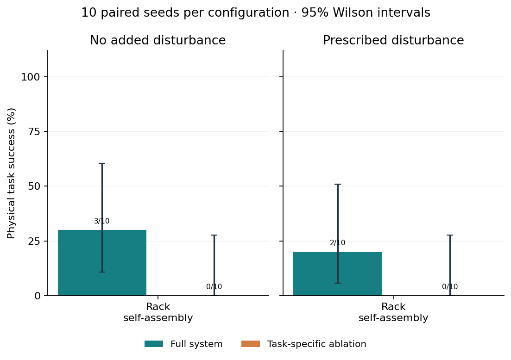
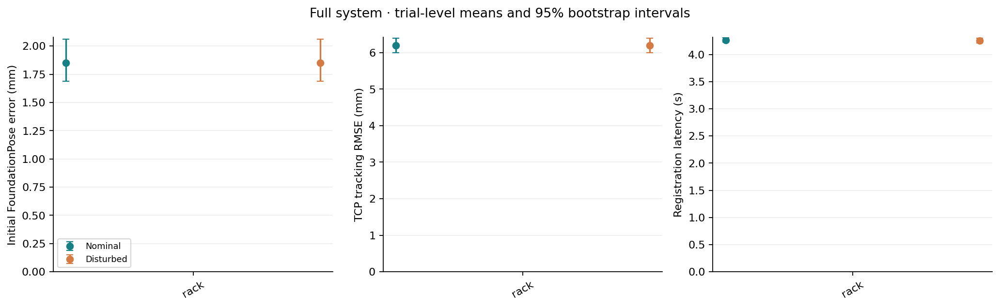

# 工具架动作修订后配对评测

已完成 **40 次**：1 类任务 × 两种方法 × 两种环境 × 每配置 10 次。固定种子 [200, 201, 202, 203, 204, 205, 206, 207, 208, 209]；每个任务/种子的四组初始物理状态 SHA-256 一致性检查已通过。开发运行不计入统计；任务失败全部保留。

控制版本：`f2a26ba5d1f1096bd6936d1d44b689e47f64efa4`；协议创建时间：`2026-11-07T14:56:33.878792+00:00`。本机并行试验数：8，GPU 推理串行共享。版本、权重与源文件校验值见 [protocol.json](protocol.json)，本机设备信息见 [hardware.json](hardware.json)。

[评测方法与复现](../../EVALUATION.md) · [全部 40 条试验 CSV](trials.csv) · [逐观测位姿 CSV](pose_observations.csv) · [完整统计 JSON](summary.json) · [原始试验摘要](trials/) · [录像清单](../../videos/rack-revision-v2/README.md)

## 任务成功率

数字为成功数/试验数、百分比及 **Wilson 95% 置信区间**。10/10 仍只有约 [72.2%, 100%]，0/10 仍有约 [0%, 27.8%]；小样本不能证明某方法永不失败。

| 任务 | 扰动 | 完整系统 | 模块消融 | 消融结果 |
|---|---|---|---|---|
| 工具架自装配 | 无 | 3/10 · 30% [10.8, 60.3] | no_wrist | 0/10 · 0% [0.0, 27.8] |
| 工具架自装配 | grasp_impulse | 2/10 · 20% [5.7, 51.0] | no_wrist | 0/10 · 0% [0.0, 27.8] |

## 6DOF 位姿预测

取每次试验每个目标的**第一张固定相机图像**；工具架任务先在两个目标间求均值，再以试验为统计单位。下表连续量为试验均值 [bootstrap 95% 区间]。准确率要求本任务所有初始目标均在 5 mm/5° 内，缺失预测计未通过，采用 Wilson 区间。这里衡量初始定位；后续腕部改进在逐观测 CSV 中单列。

| 任务 | 方法 | 扰动 | 原始平移/mm | 原始旋转/° | 原始 ADD/mm | 原始 ADD-S/mm | 原始准确率 |
|---|---|---|---|---|---|---|---|
| 工具架自装配 | full | 无 | 1.85 [1.69, 2.06] | 2.90 [2.37, 3.45] | 2.76 [2.64, 2.92] | 2.21 [2.13, 2.30] | 7/10 · 70% [39.7, 89.2] |
| 工具架自装配 | full | grasp_impulse | 1.85 [1.69, 2.06] | 2.90 [2.37, 3.45] | 2.76 [2.64, 2.92] | 2.21 [2.13, 2.30] | 7/10 · 70% [39.7, 89.2] |
| 工具架自装配 | no_wrist | 无 | 1.85 [1.69, 2.06] | 2.90 [2.37, 3.45] | 2.76 [2.64, 2.92] | 2.21 [2.13, 2.30] | 7/10 · 70% [39.7, 89.2] |
| 工具架自装配 | no_wrist | grasp_impulse | 1.85 [1.69, 2.06] | 2.90 [2.37, 3.45] | 2.76 [2.64, 2.92] | 2.21 [2.13, 2.30] | 7/10 · 70% [39.7, 89.2] |

控制器收到的位姿可能经过消融或深度纠偏。下表单列其初始结果，避免把 yaw-only 丢弃朝向后的误差归给原始网络。ADD/ADD-S 采用参考重建表面；有方向要求的装配验收仍采用完整姿态，不能以 ADD-S 通过代替。

| 任务 | 方法 | 扰动 | 控制位姿平移/mm | 控制位姿旋转/° | 控制位姿准确率 |
|---|---|---|---|---|---|
| 工具架自装配 | full | 无 | 1.85 [1.69, 2.06] | 2.90 [2.37, 3.45] | 7/10 · 70% [39.7, 89.2] |
| 工具架自装配 | full | grasp_impulse | 1.85 [1.69, 2.06] | 2.90 [2.37, 3.45] | 7/10 · 70% [39.7, 89.2] |
| 工具架自装配 | no_wrist | 无 | 1.85 [1.69, 2.06] | 2.90 [2.37, 3.45] | 7/10 · 70% [39.7, 89.2] |
| 工具架自装配 | no_wrist | grasp_impulse | 1.85 [1.69, 2.06] | 2.90 [2.37, 3.45] | 7/10 · 70% [39.7, 89.2] |

### 腕部阶段诊断

初始固定视角可能存在接近 180° 的朝向歧义，不能用较小的 ADD-S 隐藏该问题。下面作为执行过程诊断，取每个目标的第一次腕部观测，先在每次试验内平均，再汇总。仅报告实际到达腕部观测阶段的试验和目标数量；未到达或关闭腕部观测记为 N/A。该条件性诊断不能替代上面的预定初始定位指标，也不用于跨方法显著性检验。

| 任务 | 方法 | 扰动 | 有观测试验/10 | 目标观测数 | 原始平移/mm | 原始旋转/° | 控制平移/mm | 控制旋转/° |
|---|---|---|---|---|---|---|---|---|
| 工具架自装配 | full | 无 | 10/10 | 14 | 5.06 [4.00, 6.06] | 4.59 [3.60, 5.53] | 1.71 [1.00, 2.76] | 0.34 [0.23, 0.45] |
| 工具架自装配 | full | grasp_impulse | 10/10 | 14 | 5.23 [4.16, 6.13] | 4.63 [3.57, 5.65] | 1.76 [1.08, 2.73] | 0.36 [0.24, 0.50] |
| 工具架自装配 | no_wrist | 无 | 0/10 | 0 | — | — | — | — |
| 工具架自装配 | no_wrist | grasp_impulse | 0/10 | 0 | — | — | — | — |

## 标定误差

所有试验共用一次已冻结的固定相机标定，不将重复使用记成多次独立标定。外参平移误差 **4.245 mm**，旋转误差 **0.122°**；焦距相对误差 fx/fy 为 0.330% / 0.326%，主点偏差为 (-2.113, 1.126) px。

| 棋盘格图集 | 图像数 | 平均重投影 RMSE/px | 最大 RMSE/px |
|---|---|---|---|
| intrinsic_train | 19 | 0.0530 | 0.0783 |
| intrinsic_validation | 4 | 0.0499 | 0.0738 |
| extrinsic_train | 5 | 0.0660 | 0.1033 |
| extrinsic_validation | 5 | 0.0745 | 0.1224 |

腕部手眼使用理想仿真安装，独立标定误差 **N/A**。当前结果不含深度传感器真实噪声和真机手眼误差。

## 执行精度

TCP 跟踪误差比较实际关节 FK 与计划关节参考 FK；加入速度前馈时，执行器输入与计划参考分别记录。每个试验先求轨迹 RMSE，再在试验间求均值和区间。移动终点误差按完成的移动求均值。失败也保留；提前失败、没有完成移动时明确报告缺失样本数。这些是执行跟踪误差，不能替代感知精度或任务成功率。

| 任务 | 方法 | 扰动 | TCP RMSE/mm | TCP RMSE/° | 终点位置/mm | 终点旋转/° |
|---|---|---|---|---|---|---|
| 工具架自装配 | full | 无 | 6.19 [5.99, 6.40] | 1.58 [1.44, 1.72] | 0.52 [0.46, 0.58] | 0.02 [0.02, 0.02] |
| 工具架自装配 | full | grasp_impulse | 6.19 [5.99, 6.40] | 1.58 [1.44, 1.72] | 0.52 [0.46, 0.58] | 0.02 [0.02, 0.02] |
| 工具架自装配 | no_wrist | 无 | 5.55 [5.54, 5.56] | 2.34 [2.33, 2.34] | 0.45 [0.44, 0.46] | 0.03 [0.02, 0.03] |
| 工具架自装配 | no_wrist | grasp_impulse | 5.55 [5.54, 5.56] | 2.34 [2.33, 2.34] | 0.45 [0.44, 0.46] | 0.03 [0.02, 0.03] |

终态物体误差包含失败时停留的位置，不能按成功样本删选后宣称更高精度。插装深度、轴线角、环孔偏移、接触力、速度和完整终态分别保存在每条试验摘要中。

| 任务 | 方法 | 扰动 | 终态指标 | 指标 1 | 指标 2 |
|---|---|---|---|---|---|
| 工具架自装配 | full | 无 | 支架位置/mm；旋转/° | 1.14 [0.69, 1.60] | 3.34 [2.22, 4.46] |
| 工具架自装配 | full | grasp_impulse | 支架位置/mm；旋转/° | 1.14 [0.69, 1.59] | 3.31 [2.18, 4.44] |
| 工具架自装配 | no_wrist | 无 | 支架位置/mm；旋转/° | 84.29 [84.24, 84.34] | 3.59 [2.57, 4.63] |
| 工具架自装配 | no_wrist | grasp_impulse | 支架位置/mm；旋转/° | 84.29 [84.24, 84.34] | 3.59 [2.58, 4.63] |

## 执行频率与耗时

仿真控制设定 **500 Hz**，执行误差采样 **50 Hz**，录像 **25 fps**。下表为 8 路并行、GPU 串行共享时的实测值；推理时间不含排队，墙钟时间含等待和资源竞争。视觉更新是间歇性的。静态推理和离线规划期间物理暂停；运动感知使用固定 1.0 s 虚拟延迟。因此这些值不能解释为 500 Hz 视觉闭环或真机实时性能。

| 任务 | 方法 | 扰动 | 墙钟/s | 控制步/墙钟 s | 实时因子 | 注册/s | 跟踪/s | 位姿调用/墙钟 s |
|---|---|---|---|---|---|---|---|---|
| 工具架自装配 | full | 无 | 326.9 [295.7, 359.3] | 123.8 [110.7, 138.3] | 0.248 [0.221, 0.277] | 4.266 [4.225, 4.312] | 0.106 [0.100, 0.112] | 0.021 [0.020, 0.022] |
| 工具架自装配 | full | grasp_impulse | 320.8 [283.9, 357.7] | 126.5 [113.7, 138.9] | 0.253 [0.227, 0.278] | 4.254 [4.210, 4.301] | 0.108 [0.102, 0.113] | 0.021 [0.020, 0.023] |
| 工具架自装配 | no_wrist | 无 | 169.3 [154.1, 187.6] | 106.6 [97.0, 115.7] | 0.213 [0.194, 0.231] | 4.259 [4.196, 4.326] | — | 0.012 [0.011, 0.013] |
| 工具架自装配 | no_wrist | grasp_impulse | 148.5 [138.3, 158.1] | 120.3 [112.3, 129.7] | 0.241 [0.225, 0.259] | 4.227 [4.168, 4.299] | — | 0.014 [0.013, 0.015] |

局部深度配准在 CPU 执行，耗时不包含在上面的网络注册/跟踪中，但计入任务墙钟时间。每次试验先对实际配准调用求均值，再跨试验汇总；未调用的配置为 N/A。

| 任务 | 方法 | 扰动 | 深度配准单次耗时/s |
|---|---|---|---|
| 工具架自装配 | full | 无 | 6.784 [5.218, 8.208] |
| 工具架自装配 | full | grasp_impulse | 6.263 [4.919, 7.645] |

## 配对比较与动态扰动

配对胜/负指同一种子上仅 A 成功 / 仅 B 成功。成功率差的保守 95% 区间由 Bonferroni 调整的精确二项边际区间相减；检验采用配对精确 McNemar。方法比较与扰动比较分别作为一个检验族进行 Holm 校正。区间较宽时保留不确定性，不以个别失败录像代替统计证据。

| 任务 | 基线 B | 环境 | 完整系统 − B/百分点 | 胜/负 | 原始 p | Holm p |
|---|---|---|---|---|---|---|
| 工具架自装配 | no_wrist | none | +30 [-30.3, 69.2] | 3/0 | 0.2500 | 0.5000 |
| 工具架自装配 | no_wrist | grasp_impulse | +20 [-33.7, 59.9] | 2/0 | 0.5000 | 0.5000 |

| 任务 | 方法 | 扰动 A | 扰动 − 无扰动/百分点 | 胜/负 | 原始 p | Holm p |
|---|---|---|---|---|---|---|
| 工具架自装配 | full | grasp_impulse | -10 [-67.4, 54.7] | 0/1 | 1.0000 | 1.0000 |
| 工具架自装配 | no_wrist | grasp_impulse | +0 [-35.5, 35.5] | 0/0 | 1.0000 | 1.0000 |

扰动仅在规定阶段触发，提前失败可能未受到脉冲。下表明确记录送达数量；未送达的失败仍在任务成功率分母内。

| 任务 | 方法 | 扰动 | 实际送达/10 |
|---|---|---|---|
| 工具架自装配 | full | grasp_impulse | 10/10 |
| 工具架自装配 | no_wrist | grasp_impulse | 10/10 |

## 失败案例与可追溯性

预先规定选取规则：按任务顺序，最多保存两个完整系统失败任务及四个消融失败任务；每个任务/方法优先无扰动，再按最低失败种子选择。录像直接回放该次保存的物理轨迹，不重新运行、不替换失败。其余失败全部保留摘要、日志与轨迹校验值。

| 试验 | 停止阶段 | 失败信息摘要与原始记录 |
|---|---|---|
| [rack__full__none__200](../../videos/rack-revision-v2/rack__full__none__200.mp4) | PICK_APPROACH_SETTLE | MotionFailure: No collision-free offline IK at [0.5617739861825737, -0.024762743050652482, 0.4152491346158081] · [完整记录](trials/rack__full__none__200.json) |
| [rack__no_wrist__none__200](../../videos/rack-revision-v2/rack__no_wrist__none__200.mp4) | RETRACT_FRAME_SETTLE | MotionFailure: Rack frame insertion contact guard triggered · [完整记录](trials/rack__no_wrist__none__200.json) |

| 任务 | 方法 | 失败停止阶段 | 次数（两种环境合计） |
|---|---|---|---|
| 工具架自装配 | full | CHECK_HANG_STABILITY | 3 |
| 工具架自装配 | full | PICK_APPROACH_SETTLE | 12 |
| 工具架自装配 | no_wrist | RETRACT_FRAME_SETTLE | 20 |

## 适用范围

这是固定仿真场景的模块消融，不能宣称优于所有外部算法。每配置只有 10 次；随机化覆盖有限的拾取位置、夹具位置及部分装配初始角度，没有验证任意工具、任意遮挡、光照、背景或真实传感器噪声。Model-free 指 24 张标定参考 RGB-D 经官方 Neural Object Field 重建，不是无需参考图的零样本方法。夹具几何和标记安装关系已知。仿真几何、接触和速度真值用于阶段验收与安全停机，可以结束失败试验，但不向网络或运动目标生成反馈真值位姿。腕部手眼与参考扫描为理想合成标定；真机效果与对应的验收传感器需要另行实验。
