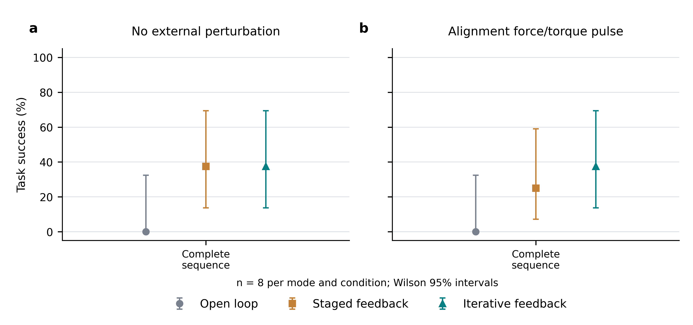
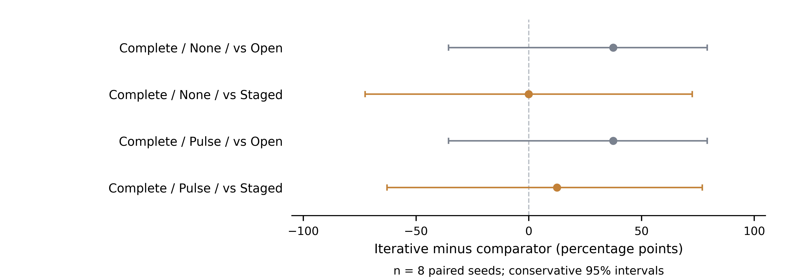

# Estimated-wrist visual feedback: 48 paired trials

Three feedback modes × two disturbance conditions × eight seeds = 48 complete-sequence attempts. The seeds 400–407 were used previously; seed400 also supported integration checks. This is a paired replication with estimated camera calibration, not a new unseen holdout. Historical ideal-wrist results and the two integration demonstrations are not pooled into this study.

Frozen control parent: `d197f70fe6055b01f805790df778f89800bbad66`. Protocol timestamp: `2026-11-09T09:10:44.538787+00:00`. 8 CPU simulations share serial GPU inference. The protocol records exact control/calibration hashes; failures remain in the denominator.

[Protocol](protocol.json) · [Hardware](hardware.json) · [All trial metrics](trials.csv) · [Pose observations](pose_observations.csv) · [Feedback observations](visual_feedback_observations.csv) · [All raw summaries](trials/) · [Technical selection](../../LITERATURE_AND_SELECTION.md)

## Manipulation success

| Mode | Disturbance | Success / attempts | Rate | Wilson 95% CI | Disturbance delivered |
|---|---|---|---|---|---|
| open_loop | none | 0/8 | 0.0% | 0.0%–32.4% | 0 |
| open_loop | alignment_impulse | 0/8 | 0.0% | 0.0%–32.4% | 3 |
| staged | none | 3/8 | 37.5% | 13.7%–69.4% | 0 |
| staged | alignment_impulse | 2/8 | 25.0% | 7.1%–59.1% | 3 |
| iterative | none | 3/8 | 37.5% | 13.7%–69.4% | 0 |
| iterative | alignment_impulse | 3/8 | 37.5% | 13.7%–69.4% | 3 |

Success requires the final physical acceptance of all four objects after release. Earlier-stage completion does not replace final whole-sequence acceptance. Trials failing before a scheduled disturbance still count; delivery is reported separately.

## Paired comparisons and disturbance robustness

### Feedback modes

| Comparison / context | Pairs | Success difference A−B | Conservative 95% CI | A-only / B-only | Exact p | Holm p |
|---|---|---|---|---|---|---|
| iterative vs open_loop / none | 8 | 37.5 pp | -35.6 to 79.1 pp | 3 / 0 | 0.2500 | 1.0000 |
| iterative vs staged / none | 8 | 0.0 pp | -72.6 to 72.6 pp | 0 / 0 | 1.0000 | 1.0000 |
| iterative vs open_loop / alignment_impulse | 8 | 37.5 pp | -35.6 to 79.1 pp | 3 / 0 | 0.2500 | 1.0000 |
| iterative vs staged / alignment_impulse | 8 | 12.5 pp | -62.8 to 76.9 pp | 1 / 0 | 1.0000 | 1.0000 |

### Disturbance versus none

| Comparison / context | Pairs | Success difference A−B | Conservative 95% CI | A-only / B-only | Exact p | Holm p |
|---|---|---|---|---|---|---|
| alignment_impulse vs none / open_loop | 8 | 0.0 pp | -42.2 to 42.2 pp | 0 / 0 | 1.0000 | 1.0000 |
| alignment_impulse vs none / staged | 8 | -12.5 pp | -76.9 to 62.8 pp | 0 / 1 | 1.0000 | 1.0000 |
| alignment_impulse vs none / iterative | 8 | 0.0 pp | -72.6 to 72.6 pp | 0 / 0 | 1.0000 | 1.0000 |

None of the feedback-method comparisons passes the Holm-adjusted 0.05 threshold. These data do not establish superiority or equivalence. Report observed differences with their wide intervals.

## Stage acceptance and reachability

| Mode | Disturbance | Object/stage | Entered | Accepted / all attempts | Wilson 95% CI |
|---|---|---|---|---|---|
| open_loop | none | hammer | 8 | 7/8 | 52.9%–97.8% |
| open_loop | none | screwdriver | 7 | 0/8 | 0.0%–32.4% |
| open_loop | none | rack_frame | 0 | 0/8 | 0.0%–32.4% |
| open_loop | none | spanner | 0 | 0/8 | 0.0%–32.4% |
| open_loop | alignment_impulse | hammer | 8 | 7/8 | 52.9%–97.8% |
| open_loop | alignment_impulse | screwdriver | 7 | 0/8 | 0.0%–32.4% |
| open_loop | alignment_impulse | rack_frame | 0 | 0/8 | 0.0%–32.4% |
| open_loop | alignment_impulse | spanner | 0 | 0/8 | 0.0%–32.4% |
| staged | none | hammer | 8 | 7/8 | 52.9%–97.8% |
| staged | none | screwdriver | 7 | 3/8 | 13.7%–69.4% |
| staged | none | rack_frame | 3 | 3/8 | 13.7%–69.4% |
| staged | none | spanner | 3 | 3/8 | 13.7%–69.4% |
| staged | alignment_impulse | hammer | 8 | 7/8 | 52.9%–97.8% |
| staged | alignment_impulse | screwdriver | 7 | 3/8 | 13.7%–69.4% |
| staged | alignment_impulse | rack_frame | 3 | 3/8 | 13.7%–69.4% |
| staged | alignment_impulse | spanner | 3 | 2/8 | 7.1%–59.1% |
| iterative | none | hammer | 8 | 7/8 | 52.9%–97.8% |
| iterative | none | screwdriver | 7 | 3/8 | 13.7%–69.4% |
| iterative | none | rack_frame | 3 | 3/8 | 13.7%–69.4% |
| iterative | none | spanner | 3 | 3/8 | 13.7%–69.4% |
| iterative | alignment_impulse | hammer | 8 | 7/8 | 52.9%–97.8% |
| iterative | alignment_impulse | screwdriver | 7 | 3/8 | 13.7%–69.4% |
| iterative | alignment_impulse | rack_frame | 3 | 3/8 | 13.7%–69.4% |
| iterative | alignment_impulse | spanner | 3 | 3/8 | 13.7%–69.4% |

These are stage outcomes within the same complete sequences, not independent task experiments.

## 6D pose estimation

| Mode | Disturbance | Translation / mm | Rotation / deg | ADD / mm | ADD-S / mm |
|---|---|---|---|---|---|
| open_loop | none | 2.60 [2.47, 2.74], n=8 | 1.44 [1.17, 1.77], n=8 | 3.17 [3.07, 3.28], n=8 | 2.29 [2.24, 2.34], n=8 |
| open_loop | alignment_impulse | 2.60 [2.47, 2.74], n=8 | 1.44 [1.17, 1.77], n=8 | 3.17 [3.07, 3.28], n=8 | 2.29 [2.24, 2.34], n=8 |
| staged | none | 2.60 [2.47, 2.74], n=8 | 1.44 [1.17, 1.77], n=8 | 3.17 [3.07, 3.28], n=8 | 2.29 [2.24, 2.34], n=8 |
| staged | alignment_impulse | 2.60 [2.47, 2.74], n=8 | 1.44 [1.17, 1.77], n=8 | 3.17 [3.07, 3.28], n=8 | 2.29 [2.24, 2.34], n=8 |
| iterative | none | 2.60 [2.47, 2.74], n=8 | 1.44 [1.17, 1.77], n=8 | 3.17 [3.07, 3.28], n=8 | 2.29 [2.24, 2.34], n=8 |
| iterative | alignment_impulse | 2.60 [2.47, 2.74], n=8 | 1.44 [1.17, 1.77], n=8 | 3.17 [3.07, 3.28], n=8 | 2.29 [2.24, 2.34], n=8 |

| Mode | Disturbance | All initial targets within 5 mm / 5 deg | Wilson 95% CI |
|---|---|---|---|
| open_loop | none | 7/8 | 52.9%–97.8% |
| open_loop | alignment_impulse | 7/8 | 52.9%–97.8% |
| staged | none | 7/8 | 52.9%–97.8% |
| staged | alignment_impulse | 7/8 | 52.9%–97.8% |
| iterative | none | 7/8 | 52.9%–97.8% |
| iterative | alignment_impulse | 7/8 | 52.9%–97.8% |

## Execution accuracy

| Mode | Disturbance | TCP RMSE / mm | TCP RMSE / deg | Endpoint mean / mm | Endpoint mean / deg |
|---|---|---|---|---|---|
| open_loop | none | 5.33 [3.57, 6.46], n=8 | 1.65 [1.18, 1.89], n=8 | 0.70 [0.48, 0.84], n=8 | 0.05 [0.03, 0.06], n=8 |
| open_loop | alignment_impulse | 5.33 [3.57, 6.46], n=8 | 1.65 [1.18, 1.89], n=8 | 0.70 [0.48, 0.84], n=8 | 0.05 [0.03, 0.06], n=8 |
| staged | none | 5.24 [3.54, 6.32], n=8 | 1.33 [0.87, 1.76], n=8 | 0.65 [0.43, 0.82], n=8 | 0.03 [0.02, 0.05], n=8 |
| staged | alignment_impulse | 5.30 [3.58, 6.48], n=8 | 1.35 [0.88, 1.76], n=8 | 0.64 [0.43, 0.81], n=8 | 0.04 [0.02, 0.05], n=8 |
| iterative | none | 5.23 [3.53, 6.30], n=8 | 1.33 [0.87, 1.76], n=8 | 0.65 [0.43, 0.82], n=8 | 0.04 [0.02, 0.05], n=8 |
| iterative | alignment_impulse | 5.22 [3.53, 6.29], n=8 | 1.33 [0.87, 1.76], n=8 | 0.65 [0.43, 0.82], n=8 | 0.04 [0.02, 0.05], n=8 |

## Frequency, latency and cost

| Mode | Disturbance | Pose calls / wall s | Inference / s | Wall time / s | Simulation / s |
|---|---|---|---|---|---|
| open_loop | none | 0.04 [0.04, 0.05], n=8 | 2.98 [2.82, 3.28], n=8 | 168.27 [133.06, 197.61], n=8 | 45.17 [33.04, 53.66], n=8 |
| open_loop | alignment_impulse | 0.04 [0.03, 0.05], n=8 | 2.96 [2.80, 3.26], n=8 | 187.00 [142.21, 222.90], n=8 | 45.17 [33.04, 53.66], n=8 |
| staged | none | 0.03 [0.03, 0.04], n=8 | 2.68 [2.35, 3.12], n=8 | 350.10 [209.26, 536.88], n=8 | 96.77 [43.16, 154.79], n=8 |
| staged | alignment_impulse | 0.03 [0.03, 0.04], n=8 | 2.68 [2.34, 3.12], n=8 | 349.58 [215.24, 508.60], n=8 | 92.89 [43.02, 147.02], n=8 |
| iterative | none | 0.04 [0.04, 0.05], n=8 | 2.40 [1.80, 3.06], n=8 | 358.86 [182.23, 553.57], n=8 | 97.56 [43.16, 156.63], n=8 |
| iterative | alignment_impulse | 0.04 [0.04, 0.05], n=8 | 2.38 [1.76, 3.05], n=8 | 354.20 [169.88, 558.81], n=8 | 97.99 [43.16, 157.58], n=8 |

## Iterative feedback activity

| Mode | Disturbance | Observations | Corrections | Feedback wall time / s | Feedback sim time / s |
|---|---|---|---|---|---|
| open_loop | none | 0.00 [0.00, 0.00], n=8 | 0.00 [0.00, 0.00], n=8 | 0.00 [0.00, 0.00], n=8 | 0.00 [0.00, 0.00], n=8 |
| open_loop | alignment_impulse | 0.00 [0.00, 0.00], n=8 | 0.00 [0.00, 0.00], n=8 | 0.00 [0.00, 0.00], n=8 | 0.00 [0.00, 0.00], n=8 |
| staged | none | 0.00 [0.00, 0.00], n=8 | 0.00 [0.00, 0.00], n=8 | 0.00 [0.00, 0.00], n=8 | 0.00 [0.00, 0.00], n=8 |
| staged | alignment_impulse | 0.00 [0.00, 0.00], n=8 | 0.00 [0.00, 0.00], n=8 | 0.00 [0.00, 0.00], n=8 | 0.00 [0.00, 0.00], n=8 |
| iterative | none | 2.75 [0.75, 5.38], n=8 | 0.38 [0.00, 0.88], n=8 | 19.71 [4.25, 40.13], n=8 | 0.77 [0.15, 1.61], n=8 |
| iterative | alignment_impulse | 3.00 [0.88, 5.88], n=8 | 0.62 [0.12, 1.38], n=8 | 19.48 [5.72, 37.92], n=8 | 0.97 [0.25, 1.94], n=8 |

## Iterative observation timing

| Mode | Disturbance | Updates / wall s | Cycle wall time / s | Measurement age / sim s |
|---|---|---|---|---|
| open_loop | none | N/A | N/A | N/A |
| open_loop | alignment_impulse | N/A | N/A | N/A |
| staged | none | N/A | N/A | N/A |
| staged | alignment_impulse | N/A | N/A | N/A |
| iterative | none | 0.15 [0.12, 0.18], n=3 | 7.00 [5.67, 8.20], n=3 | 0.15 [0.15, 0.15], n=3 |
| iterative | alignment_impulse | 0.15 [0.13, 0.18], n=3 | 6.62 [5.60, 7.73], n=3 | 0.15 [0.15, 0.15], n=3 |

## Visual recovery after delivered disturbances

| Mode | Disturbance | Screwdriver / sim s | Rack / sim s | Spanner / sim s |
|---|---|---|---|---|
| open_loop | none | N/A | N/A | N/A |
| open_loop | alignment_impulse | N/A | N/A | N/A |
| staged | none | N/A | N/A | N/A |
| staged | alignment_impulse | N/A | N/A | N/A |
| iterative | none | N/A | N/A | N/A |
| iterative | alignment_impulse | 0.77 [0.55, 1.20], n=3 | 0.55 [0.55, 0.55], n=3 | 2.02 [1.65, 2.75], n=3 |

Continuous entries are means [bootstrap 95% CI] with their available trial count. Each trajectory is summarized before resampling; frames are not independent replicates. Initial pose metrics use the first fixed-camera observation of each required object. All-observation metrics have different observation schedules and are diagnostic only.

500 Hz is the physics/joint-control step rate, not the visual feedback rate. Inference/queue/planning pauses and shared GPU resources preclude a real-time hardware claim. End-to-end wall time also includes evaluation diagnostics, including downstream mask rendering; it is not isolated controller latency. The fixed virtual feedback delay is 0.15 s; moving-pickup observations use 1.0 s. Short failed trials must not be described as efficient task completion. Zero iterative-loop counters in staged mode do not mean no staged observations. Visual recovery times apply only to delivered disturbances followed by observed convergence; unavailable values are not zero recovery times, and convergence is not final physical success.

## Independent true alignment before and after feedback

| Mode | Disturbance | Stage | Before / mm | After / mm | Before / deg | After / deg |
|---|---|---|---|---|---|---|
| open_loop | none | screwdriver | 9.32 [8.45, 10.79], n=3 | 9.32 [8.45, 10.79], n=3 | 26.82 [24.68, 28.42], n=3 | 26.82 [24.68, 28.42], n=3 |
| open_loop | alignment_impulse | screwdriver | 9.38 [8.50, 10.85], n=3 | 9.38 [8.50, 10.85], n=3 | 26.83 [24.70, 28.43], n=3 | 26.83 [24.70, 28.43], n=3 |
| staged | none | screwdriver | 1.08 [1.02, 1.17], n=3 | 1.08 [1.02, 1.17], n=3 | 1.30 [1.06, 1.70], n=3 | 1.30 [1.06, 1.70], n=3 |
| staged | none | rack_frame | 3.34 [3.26, 3.41], n=3 | 3.34 [3.26, 3.41], n=3 | 0.24 [0.14, 0.40], n=3 | 0.24 [0.14, 0.40], n=3 |
| staged | none | spanner | 8.40 [7.76, 9.24], n=3 | 8.40 [7.76, 9.24], n=3 | 2.30 [1.83, 3.20], n=3 | 2.30 [1.83, 3.20], n=3 |
| staged | alignment_impulse | screwdriver | 1.00 [0.94, 1.10], n=3 | 1.00 [0.94, 1.10], n=3 | 1.33 [1.08, 1.72], n=3 | 1.33 [1.08, 1.72], n=3 |
| staged | alignment_impulse | rack_frame | 3.28 [3.22, 3.35], n=3 | 3.28 [3.22, 3.35], n=3 | 0.38 [0.14, 0.79], n=3 | 0.38 [0.14, 0.79], n=3 |
| staged | alignment_impulse | spanner | 8.58 [8.07, 9.08], n=2 | 8.58 [8.07, 9.08], n=2 | 1.91 [1.77, 2.05], n=2 | 1.91 [1.77, 2.05], n=2 |
| iterative | none | screwdriver | 1.08 [1.02, 1.17], n=3 | 0.44 [0.24, 0.64], n=3 | 1.30 [1.06, 1.70], n=3 | 1.06 [0.67, 1.51], n=3 |
| iterative | none | rack_frame | 3.30 [3.27, 3.35], n=3 | 2.19 [2.15, 2.26], n=3 | 0.22 [0.16, 0.30], n=3 | 0.17 [0.10, 0.22], n=3 |
| iterative | none | spanner | 9.15 [8.77, 9.37], n=3 | 9.02 [8.89, 9.18], n=3 | 2.59 [2.30, 2.89], n=3 | 2.50 [2.34, 2.68], n=3 |
| iterative | alignment_impulse | screwdriver | 1.00 [0.94, 1.10], n=3 | 0.42 [0.22, 0.62], n=3 | 1.33 [1.08, 1.72], n=3 | 1.07 [0.68, 1.52], n=3 |
| iterative | alignment_impulse | rack_frame | 3.29 [3.21, 3.34], n=3 | 2.23 [2.15, 2.29], n=3 | 0.39 [0.16, 0.78], n=3 | 0.38 [0.16, 0.78], n=3 |
| iterative | alignment_impulse | spanner | 9.60 [8.43, 10.53], n=3 | 9.29 [7.99, 10.27], n=3 | 3.67 [2.08, 5.56], n=3 | 3.30 [1.83, 5.61], n=3 |

These conditional diagnostics include only reached stages. Different reachability prevents treating them as an unconditional causal comparison. Ground truth is used for scoring, not correction targets. Estimated residuals can decrease without improving true alignment. There is no matched-duration passive-wait fourth arm; changes during zero-action observations can reflect settling.

## Camera calibration

| Camera | Translation error / mm | Rotation error / deg | Origin |
|---|---|---|---|
| Fixed | 4.245 | 0.1216 | Estimated 3D–2D calibration |
| Wrist | 0.852 | 0.0227 | Image/FK AX=XB estimation |

The same calibration is reused throughout, not independently recalibrated 48 times. [Calibration images, splits and reproduction](../wrist-calibration-v1/README.md) · [Independent localization experiment](../workshop-localization-v1/README.md).

## Failures and evidence

| Mode | Disturbance | Last stage | Count | Recorded reason |
|---|---|---|---|---|
| iterative | alignment_impulse | CLOSE_GRIPPER | 1 | MotionFailure: No bilateral grasp: {'left': 0.0, 'right': 0.0}; opposing normal dot=None |
| iterative | alignment_impulse | CLOSE_GRIPPER | 1 | MotionFailure: No bilateral grasp: {'left': 4.219072695009828, 'right': 1.3295160152970769}; opposing normal dot=0.5870897409432094 |
| iterative | alignment_impulse | CLOSE_GRIPPER | 1 | MotionFailure: Unexpected robot contact at CLOSE_GRIPPER: [{'geom1': 'geom_70', 'geom2': 'target_screwdriver_geom_21', 'body1': 'gripper_right_follower', 'body2': 'target_screwdriver', 'penetration_m': 0.000509729813424164}] |
| iterative | alignment_impulse | CLOSE_GRIPPER | 1 | MotionFailure: Unexpected robot contact at CLOSE_GRIPPER: [{'geom1': 'geom_70', 'geom2': 'target_screwdriver_geom_4', 'body1': 'gripper_right_follower', 'body2': 'target_screwdriver', 'penetration_m': 0.0005068190464464404}] |
| iterative | alignment_impulse | PICK_APPROACH_SETTLE | 1 | MotionFailure: No collision-free offline IK at [0.6061839732217108, -0.08912629936547284, 0.4159940285874027]; best={'p_error': 3.0356926114439265e-12, 'r_error': 8.504642339505989e-12, 'contacts': [{'geom1': 'gripper_left_pad1', 'geom2': 'target_spanner_geom_73', 'body1': 'gripper_left_pad', 'body2': 'target_spanner', 'penetration_m': 0.0010693689881197952}, {'geom1': 'gripper_left_pad1', 'geom2': 'target_spanner_geom_73', 'body1': 'gripper_left_pad', 'body2': 'target_spanner', 'penetration_m': 0.0010665054673429022}], 'q': [0.07027363365799554, -1.8741696634867797, -0.9949765737807389, -1.86689184618765, 1.5806869586809267, -1.4993518701957644]} |
| iterative | none | CLOSE_GRIPPER | 1 | MotionFailure: No bilateral grasp: {'left': 0.0, 'right': 0.0}; opposing normal dot=None |
| iterative | none | CLOSE_GRIPPER | 1 | MotionFailure: No bilateral grasp: {'left': 4.219072695009828, 'right': 1.3295160152970769}; opposing normal dot=0.5870897409432094 |
| iterative | none | CLOSE_GRIPPER | 1 | MotionFailure: Unexpected robot contact at CLOSE_GRIPPER: [{'geom1': 'geom_70', 'geom2': 'target_screwdriver_geom_21', 'body1': 'gripper_right_follower', 'body2': 'target_screwdriver', 'penetration_m': 0.000509729813424164}] |
| iterative | none | CLOSE_GRIPPER | 1 | MotionFailure: Unexpected robot contact at CLOSE_GRIPPER: [{'geom1': 'geom_70', 'geom2': 'target_screwdriver_geom_4', 'body1': 'gripper_right_follower', 'body2': 'target_screwdriver', 'penetration_m': 0.0005068190464464404}] |
| iterative | none | PICK_APPROACH_SETTLE | 1 | MotionFailure: No collision-free offline IK at [0.6061839732217108, -0.08912629936547284, 0.4159940285874027]; best={'p_error': 3.0356926114439265e-12, 'r_error': 8.504642339505989e-12, 'contacts': [{'geom1': 'gripper_left_pad1', 'geom2': 'target_spanner_geom_73', 'body1': 'gripper_left_pad', 'body2': 'target_spanner', 'penetration_m': 0.0010693689881197952}, {'geom1': 'gripper_left_pad1', 'geom2': 'target_spanner_geom_73', 'body1': 'gripper_left_pad', 'body2': 'target_spanner', 'penetration_m': 0.0010665054673429022}], 'q': [0.07027363365799554, -1.8741696634867797, -0.9949765737807389, -1.86689184618765, 1.5806869586809267, -1.4993518701957644]} |
| open_loop | alignment_impulse | CLOSE_GRIPPER | 1 | MotionFailure: No bilateral grasp: {'left': 0.0, 'right': 0.0}; opposing normal dot=None |
| open_loop | alignment_impulse | CLOSE_GRIPPER | 1 | MotionFailure: No bilateral grasp: {'left': 4.219072695009828, 'right': 1.3295160152970769}; opposing normal dot=0.5870897409432094 |
| open_loop | alignment_impulse | CLOSE_GRIPPER | 1 | MotionFailure: Unexpected robot contact at CLOSE_GRIPPER: [{'geom1': 'geom_70', 'geom2': 'target_screwdriver_geom_21', 'body1': 'gripper_right_follower', 'body2': 'target_screwdriver', 'penetration_m': 0.000509729813424164}] |
| open_loop | alignment_impulse | CLOSE_GRIPPER | 1 | MotionFailure: Unexpected robot contact at CLOSE_GRIPPER: [{'geom1': 'geom_70', 'geom2': 'target_screwdriver_geom_4', 'body1': 'gripper_right_follower', 'body2': 'target_screwdriver', 'penetration_m': 0.0005068190464464404}] |
| open_loop | alignment_impulse | PICK_APPROACH_SETTLE | 1 | MotionFailure: No collision-free offline IK at [0.6061839732217108, -0.08912629936547284, 0.4159940285874027]; best={'p_error': 3.0356926114439265e-12, 'r_error': 8.504642339505989e-12, 'contacts': [{'geom1': 'gripper_left_pad1', 'geom2': 'target_spanner_geom_73', 'body1': 'gripper_left_pad', 'body2': 'target_spanner', 'penetration_m': 0.0010693689881197952}, {'geom1': 'gripper_left_pad1', 'geom2': 'target_spanner_geom_73', 'body1': 'gripper_left_pad', 'body2': 'target_spanner', 'penetration_m': 0.0010665054673429022}], 'q': [0.07027363365799554, -1.8741696634867797, -0.9949765737807389, -1.86689184618765, 1.5806869586809267, -1.4993518701957644]} |
| open_loop | alignment_impulse | RETRACT_DRIVER_SETTLE | 3 | MotionFailure: Driver insertion contact guard stopped the task |
| open_loop | none | CLOSE_GRIPPER | 1 | MotionFailure: No bilateral grasp: {'left': 0.0, 'right': 0.0}; opposing normal dot=None |
| open_loop | none | CLOSE_GRIPPER | 1 | MotionFailure: No bilateral grasp: {'left': 4.219072695009828, 'right': 1.3295160152970769}; opposing normal dot=0.5870897409432094 |
| open_loop | none | CLOSE_GRIPPER | 1 | MotionFailure: Unexpected robot contact at CLOSE_GRIPPER: [{'geom1': 'geom_70', 'geom2': 'target_screwdriver_geom_21', 'body1': 'gripper_right_follower', 'body2': 'target_screwdriver', 'penetration_m': 0.000509729813424164}] |
| open_loop | none | CLOSE_GRIPPER | 1 | MotionFailure: Unexpected robot contact at CLOSE_GRIPPER: [{'geom1': 'geom_70', 'geom2': 'target_screwdriver_geom_4', 'body1': 'gripper_right_follower', 'body2': 'target_screwdriver', 'penetration_m': 0.0005068190464464404}] |
| open_loop | none | PICK_APPROACH_SETTLE | 1 | MotionFailure: No collision-free offline IK at [0.6061839732217108, -0.08912629936547284, 0.4159940285874027]; best={'p_error': 3.0356926114439265e-12, 'r_error': 8.504642339505989e-12, 'contacts': [{'geom1': 'gripper_left_pad1', 'geom2': 'target_spanner_geom_73', 'body1': 'gripper_left_pad', 'body2': 'target_spanner', 'penetration_m': 0.0010693689881197952}, {'geom1': 'gripper_left_pad1', 'geom2': 'target_spanner_geom_73', 'body1': 'gripper_left_pad', 'body2': 'target_spanner', 'penetration_m': 0.0010665054673429022}], 'q': [0.07027363365799554, -1.8741696634867797, -0.9949765737807389, -1.86689184618765, 1.5806869586809267, -1.4993518701957644]} |
| open_loop | none | RETRACT_DRIVER_SETTLE | 3 | MotionFailure: Driver insertion contact guard stopped the task |
| staged | alignment_impulse | CLOSE_GRIPPER | 1 | MotionFailure: No bilateral grasp: {'left': 0.0, 'right': 0.0}; opposing normal dot=None |
| staged | alignment_impulse | CLOSE_GRIPPER | 1 | MotionFailure: No bilateral grasp: {'left': 4.219072695009828, 'right': 1.3295160152970769}; opposing normal dot=0.5870897409432094 |
| staged | alignment_impulse | CLOSE_GRIPPER | 1 | MotionFailure: Unexpected robot contact at CLOSE_GRIPPER: [{'geom1': 'geom_70', 'geom2': 'target_screwdriver_geom_21', 'body1': 'gripper_right_follower', 'body2': 'target_screwdriver', 'penetration_m': 0.000509729813424164}] |
| staged | alignment_impulse | CLOSE_GRIPPER | 1 | MotionFailure: Unexpected robot contact at CLOSE_GRIPPER: [{'geom1': 'geom_70', 'geom2': 'target_screwdriver_geom_4', 'body1': 'gripper_right_follower', 'body2': 'target_screwdriver', 'penetration_m': 0.0005068190464464404}] |
| staged | alignment_impulse | PICK_APPROACH_SETTLE | 1 | MotionFailure: No collision-free offline IK at [0.6061839732217108, -0.08912629936547284, 0.4159940285874027]; best={'p_error': 3.0356926114439265e-12, 'r_error': 8.504642339505989e-12, 'contacts': [{'geom1': 'gripper_left_pad1', 'geom2': 'target_spanner_geom_73', 'body1': 'gripper_left_pad', 'body2': 'target_spanner', 'penetration_m': 0.0010693689881197952}, {'geom1': 'gripper_left_pad1', 'geom2': 'target_spanner_geom_73', 'body1': 'gripper_left_pad', 'body2': 'target_spanner', 'penetration_m': 0.0010665054673429022}], 'q': [0.07027363365799554, -1.8741696634867797, -0.9949765737807389, -1.86689184618765, 1.5806869586809267, -1.4993518701957644]} |
| staged | alignment_impulse | REORIENT_AND_APPROACH_RACK | 1 | MotionFailure: Lost physical bilateral grasp at REORIENT_AND_APPROACH_RACK: {'left': 0.0, 'right': 5.33036127684136} |
| staged | none | CLOSE_GRIPPER | 1 | MotionFailure: No bilateral grasp: {'left': 0.0, 'right': 0.0}; opposing normal dot=None |
| staged | none | CLOSE_GRIPPER | 1 | MotionFailure: No bilateral grasp: {'left': 4.219072695009828, 'right': 1.3295160152970769}; opposing normal dot=0.5870897409432094 |
| staged | none | CLOSE_GRIPPER | 1 | MotionFailure: Unexpected robot contact at CLOSE_GRIPPER: [{'geom1': 'geom_70', 'geom2': 'target_screwdriver_geom_21', 'body1': 'gripper_right_follower', 'body2': 'target_screwdriver', 'penetration_m': 0.000509729813424164}] |
| staged | none | CLOSE_GRIPPER | 1 | MotionFailure: Unexpected robot contact at CLOSE_GRIPPER: [{'geom1': 'geom_70', 'geom2': 'target_screwdriver_geom_4', 'body1': 'gripper_right_follower', 'body2': 'target_screwdriver', 'penetration_m': 0.0005068190464464404}] |
| staged | none | PICK_APPROACH_SETTLE | 1 | MotionFailure: No collision-free offline IK at [0.6061839732217108, -0.08912629936547284, 0.4159940285874027]; best={'p_error': 3.0356926114439265e-12, 'r_error': 8.504642339505989e-12, 'contacts': [{'geom1': 'gripper_left_pad1', 'geom2': 'target_spanner_geom_73', 'body1': 'gripper_left_pad', 'body2': 'target_spanner', 'penetration_m': 0.0010693689881197952}, {'geom1': 'gripper_left_pad1', 'geom2': 'target_spanner_geom_73', 'body1': 'gripper_left_pad', 'body2': 'target_spanner', 'penetration_m': 0.0010665054673429022}], 'q': [0.07027363365799554, -1.8741696634867797, -0.9949765737807389, -1.86689184618765, 1.5806869586809267, -1.4993518701957644]} |

[Evidence selection and hashes](evidence_manifest.json) · [Original trial replays](../../videos/visual-feedback-calibrated-v1/README.md). Failure examples follow the protocol's seed-order rule; matched iterative trials are retained regardless of outcome. Replays do not rerun inference or replace failed attempts.

## Scope and engineering conclusions

The system connects independently estimated manipulation-camera calibration, image-based localization, reconstructed object references, 6D pose estimation and physical manipulation. Overall success also depends on motion planning, pickup contacts and release stability. The evaluation compares feedback modules, not external pose estimators. Narrow layout variation, eight trials per configuration, ideal FK/depth, synthetic reference calibration and known pickup stations limit generalization. No task result is excluded to produce a favorable comparison.

All remaining per-group metrics, including terminal geometry, delivered-disturbance recovery and observation timing, are preserved with sample counts in [summary.json](summary.json) and [trials.csv](trials.csv).

## Independent publication checks

[Recomputed counts, intervals and calibration provenance](independent_counts_validation.json) · [Original main-video motion and passive-stability audit](hero_motion_audit.json) · [Data, source, feedback CSV and video validation](validation.json). The motion audit evaluates the saved 25 Hz states and a separate 30-second passive extension; it does not inspect every 500 Hz physics step or change the original trial outcome.
