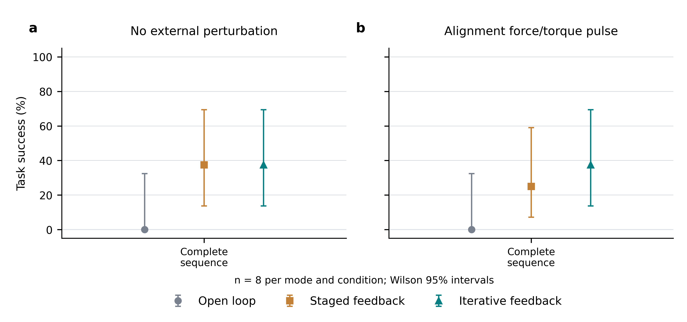
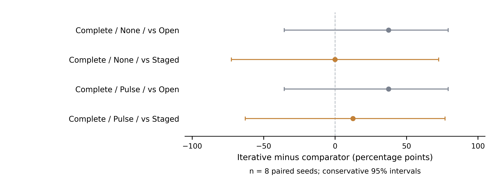

# Figures: estimated-wrist feedback replication

## Complete-sequence success

Panels a and b compare the same three modes without an external disturbance and with the specified alignment pulse. Points show success fractions; error bars are Wilson 95% intervals. Each configuration contains eight complete-sequence attempts. Failures remain in the denominator even when the feedback or disturbance stage was not reached. The two conditions use the same seed set.

[Editable PDF](success_rates.pdf) · [Editable SVG](success_rates.svg) · [Source data](success_rates.source-data.csv) · [Panel alignment](success_rates.alignment.json) · [Text audit](success_rates.text-audit.json) · [Collision audit](success_rates.collision-audit.json)

## Paired differences

Each point is the iterative-mode success fraction minus its comparator on eight matched seeds. Intervals use the report's conservative Bonferroni-adjusted exact marginal bounds. Every planned method comparison is shown; no interval excludes zero. The accompanying exact paired tests have Holm-adjusted p = 1.0 for all four comparisons. This does not establish equivalence or architectural superiority.

[Editable PDF](paired_differences.pdf) · [Editable SVG](paired_differences.svg) · [Source data](paired_differences.source-data.csv) · [Alignment record](paired_differences.alignment.json) · [Text audit](paired_differences.text-audit.json) · [Collision audit](paired_differences.collision-audit.json)

## Provenance and visual checks

The existing Python/matplotlib workflow was reused with the new completed summary. All six configurations and four paired comparisons are retained. [Provenance](provenance.json) records the input SHA-256, units and dimensions; the [figure contract](../../../FINAL_FIGURE_CONTRACT.md) specifies the claim, field mapping and exports.

Both final plots were visually inspected, including the two individual success panels, labels, intervals and full composition. Text-size and collision audits passed with no collisions or warnings. The two-panel alignment check passed; the single-panel paired plot records alignment as not applicable. PNG files are 600 dpi; editable SVG/PDF files are provided. The source validator's missing-TIFF warning is accepted because this course delivery requires slides, PDF, SVG and PNG rather than a journal submission raster.
