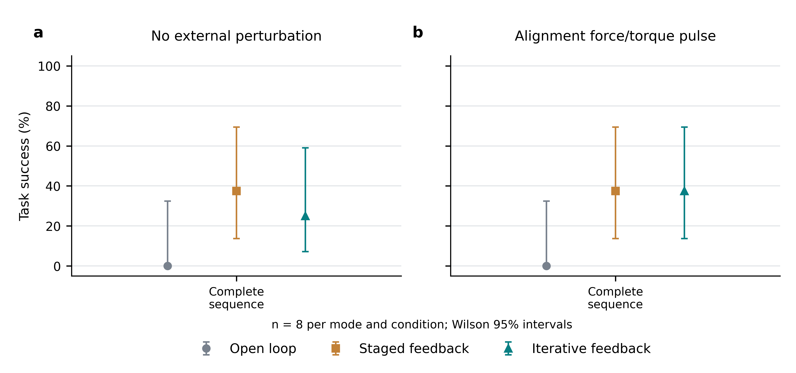
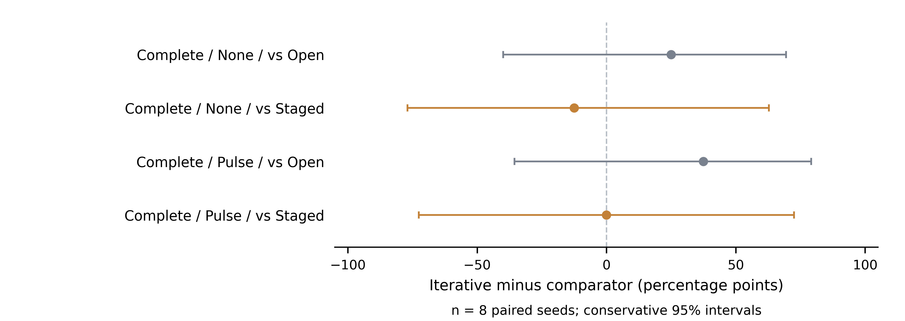

# 三种视觉反馈方式：配对评测结果

已完成 **48 次**，1 类任务 × 3 种反馈模式 × 2 种环境 × 每配置 8 次。种子 400–407，初始物理状态配对哈希已验证。开发运行和历史 240／40 次结果均未混入本轮。

控制提交 `d02323cd336b74ca8e30f3882552e7e274d95956`，协议时间 `2026-11-08T11:40:25.933216+00:00`；8 路 CPU 仿真共享串行 GPU 推理。[冻结协议](protocol.json) · [硬件与运行命令](hardware.json) · [全部试验 CSV](trials.csv) · [逐观测位姿](pose_observations.csv) · [逐次闭环观测](visual_feedback_observations.csv) · [原始摘要](trials/) · [反馈方法](../../VISUAL_FEEDBACK.md) · [原轨迹视频](../../videos/visual-feedback-v1/README.md)。

`open_loop` 保留初始定位和运动抓取前的预测，但关闭抓取后／释放后的视觉纠偏；`staged` 使用关键阶段复测；`iterative` 再加入对准后的重复观察、限幅纠偏与目标观测质量检查。所有配置保留同样的关节控制、真实接触、力限和最终验收。这是内部反馈模块对比，不是外部位姿算法排名。

## 任务成功率

各格为成功数／试验数、成功率及 Wilson 95% 区间。所有有效失败均保留，包括尚未到达反馈或扰动阶段的试验。

| 任务 | 扰动 | 无执行期纠偏 | 分阶段纠偏 | 迭代视觉闭环 |
|---|---|---|---|---|
| 四阶段完整流程 | 无 | 0/8 · 0.0% [0.0, 32.4] | 3/8 · 37.5% [13.7, 69.4] | 2/8 · 25.0% [7.1, 59.1] |
| 四阶段完整流程 | 对准脉冲 | 0/8 · 0.0% [0.0, 32.4] | 3/8 · 37.5% [13.7, 69.4] | 3/8 · 37.5% [13.7, 69.4] |

本轮所有方法比较均未达到 Holm 校正后的 0.05 门槛，不能据此宣称迭代闭环优于关键阶段反馈，也不能据此证明两者等效。成功演示与完整成功率统计必须区分。

[可编辑图、源数据与图表核对记录](figures/README.md)。

## 完整流程的阶段验收

以下是阶段完成当时的验收，分母仍为每配置全部 8 次；同时给出实际进入该阶段的次数。这些是完整流程中的阶段统计，不是独立任务成功率。整条任务还须在最后重新验收此前归位的物体，不能用某个阶段通过代替整链成功。

| 阶段 | 扰动 | 无执行期纠偏 | 分阶段纠偏 | 迭代视觉闭环 |
|---|---|---|---|---|
| 锤子归位 | 无 | 7/8 · 87.5% [52.9, 97.8]；到达 8 | 7/8 · 87.5% [52.9, 97.8]；到达 8 | 7/8 · 87.5% [52.9, 97.8]；到达 8 |
| 螺丝刀插架 | 无 | 0/8 · 0.0% [0.0, 32.4]；到达 7 | 3/8 · 37.5% [13.7, 69.4]；到达 7 | 3/8 · 37.5% [13.7, 69.4]；到达 7 |
| 支架安装 | 无 | 0/8 · 0.0% [0.0, 32.4]；到达 0 | 3/8 · 37.5% [13.7, 69.4]；到达 3 | 3/8 · 37.5% [13.7, 69.4]；到达 3 |
| 扳手挂放 | 无 | 0/8 · 0.0% [0.0, 32.4]；到达 0 | 3/8 · 37.5% [13.7, 69.4]；到达 3 | 2/8 · 25.0% [7.1, 59.1]；到达 3 |
| 锤子归位 | 对准脉冲 | 7/8 · 87.5% [52.9, 97.8]；到达 8 | 7/8 · 87.5% [52.9, 97.8]；到达 8 | 7/8 · 87.5% [52.9, 97.8]；到达 8 |
| 螺丝刀插架 | 对准脉冲 | 0/8 · 0.0% [0.0, 32.4]；到达 7 | 3/8 · 37.5% [13.7, 69.4]；到达 7 | 3/8 · 37.5% [13.7, 69.4]；到达 7 |
| 支架安装 | 对准脉冲 | 0/8 · 0.0% [0.0, 32.4]；到达 0 | 3/8 · 37.5% [13.7, 69.4]；到达 3 | 3/8 · 37.5% [13.7, 69.4]；到达 3 |
| 扳手挂放 | 对准脉冲 | 0/8 · 0.0% [0.0, 32.4]；到达 0 | 3/8 · 37.5% [13.7, 69.4]；到达 3 | 3/8 · 37.5% [13.7, 69.4]；到达 3 |

## 6D 位姿预测

使用各目标的第一次固定相机观察，先按试验汇总，再计算 bootstrap 95% 区间；通过率要求该任务所有初始目标都在 5 mm／5° 内。相同模型和初始输入的读数相同是预期行为，闭环的影响在后续对准和任务结果中体现。

| 任务 | 模式 | 扰动 | 平移/mm | 旋转/° | ADD/mm | ADD-S/mm | 5 mm／5° 通过率 |
|---|---|---|---|---|---|---|---|
| 四阶段完整流程 | 无执行期纠偏 | 无 | 2.60 [2.47, 2.74] (n=8) | 1.44 [1.17, 1.77] (n=8) | 3.17 [3.07, 3.28] (n=8) | 2.29 [2.24, 2.34] (n=8) | 7/8 · 87.5% [52.9, 97.8] |
| 四阶段完整流程 | 无执行期纠偏 | 对准脉冲 | 2.60 [2.47, 2.74] (n=8) | 1.44 [1.17, 1.77] (n=8) | 3.17 [3.07, 3.28] (n=8) | 2.29 [2.24, 2.34] (n=8) | 7/8 · 87.5% [52.9, 97.8] |
| 四阶段完整流程 | 分阶段纠偏 | 无 | 2.60 [2.47, 2.74] (n=8) | 1.44 [1.17, 1.77] (n=8) | 3.17 [3.07, 3.28] (n=8) | 2.29 [2.24, 2.34] (n=8) | 7/8 · 87.5% [52.9, 97.8] |
| 四阶段完整流程 | 分阶段纠偏 | 对准脉冲 | 2.60 [2.47, 2.74] (n=8) | 1.44 [1.17, 1.77] (n=8) | 3.17 [3.07, 3.28] (n=8) | 2.29 [2.24, 2.34] (n=8) | 7/8 · 87.5% [52.9, 97.8] |
| 四阶段完整流程 | 迭代视觉闭环 | 无 | 2.60 [2.47, 2.74] (n=8) | 1.44 [1.17, 1.77] (n=8) | 3.17 [3.07, 3.28] (n=8) | 2.29 [2.24, 2.34] (n=8) | 7/8 · 87.5% [52.9, 97.8] |
| 四阶段完整流程 | 迭代视觉闭环 | 对准脉冲 | 2.60 [2.47, 2.74] (n=8) | 1.44 [1.17, 1.77] (n=8) | 3.17 [3.07, 3.28] (n=8) | 2.29 [2.24, 2.34] (n=8) | 7/8 · 87.5% [52.9, 97.8] |

## 实际对准误差：反馈前后

使用独立仿真真值计算物体与真实安装目标的偏差，只用于评估，不反馈给控制器。每行只包含到达该对准阶段的试验，n 必须与任务成功率分母区分；不同模式到达的样本可能不同，不将这张条件性诊断表当作总体因果比较。开环和分阶段模式在这个检查点不增加迭代动作，因此前后值相同。

具体比较物体参考坐标系：用真实安装基座／支架的变换替换视觉变换，保留重建特征定义的目标关系。它是位姿对准诊断，不是最终孔隙或插入深度；后者在物理验收字段中单独记录。

| 任务 | 模式 | 扰动 | 阶段 | n | 前/mm | 后/mm | 前/° | 后/° |
|---|---|---|---|---|---|---|---|---|
| 四阶段完整流程 | 无执行期纠偏 | 无 | 螺丝刀插架 | 3 | 9.32 [8.45, 10.79] (n=3) | 9.32 [8.45, 10.79] (n=3) | 26.82 [24.68, 28.42] (n=3) | 26.82 [24.68, 28.42] (n=3) |
| 四阶段完整流程 | 无执行期纠偏 | 对准脉冲 | 螺丝刀插架 | 3 | 9.38 [8.50, 10.85] (n=3) | 9.38 [8.50, 10.85] (n=3) | 26.83 [24.70, 28.43] (n=3) | 26.83 [24.70, 28.43] (n=3) |
| 四阶段完整流程 | 分阶段纠偏 | 无 | 螺丝刀插架 | 3 | 0.76 [0.55, 0.97] (n=3) | 0.76 [0.55, 0.97] (n=3) | 1.32 [1.11, 1.54] (n=3) | 1.32 [1.11, 1.54] (n=3) |
| 四阶段完整流程 | 分阶段纠偏 | 无 | 支架安装 | 3 | 2.13 [2.10, 2.19] (n=3) | 2.13 [2.10, 2.19] (n=3) | 0.34 [0.14, 0.64] (n=3) | 0.34 [0.14, 0.64] (n=3) |
| 四阶段完整流程 | 分阶段纠偏 | 无 | 扳手挂放 | 3 | 10.42 [8.39, 13.34] (n=3) | 10.42 [8.39, 13.34] (n=3) | 3.49 [1.83, 6.15] (n=3) | 3.49 [1.83, 6.15] (n=3) |
| 四阶段完整流程 | 分阶段纠偏 | 对准脉冲 | 螺丝刀插架 | 3 | 0.67 [0.45, 0.89] (n=3) | 0.67 [0.45, 0.89] (n=3) | 1.34 [1.14, 1.56] (n=3) | 1.34 [1.14, 1.56] (n=3) |
| 四阶段完整流程 | 分阶段纠偏 | 对准脉冲 | 支架安装 | 3 | 2.08 [2.05, 2.10] (n=3) | 2.08 [2.05, 2.10] (n=3) | 0.26 [0.16, 0.46] (n=3) | 0.26 [0.16, 0.46] (n=3) |
| 四阶段完整流程 | 分阶段纠偏 | 对准脉冲 | 扳手挂放 | 3 | 8.82 [8.11, 9.92] (n=3) | 8.82 [8.11, 9.92] (n=3) | 2.31 [1.80, 2.64] (n=3) | 2.31 [1.80, 2.64] (n=3) |
| 四阶段完整流程 | 迭代视觉闭环 | 无 | 螺丝刀插架 | 3 | 0.76 [0.55, 0.97] (n=3) | 0.61 [0.43, 0.70] (n=3) | 1.32 [1.11, 1.54] (n=3) | 1.16 [0.96, 1.37] (n=3) |
| 四阶段完整流程 | 迭代视觉闭环 | 无 | 支架安装 | 3 | 2.18 [2.14, 2.23] (n=3) | 1.01 [0.98, 1.06] (n=3) | 0.37 [0.26, 0.51] (n=3) | 0.38 [0.30, 0.51] (n=3) |
| 四阶段完整流程 | 迭代视觉闭环 | 无 | 扳手挂放 | 3 | 8.19 [7.23, 9.15] (n=3) | 7.97 [7.09, 8.60] (n=3) | 2.96 [1.87, 5.00] (n=3) | 3.33 [1.93, 5.68] (n=3) |
| 四阶段完整流程 | 迭代视觉闭环 | 对准脉冲 | 螺丝刀插架 | 3 | 0.67 [0.45, 0.89] (n=3) | 0.61 [0.43, 0.70] (n=3) | 1.34 [1.14, 1.56] (n=3) | 1.17 [0.97, 1.38] (n=3) |
| 四阶段完整流程 | 迭代视觉闭环 | 对准脉冲 | 支架安装 | 3 | 2.09 [2.08, 2.10] (n=3) | 0.98 [0.97, 1.00] (n=3) | 0.33 [0.19, 0.43] (n=3) | 0.33 [0.19, 0.41] (n=3) |
| 四阶段完整流程 | 迭代视觉闭环 | 对准脉冲 | 扳手挂放 | 3 | 8.73 [8.17, 9.44] (n=3) | 8.73 [8.34, 9.40] (n=3) | 2.53 [2.07, 3.36] (n=3) | 2.31 [2.13, 2.51] (n=3) |

每次视觉残差、独立几何误差、被拒绝的目标更新、实际修正次数及收敛状态保存在逐试验摘要的 `visual_servo` 中。视觉残差下降不保证真实误差同步下降。

本轮没有等时静置的第四组对照；零修正阶段的前后变化可能来自观察等待期间的自然静置，不能当作纠偏动作的因果证据。

`visual_feedback_observations.csv` 展开每次反馈观察，包括视觉残差、该时刻的独立真值对准误差、目标是否更新、延迟和循环耗时。`proposed_tcp_*` 是候选步长，达到阈值时不执行；实际完成的修正次数见试验 CSV 的 `feedback_corrections`。观察行不作为独立统计样本，拒绝观测的缺失数值保持空白。

## 标定误差

固定相机使用同一套冻结标定：外参平移 **4.245 mm**，旋转 **0.122°**。焦距相对误差 fx/fy 为 0.330%／0.326%。腕部手眼为理想仿真安装，独立实测误差为 **N/A**。重复使用这一标定不算多次独立标定实验。

| 标定图集 | 图像数 | 平均重投影 RMSE/px | 最大 RMSE/px |
|---|---|---|---|
| intrinsic_train | 19 | 0.0530 | 0.0783 |
| intrinsic_validation | 4 | 0.0499 | 0.0738 |
| extrinsic_train | 5 | 0.0660 | 0.1033 |
| extrinsic_validation | 5 | 0.0745 | 0.1224 |

## 执行精度

实际 TCP 与计划关节参考 FK 比较，每次试验先求轨迹 RMSE，再汇总均值及区间；终点误差按完成移动求均值。提前失败造成的缺测明确保留样本量。最终各物体的插入深度、轴线偏差、孔偏差、支撑接触与速度见 `terminal_outcomes_evaluation_only` 和 CSV 的 `final_*` 字段。

| 任务 | 模式 | 扰动 | TCP RMSE/mm | TCP RMSE/° | 终点均值/mm | 终点均值/° |
|---|---|---|---|---|---|---|
| 四阶段完整流程 | 无执行期纠偏 | 无 | 5.33 [3.57, 6.46] (n=8) | 1.65 [1.18, 1.89] (n=8) | 0.70 [0.48, 0.84] (n=8) | 0.05 [0.03, 0.06] (n=8) |
| 四阶段完整流程 | 无执行期纠偏 | 对准脉冲 | 5.33 [3.57, 6.46] (n=8) | 1.65 [1.18, 1.89] (n=8) | 0.70 [0.48, 0.84] (n=8) | 0.05 [0.03, 0.06] (n=8) |
| 四阶段完整流程 | 分阶段纠偏 | 无 | 5.24 [3.54, 6.32] (n=8) | 1.33 [0.87, 1.76] (n=8) | 0.65 [0.43, 0.82] (n=8) | 0.03 [0.02, 0.05] (n=8) |
| 四阶段完整流程 | 分阶段纠偏 | 对准脉冲 | 5.24 [3.54, 6.32] (n=8) | 1.33 [0.87, 1.76] (n=8) | 0.65 [0.43, 0.82] (n=8) | 0.03 [0.02, 0.05] (n=8) |
| 四阶段完整流程 | 迭代视觉闭环 | 无 | 5.23 [3.53, 6.30] (n=8) | 1.33 [0.87, 1.76] (n=8) | 0.65 [0.43, 0.82] (n=8) | 0.04 [0.02, 0.05] (n=8) |
| 四阶段完整流程 | 迭代视觉闭环 | 对准脉冲 | 5.23 [3.53, 6.30] (n=8) | 1.33 [0.87, 1.76] (n=8) | 0.65 [0.43, 0.82] (n=8) | 0.04 [0.02, 0.05] (n=8) |

## 频率、延迟和反馈代价

500 Hz 为仿真控制步频，日志 50 Hz，回放 25 fps；不是视觉闭环频率。新反馈观测固定推进 0.15 s 仿真时间，运动抓取的初始观察推进 1.0 s。反馈观测频率包含完成估计后被安全范围检查拒绝的读数，与实际修正动作频率不同。实际推理／排队／规划期间仍存在暂停，以下墙钟指标包含共享资源等待，不代表独占硬件或真机实时性能。总耗时包括提前失败，不能把较短的失败运行解释为完成任务的效率提高。

下表的观测与修正计数仅指新增 `visual_align` 迭代环；`staged` 的关键阶段观察记录在 `perception` 和全部位姿调用中，迭代环计数为 0 不表示关闭了阶段反馈。

| 任务 | 模式 | 扰动 | 总墙钟/s | 仿真时长/s | 迭代环观测次数 | 迭代环完成修正 | 迭代环观测/墙钟 s | 循环墙钟/s |
|---|---|---|---|---|---|---|---|---|
| 四阶段完整流程 | 无执行期纠偏 | 无 | 215.7 [154.0, 277.1] (n=8) | 45.2 [33.0, 53.7] (n=8) | 0.0 [0.0, 0.0] (n=8) | 0.0 [0.0, 0.0] (n=8) | — | — |
| 四阶段完整流程 | 无执行期纠偏 | 对准脉冲 | 215.3 [158.1, 269.5] (n=8) | 45.2 [33.0, 53.7] (n=8) | 0.0 [0.0, 0.0] (n=8) | 0.0 [0.0, 0.0] (n=8) | — | — |
| 四阶段完整流程 | 分阶段纠偏 | 无 | 381.0 [202.0, 586.3] (n=8) | 96.8 [43.2, 154.9] (n=8) | 0.0 [0.0, 0.0] (n=8) | 0.0 [0.0, 0.0] (n=8) | — | — |
| 四阶段完整流程 | 分阶段纠偏 | 对准脉冲 | 398.6 [227.5, 586.9] (n=8) | 96.9 [43.2, 155.0] (n=8) | 0.0 [0.0, 0.0] (n=8) | 0.0 [0.0, 0.0] (n=8) | — | — |
| 四阶段完整流程 | 迭代视觉闭环 | 无 | 441.2 [207.1, 706.1] (n=8) | 97.5 [43.2, 156.3] (n=8) | 2.8 [0.9, 5.4] (n=8) | 0.4 [0.1, 0.8] (n=8) | 0.141 [0.115, 0.172] (n=3) | 7.268 [5.798, 8.673] (n=3) |
| 四阶段完整流程 | 迭代视觉闭环 | 对准脉冲 | 372.8 [180.9, 579.0] (n=8) | 97.4 [43.2, 156.1] (n=8) | 2.5 [0.8, 4.9] (n=8) | 0.2 [0.0, 0.6] (n=8) | 0.204 [0.142, 0.263] (n=3) | 5.222 [3.799, 7.018] (n=3) |

| 任务 | 模式 | 扰动 | 网络注册/s | 网络跟踪/s | 深度配准/s | 全部位姿调用/墙钟 s |
|---|---|---|---|---|---|---|
| 四阶段完整流程 | 无执行期纠偏 | 无 | 4.225 [4.045, 4.536] (n=8) | 0.116 [0.095, 0.138] (n=7) | — | 0.036 [0.028, 0.046] (n=8) |
| 四阶段完整流程 | 无执行期纠偏 | 对准脉冲 | 4.127 [4.092, 4.159] (n=8) | 0.209 [0.110, 0.368] (n=7) | — | 0.036 [0.028, 0.046] (n=8) |
| 四阶段完整流程 | 分阶段纠偏 | 无 | 4.127 [4.071, 4.186] (n=8) | 0.108 [0.090, 0.126] (n=7) | 3.642 [2.556, 4.800] (n=3) | 0.032 [0.026, 0.038] (n=8) |
| 四阶段完整流程 | 分阶段纠偏 | 对准脉冲 | 4.283 [4.102, 4.575] (n=8) | 0.115 [0.109, 0.123] (n=7) | 3.751 [3.247, 4.036] (n=3) | 0.029 [0.024, 0.034] (n=8) |
| 四阶段完整流程 | 迭代视觉闭环 | 无 | 4.143 [4.078, 4.207] (n=8) | 0.121 [0.112, 0.131] (n=7) | 3.214 [2.704, 3.834] (n=3) | 0.036 [0.032, 0.043] (n=8) |
| 四阶段完整流程 | 迭代视觉闭环 | 对准脉冲 | 4.105 [4.050, 4.159] (n=8) | 0.102 [0.093, 0.111] (n=7) | 2.852 [2.234, 3.220] (n=3) | 0.041 [0.035, 0.050] (n=8) |

## 配对差异与扰动鲁棒性

方法比较和扰动比较分别进行 Holm 校正。差值区间来自 Bonferroni 调整的精确二项边际区间，另给同种子配对胜／负及精确 McNemar p 值。小样本和宽区间不能证明方法普遍优越。

| 任务 | 环境 | 方法差 | 差值/百分点 [95% CI] | 胜/负 | p | Holm p |
|---|---|---|---|---|---|---|
| 四阶段完整流程 | none | 迭代视觉闭环 − 无执行期纠偏 | +25.0 [-40.0, 69.4] | 2/0 | 0.5000 | 1.0000 |
| 四阶段完整流程 | none | 迭代视觉闭环 − 分阶段纠偏 | -12.5 [-76.9, 62.8] | 0/1 | 1.0000 | 1.0000 |
| 四阶段完整流程 | alignment_impulse | 迭代视觉闭环 − 无执行期纠偏 | +37.5 [-35.6, 79.1] | 3/0 | 0.2500 | 1.0000 |
| 四阶段完整流程 | alignment_impulse | 迭代视觉闭环 − 分阶段纠偏 | +0.0 [-72.6, 72.6] | 0/0 | 1.0000 | 1.0000 |

| 任务 | 模式 | 环境差 | 差值/百分点 [95% CI] | 胜/负 | p | Holm p |
|---|---|---|---|---|---|---|
| 四阶段完整流程 | 无执行期纠偏 | 有扰动 − 无扰动 | +0.0 [-42.2, 42.2] | 0/0 | 1.0000 | 1.0000 |
| 四阶段完整流程 | 分阶段纠偏 | 有扰动 − 无扰动 | +0.0 [-72.6, 72.6] | 0/0 | 1.0000 | 1.0000 |
| 四阶段完整流程 | 迭代视觉闭环 | 有扰动 − 无扰动 | +12.5 [-62.8, 76.9] | 1/0 | 1.0000 | 1.0000 |

| 任务 | 模式 | 扰动 | 阶段 | 实际送达 | 视觉确认收敛数 | 收敛耗时/仿真 s |
|---|---|---|---|---|---|---|
| 四阶段完整流程 | 无执行期纠偏 | 对准脉冲 | 螺丝刀插架 | 3/8 | N/A | — |
| 四阶段完整流程 | 无执行期纠偏 | 对准脉冲 | 支架安装 | 0/8 | N/A | — |
| 四阶段完整流程 | 无执行期纠偏 | 对准脉冲 | 扳手挂放 | 0/8 | N/A | — |
| 四阶段完整流程 | 分阶段纠偏 | 对准脉冲 | 螺丝刀插架 | 3/8 | N/A | — |
| 四阶段完整流程 | 分阶段纠偏 | 对准脉冲 | 支架安装 | 3/8 | N/A | — |
| 四阶段完整流程 | 分阶段纠偏 | 对准脉冲 | 扳手挂放 | 3/8 | N/A | — |
| 四阶段完整流程 | 迭代视觉闭环 | 对准脉冲 | 螺丝刀插架 | 3/8 | 3 | 0.550 [0.550, 0.550] (n=3) |
| 四阶段完整流程 | 迭代视觉闭环 | 对准脉冲 | 支架安装 | 3/8 | 3 | 0.550 [0.550, 0.550] (n=3) |
| 四阶段完整流程 | 迭代视觉闭环 | 对准脉冲 | 扳手挂放 | 3/8 | 3 | 1.385 [0.850, 1.652] (n=3) |

视觉收敛是控制器判断；真正恢复还须最终任务验收通过。完整流程后段未被送达扰动的情况不会伪称经历了该扰动。

## 失败记录与原轨迹视频

按协议预先规定的顺序选择失败，不以最有利案例替换。每个对照失败附上相同任务、环境和种子的迭代模式回放，无论其成功还是失败；它们不增加统计样本。

| 原始试验 | 停止阶段 | 原因 |
|---|---|---|
| [complete__iterative__none__401](../../videos/visual-feedback-v1/complete__iterative__none__401.mp4) | CLOSE_GRIPPER | MotionFailure: Unexpected robot contact at CLOSE_GRIPPER；[摘要](trials/complete__iterative__none__401.json) |
| [complete__open_loop__none__400](../../videos/visual-feedback-v1/complete__open_loop__none__400.mp4) | RETRACT_DRIVER_SETTLE | MotionFailure: Driver insertion contact guard stopped the task；[摘要](trials/complete__open_loop__none__400.json) |
| [complete__staged__none__401](../../videos/visual-feedback-v1/complete__staged__none__401.mp4) | CLOSE_GRIPPER | MotionFailure: Unexpected robot contact at CLOSE_GRIPPER；[摘要](trials/complete__staged__none__401.json) |

| 任务 | 模式 | 停止阶段 | 次数 |
|---|---|---|---|
| 四阶段完整流程 | 迭代视觉闭环 | CHECK_HANG_STABILITY | 1 |
| 四阶段完整流程 | 迭代视觉闭环 | CLOSE_GRIPPER | 8 |
| 四阶段完整流程 | 迭代视觉闭环 | PICK_APPROACH_SETTLE | 2 |
| 四阶段完整流程 | 无执行期纠偏 | CLOSE_GRIPPER | 8 |
| 四阶段完整流程 | 无执行期纠偏 | PICK_APPROACH_SETTLE | 2 |
| 四阶段完整流程 | 无执行期纠偏 | RETRACT_DRIVER_SETTLE | 6 |
| 四阶段完整流程 | 分阶段纠偏 | CLOSE_GRIPPER | 8 |
| 四阶段完整流程 | 分阶段纠偏 | PICK_APPROACH_SETTLE | 2 |

## 完整成功视频与独立复核

按预定规则选择无扰动迭代模式中的最低成功种子：`complete__iterative__none__400`。[完整全景＋腕部](../../videos/visual-feedback-v1/complete__iterative__none__400.mp4) · [独立腕部](../../videos/visual-feedback-v1/complete__iterative__none__400__wrist.mp4) · [原始摘要](trials/complete__iterative__none__400.json) · [原始轨迹](replay_inputs/complete__iterative__none__400/)。这一成功案例不替代上面的整组统计。

[独立运动复核](hero_motion_audit.json)检查了原轨迹的 4942 个 25 Hz 快照，非预期机器人接触候选 0 项，最终释放后夹爪继续承重记录 0 条。额外静置 30 秒复核全部通过。快照检查不代表重新检查每个 500 Hz 物理步；额外静置属于独立诊断，不改动原试验结果。

## 数据与适用范围

每个配置只包含有限布局扰动的 8 个仿真种子，不是同样数量的真实环境。物体参考来自 RGB-D 重建；固定夹具属于已测量工位，深度与腕部手眼仍为理想仿真。几何、接触和速度真值用于独立统计、验收和安全停机，不生成视觉纠偏目标。完整任务保留 10 秒悬挂稳定窗口；不跨任务合并成功率。

原 240 次视觉反馈计划开始后，按组员要求缩减为约 50 次。本轮另用新种子冻结 48 次完整流程，控制器保持不变；[旧计划已启动的 16 次试验](superseded-plan/README.md)单独留存，不混入统计。

[证据清单](evidence_manifest.json)包含所有摘要、日志与轨迹的校验值，所选原轨迹在 `replay_inputs/`；完整 RGB-D 在本机源目录的无损归档中。历史报告保持不变。

